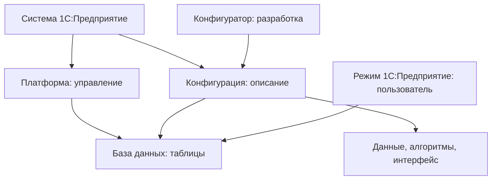
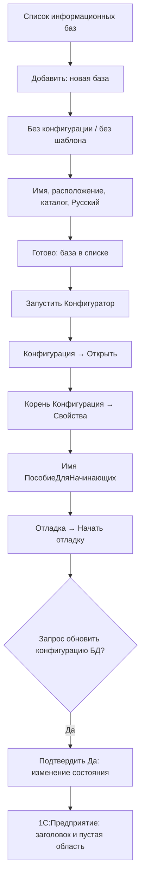

# Схемы занятия 1 (Mermaid)

**Основание:** PDF с. 16–35; RAG-чанки `p0016:c01`–`p0035:c01`. Схемы отражают текст, а не реконструкцию авторских рисунков.

## Модель платформы

Основание: [p0017:c01](../../../rag/chunks/p0001-p0100/p0017-c01.md), [p0018:c01](../../../rag/chunks/p0001-p0100/p0018-c01.md), [p0020:c01](../../../rag/chunks/p0001-p0100/p0020-c01.md), [p0028:c01](../../../rag/chunks/p0001-p0100/p0028-c01.md).

## Практический путь

В учебном примере подтверждается ветка «Да»; обход запроса обновления источник не описывает. [p0021:c01](../../../rag/chunks/p0001-p0100/p0021-c01.md), [p0022:c01](../../../rag/chunks/p0001-p0100/p0022-c01.md), [p0023:c01](../../../rag/chunks/p0001-p0100/p0023-c01.md), [p0024:c01](../../../rag/chunks/p0001-p0100/p0024-c01.md), [p0026:c01](../../../rag/chunks/p0001-p0100/p0026-c01.md), [p0033:c01](../../../rag/chunks/p0001-p0100/p0033-c01.md), [p0035:c01](../../../rag/chunks/p0001-p0100/p0035-c01.md).

**Rollback:** `[Needs confirmation]`.
