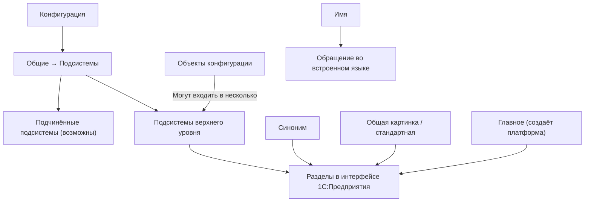
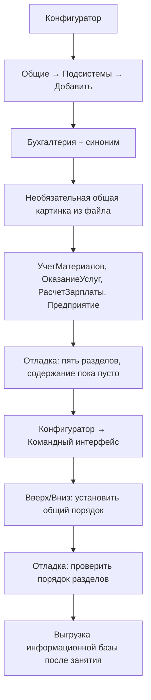
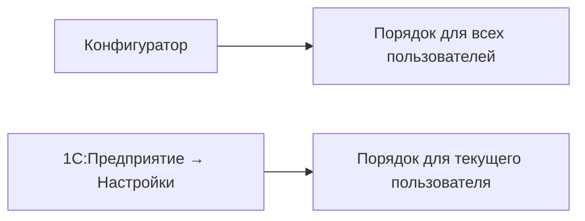

# Логика занятия 2 — Mermaid

Схемы основаны исключительно на PDF с. 40–54 ([p0040:c01](../../../rag/chunks/p0001-p0100/p0040-c01.md), [p0054:c01](../../../rag/chunks/p0001-p0100/p0054-c01.md)). Не копируют авторские иллюстрации.

## Устройство интерфейса

Основание: [p0040:c01](../../../rag/chunks/p0001-p0100/p0040-c01.md), [p0044:c01](../../../rag/chunks/p0001-p0100/p0044-c01.md), [p0048:c01](../../../rag/chunks/p0001-p0100/p0048-c01.md), [p0050:c01](../../../rag/chunks/p0001-p0100/p0050-c01.md).

## Практический маршрут

Основание: [p0042:c01](../../../rag/chunks/p0001-p0100/p0042-c01.md), [p0045:c01](../../../rag/chunks/p0001-p0100/p0045-c01.md), [p0048:c01](../../../rag/chunks/p0001-p0100/p0048-c01.md), [p0049:c01](../../../rag/chunks/p0001-p0100/p0049-c01.md), [p0051:c01](../../../rag/chunks/p0001-p0100/p0051-c01.md), [p0052:c01](../../../rag/chunks/p0001-p0100/p0052-c01.md), [p0053:c01](../../../rag/chunks/p0001-p0100/p0053-c01.md).

## Область настройки порядка

Основание: [p0052:c01](../../../rag/chunks/p0001-p0100/p0052-c01.md). Если картинки из дополнительных материалов отсутствуют, конкретные файлы и пиктограммы — `[Needs confirmation]`.
