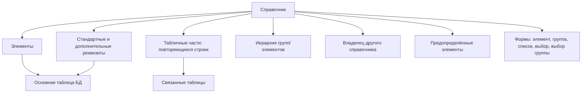
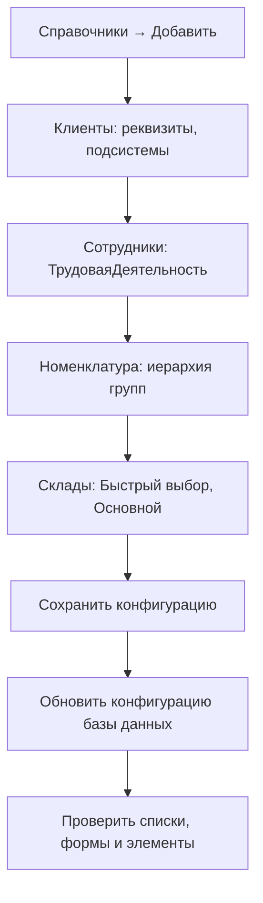
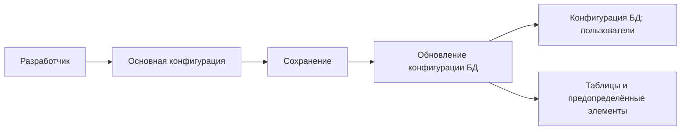

# Схемы занятия 3 (Mermaid)

Построены по текстовому RAG главы, не воспроизводят авторские иллюстрации.

## Объект конфигурации «Справочник»

Основание: [p56:c01](../../../rag/chunks/p0001-p0100/p0056-c01.md), [p58:c01](../../../rag/chunks/p0001-p0100/p0058-c01.md), [p59:c01](../../../rag/chunks/p0001-p0100/p0059-c01.md), [p60:c01](../../../rag/chunks/p0001-p0100/p0060-c01.md), [p62:c01](../../../rag/chunks/p0001-p0100/p0062-c01.md), [p63:c01](../../../rag/chunks/p0001-p0100/p0063-c01.md), [p66:c01](../../../rag/chunks/p0001-p0100/p0066-c01.md), [p67:c01](../../../rag/chunks/p0001-p0100/p0067-c01.md).

## Практические объекты

В книге отладка выполняется **после каждого созданного справочника**, а не только в конце; схема показывает концептуальную последовательность. [p69:c01](../../../rag/chunks/p0001-p0100/p0069-c01.md), [p78:c01](../../../rag/chunks/p0001-p0100/p0078-c01.md), [p92:c01](../../../rag/chunks/p0001-p0100/p0092-c01.md), [p101:c01](../../../rag/chunks/p0101-p0200/p0101-c01.md), [p112:c01](../../../rag/chunks/p0101-p0200/p0112-c01.md).

## Две конфигурации

Изменения структуры требуют реструктуризации и завершения сеансов. [p115:c01](../../../rag/chunks/p0101-p0200/p0115-c01.md), [p117:c01](../../../rag/chunks/p0101-p0200/p0117-c01.md), [p118:c01](../../../rag/chunks/p0101-p0200/p0118-c01.md), [p119:c01](../../../rag/chunks/p0101-p0200/p0119-c01.md).
