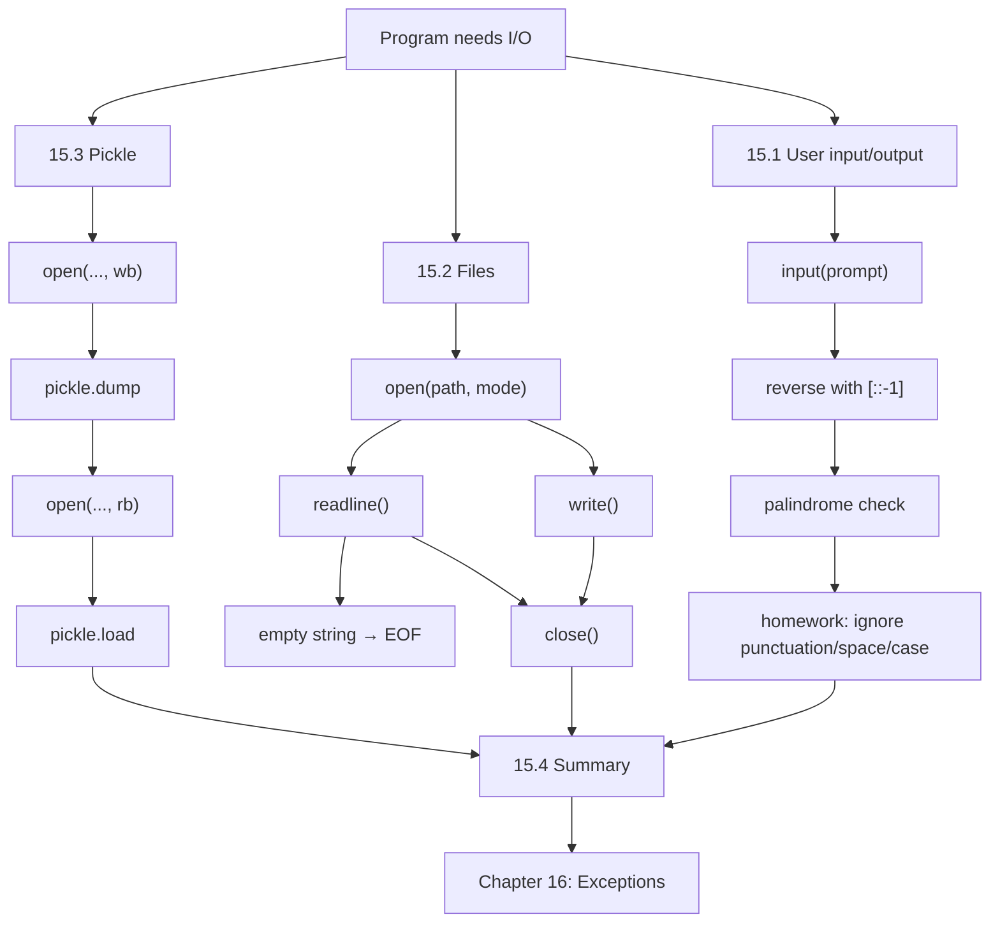

# Chapter logic diagram — «Ввод-вывод»

## Source boundary

`p0121:c01` → `p0126:c01`.

Substantive content ends at `p0125:c01`; `p0126:c01` contains only the running
footer for chapter 15. The next substantive chunk `p0127:c01` begins chapter 16
«Исключения».
