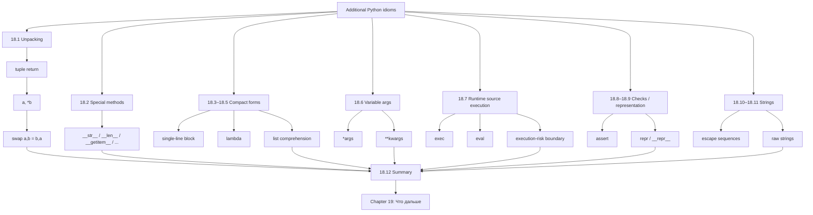

# Chapter logic diagram — «Дополнительно»

## Source boundary

`p0137:c01` → `p0144:c01`.

Substantive content ends at `p0143:c01`; `p0144:c01` contains only the running
footer for chapter 18. The next chunk `p0145:c01` begins chapter 19 «Что дальше».
