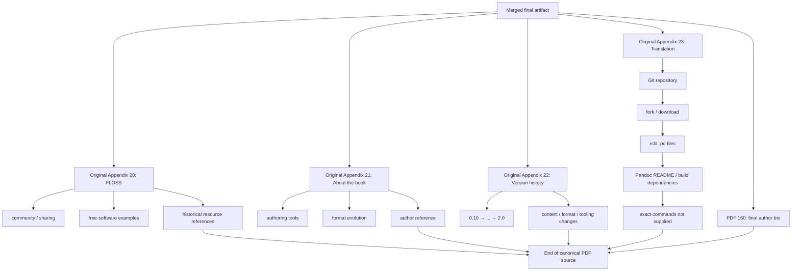

# Chapter logic diagram — «Приложения»

## Source boundary

Merged artifact:

`p0151:c01` → `p0160:c01`.

Original appendix boundaries:

- 20: `p0151:c01–p0152:c01`
- 21: `p0153:c01–p0154:c01`
- 22: `p0155:c01–p0158:c01`
- 23: `p0159:c01`
- final back matter: `p0160:c01`

`p0160:c01` is the final PDF page; there is no next source page.
