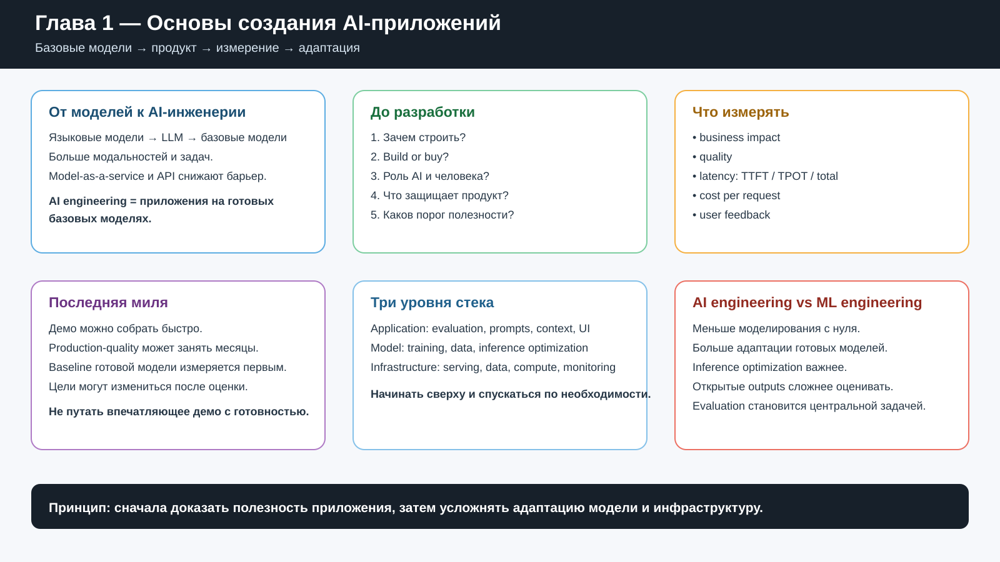
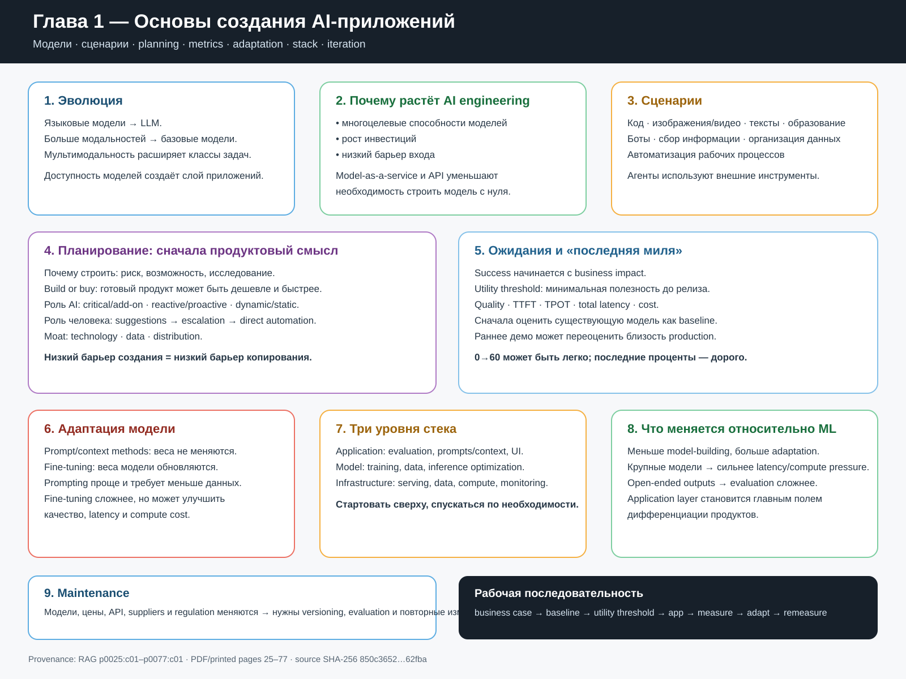

# Глава 1 — Основы создания AI-приложений с использованием базовых моделей

Практические и концептуальные заметки по главе 1 книги «AI-инженерия. Построение приложений с использованием базовых моделей».

## Идентификация

- Book ID: `ai-engineering-chip-huyen-ru`
- Глава: 1
- Название: «Основы создания AI-приложений с использованием базовых моделей»
- Slug: `ai-application-foundations`
- Chapter-analysis request: `BIBLIOTEKA-VSP-CHAPTER-ANALYSIS-REQUEST v1.2`
- Artifact collection: `BIBLIOTEKA-VSP-CHAPTER-ARTIFACT-COLLECTION v1.6`
- Readiness contract: `BIBLIOTEKA-VSP-BOOK-READINESS v1.2`
- Source policy: `rag_only`
- External sources: запрещены
- Model memory: запрещена
- Прямой доступ к canonical source: не использовался
- Book-level readiness: `READY` по canonical repository evidence до retrieval главы

## Provenance

- RAG chunks: `p0025:c01`–`p0077:c01`
- Source format: `pdf`
- Source locator range: `PDF pages 25–77`
- PDF page range: `25–77`
- EPUB spine range: `[Not applicable]`
- Printed page range: `25–77`
- `p0006:c01` указывает начало главы 1 на странице 25 и начало главы 2 на странице 78.
- `p0025:c01` начинается заголовком «ГЛАВА 1. Основы создания AI-приложений с использованием базовых моделей».
- `p0078:c01` начинается заголовком «ГЛАВА 2. Знакомство с базовыми моделями».
- В `chunk-index.jsonl` страницы 25–77 представлены по одному addressable chunk на страницу: `p0025:c01` … `p0077:c01`.
- Chapter boundary verified: yes
- Provenance normalized to `BIBLIOTEKA-VSP-CHAPTER-ARTIFACT-COLLECTION v1.6` without changing the verified chapter boundary or content scope.
- Source SHA-256: `850c365211ba0e3d68a8ff8e7d7d48fb95188e24228270d11c0ec954c2062fba`

## Содержимое

- [cheatsheet.md](cheatsheet.md) — рабочая рамка для планирования AI-приложения по логике главы.
- [commands.md](commands.md) — команды и инструменты, явно названные в главе; shell-команды отсутствуют.
- [diagram.md](diagram.md) — Mermaid-карта: происхождение AI-инженерии, планирование и три уровня стека.
- [visual-cheatsheet.svg](visual-cheatsheet.svg) — компактный обзор.
- [visual-cheatsheet-detailed.svg](visual-cheatsheet-detailed.svg) — подробный обзор всей главы.
- [summary.md](summary.md) — перенос chapter-end «Резюме» из `p0076:c01`–`p0077:c01`.

`review-questions.md` и `review-answers.md` не создавались: в проверенной границе главы после «Резюме» сразу начинается глава 2; отдельного блока контрольных вопросов или упражнений в RAG главы не обнаружено.

## Карта главы

1. Переход от языковых моделей к большим языковым моделям.
2. Расширение модальностей и переход к базовым моделям.
3. Возникновение AI-инженерии как разработки приложений на основе доступных базовых моделей.
4. Три фактора роста AI-инженерии:
   - многоцелевые возможности моделей;
   - рост инвестиций;
   - снижение входного барьера через модель как услугу и API.
5. Основные сценарии использования:
   - написание кода;
   - изображения и видео;
   - тексты;
   - образование;
   - боты-собеседники;
   - сбор информации;
   - организация данных;
   - автоматизация рабочих процессов.
6. Планирование продукта:
   - зачем строить;
   - строить или покупать;
   - роль AI и человека;
   - защитимость продукта;
   - ожидания и метрики;
   - основные этапы;
   - «последняя миля»;
   - обслуживание и изменение зависимостей.
7. Три уровня стека AI:
   - разработка приложения;
   - разработка модели;
   - инфраструктура.
8. Отличия AI-инженерии от традиционной ML-инженерии:
   - меньше акцента на самостоятельное обучение модели;
   - больше акцента на адаптацию;
   - более тяжёлые модели и более важная оптимизация вывода;
   - открытые результаты и более сложная оценка.
9. Слой приложения:
   - оценка;
   - промт-инжиниринг и построение контекста;
   - AI-интерфейс.
10. Новый рабочий процесс: быстрее собирать продукт, получать обратную связь и итеративно улучшать его.

## Краткий анализ главы

Глава задаёт исходную модель всей книги: AI-инженерия — это создание приложений на основе уже доступных базовых моделей. Историческая цепочка в главе строится как `языковые модели → большие языковые модели → мультимодальные базовые модели → AI-инженерия`.

Базовые модели меняют экономику разработки. Дорогую разработку крупных моделей выполняет ограниченное число организаций, а потребители моделей получают доступ к ним через API или другие формы «модели как услуги». Поэтому создание приложения всё чаще начинается не с обучения модели, а с адаптации существующей.

Вторая часть главы показывает, что область применения базовых моделей не сводится к чат-ботам. Автор группирует практические сценарии вокруг генерации кода и контента, обучения, общения, поиска и обобщения информации, организации данных и автоматизации рабочих процессов.

Главный продуктовый фильтр главы — не «можно ли это сделать с AI», а «стоит ли это делать». Перед разработкой предлагается выяснить причину проекта, решить вопрос build-or-buy, определить роль AI и человека, оценить защитимость продукта и сформулировать измеримый порог полезности.

Порог полезности связывается не только с качеством ответов. В главе отдельно названы бизнес-показатели, качество, задержка, стоимость и другие требования. После установки цели необходимо сначала оценить готовые модели: их исходные возможности определяют объём оставшейся работы и могут изменить решение о целесообразности проекта.

Глава предупреждает об эффекте «последней мили»: впечатляющая демоверсия может появиться быстро, но доведение продукта до требуемого качества способно занять существенно больше времени. После запуска работа не заканчивается: поставщики, модели, цены, API, регулирование и требования к данным меняются, поэтому нужны версионирование, оценка и повторные измерения.

Стек AI-инженерии представлен тремя уровнями. Начинать рекомендуется с уровня приложения и спускаться ниже только при необходимости. На уровне приложения центральны оценка, промт-инжиниринг/контекст и интерфейс. На уровне модели находятся обучение и дообучение, данные и оптимизация вывода. Инфраструктура отвечает за обслуживание моделей, данные, вычисления и мониторинг.

## Основной принцип

Для приложения на базовой модели начинать следует с продукта и измеримого результата, а не с самостоятельного обучения модели:

`business/use case → baseline существующей модели → порог полезности → приложение и оценка → адаптация модели при необходимости → инфраструктура по мере необходимости`.

При этом переход к большей автоматизации должен опираться на наблюдаемое качество и обратную связь, а не только на эффектную демоверсию.

## Ограничения

- Глава обзорная: многие темы намеренно раскрываются поверхностно и развиваются в последующих главах.
- Глава не содержит shell-команд и не задаёт эксплуатационный CLI-workflow.
- Числа о рынке, инвестициях, продуктах и опросах относятся к источникам и временным срезам, приведённым в книге; они не проверялись внешним вебом и не трактуются как текущие данные.
- RAG не кодирует рисунки и таблицы как отдельные мультимодальные объекты; анализ опирается на извлечённый текст, подписи и табличный текст.