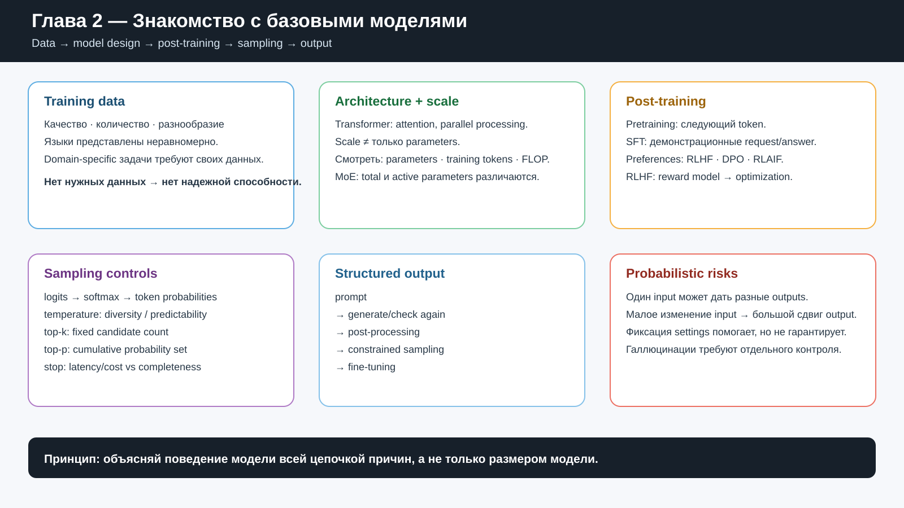
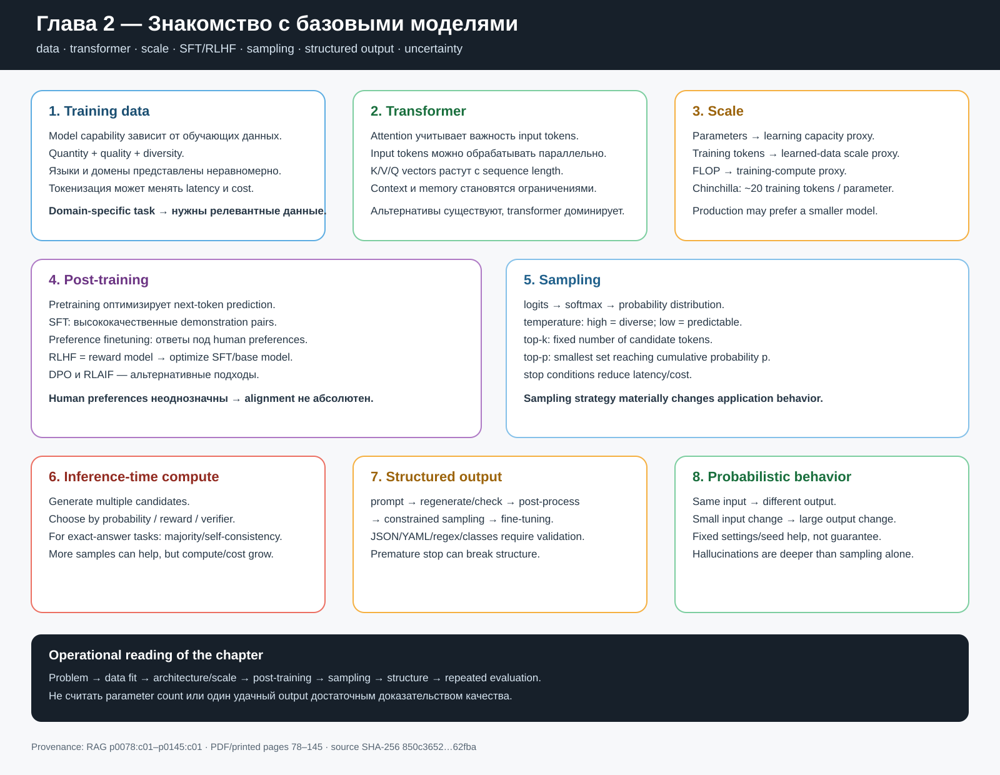

# Глава 2 — Знакомство с базовыми моделями

Практические и концептуальные заметки по главе 2 книги «AI-инженерия. Построение приложений с использованием базовых моделей».

## Идентификация

- Book ID: `ai-engineering-chip-huyen-ru`
- Глава: 2
- Название: «Знакомство с базовыми моделями»
- Slug: `foundation-models`
- Chapter-analysis request: `BIBLIOTEKA-VSP-CHAPTER-ANALYSIS-REQUEST v1.2`
- Artifact collection: `BIBLIOTEKA-VSP-CHAPTER-ARTIFACT-COLLECTION v1.6`
- Readiness contract: `BIBLIOTEKA-VSP-BOOK-READINESS v1.2`
- Source policy: `rag_only`
- External sources: запрещены
- Model memory: запрещена
- Прямой доступ к canonical source: не использовался
- Book-level readiness: `READY` по canonical repository evidence до retrieval главы

## Provenance

- RAG chunks: `p0078:c01`–`p0145:c01`
- Source format: `pdf`
- Source locator range: `PDF pages 78–145`
- PDF page range: `78–145`
- EPUB spine range: `[Not applicable]`
- Printed page range: `78–145`
- `p0007:c01` указывает начало главы 2 на странице 78, резюме на странице 144 и начало главы 3 на странице 146.
- `p0078:c01` начинается заголовком «ГЛАВА 2. Знакомство с базовыми моделями».
- `p0144:c01`–`p0145:c01` содержат явный chapter-end раздел «Резюме».
- `p0146:c01` начинается заголовком «ГЛАВА 3. Методология оценки».
- Chapter boundary verified: yes
- Source SHA-256: `850c365211ba0e3d68a8ff8e7d7d48fb95188e24228270d11c0ec954c2062fba`

## Содержимое

- [cheatsheet.md](cheatsheet.md) — рамка выбора и адаптации базовой модели по факторам главы.
- [commands.md](commands.md) — source-confirmed inference controls, model-development actions и structured-output tools; shell-команды в главе отсутствуют.
- [diagram.md](diagram.md) — Mermaid-карты происхождения поведения модели и рабочего выбора/адаптации.
- [visual-cheatsheet.svg](visual-cheatsheet.svg) — компактный обзор.
- [visual-cheatsheet-detailed.svg](visual-cheatsheet-detailed.svg) — подробный обзор всей главы.
- [summary.md](summary.md) — chapter-end «Резюме» из `p0144:c01`–`p0145:c01`.

`review-questions.md` и `review-answers.md` не создавались: после явного раздела «Резюме» на страницах 144–145 следующий addressable chunk `p0146:c01` уже начинает главу 3; отдельного блока контрольных вопросов или упражнений в границе главы не обнаружено.

## Карта главы

1. Обучающие данные:
   - качество, количество и распределение;
   - многоязычность;
   - предметно-ориентированные модели.
2. Создание модели:
   - архитектура «трансформер» и механизм внимания;
   - ограничения трансформера и альтернативные архитектуры;
   - размер модели и разреженные/MoE-модели.
3. Масштаб:
   - количество параметров;
   - количество обучающих токенов;
   - FLOP как мера вычислений;
   - вычислительно оптимальное обучение и закон масштабирования Chinchilla.
4. Последующее обучение:
   - supervised finetuning (SFT);
   - дообучение с учетом предпочтений;
   - RLHF, DPO и RLAIF;
   - модели вознаграждения и сравнительные данные.
5. Сэмплирование:
   - logits → softmax → вероятности;
   - greedy sampling;
   - temperature;
   - top-k;
   - top-p;
   - условия остановки.
6. Вычисление во время инференса:
   - несколько вариантов вывода;
   - «лучшее из N»;
   - модель вознаграждения/верификатор;
   - выбор наиболее частого ответа для задач с точным ответом.
7. Структурированный вывод:
   - prompting;
   - повторная генерация/проверка;
   - последующая обработка;
   - constrained sampling;
   - fine-tuning.
8. Вероятностная природа:
   - несогласованность;
   - галлюцинации;
   - ограничения попыток сделать генерацию детерминированной.

## Краткий анализ главы

Главная идея главы: наблюдаемое поведение базовой модели является результатом нескольких разных проектных решений, а не одного параметра «размер модели». Для выбора модели и ее адаптации нужно понимать происхождение ее возможностей и ограничений.

Первый фактор — данные. Модель не может надежно освоить язык, предметную область или тип данных, которые слабо представлены при обучении. Глава отдельно подчеркивает многоязычную асимметрию: языки представлены в интернет-корпусах неравномерно, а различия токенизации способны дополнительно влиять на latency и стоимость. Для специализированных задач часто требуются специализированные данные.

Второй фактор — архитектура. Трансформер доминирует благодаря механизму внимания и возможности параллельной обработки входных токенов, но его контекст и вычисления имеют ограничения. В главе рассматриваются альтернативы, однако практический вывод не сводится к поиску «лучшей архитектуры»: архитектура влияет на deployment, контекст, память и способы дальнейшей оптимизации.

Третий фактор — масштаб. Его глава предлагает оценивать тремя числами: параметрами, обучающими токенами и FLOP. Большая модель без достаточного количества данных может уступить меньшей. Закон масштабирования Chinchilla связывает вычислительный бюджет, количество параметров и объем обучающих токенов; для описанного в книге вычислительно оптимального режима число обучающих токенов примерно в 20 раз превышает число параметров. При этом production-выбор может сознательно предпочесть меньшую модель ради более дешевого и простого inference.

После предварительного обучения модель еще не обязательно удобна для диалога и согласована с человеческими предпочтениями. Типовая схема последующего обучения состоит из SFT, а затем preference finetuning. В качестве подходов к preference finetuning глава рассматривает RLHF, DPO и RLAIF. Для RLHF сначала обучается модель вознаграждения на сравнительных данных, затем базовая/SFT-модель оптимизируется на получение высоких оценок этой модели.

Отдельный крупный блок посвящен сэмплированию. Языковая модель сначала формирует logits, из которых через softmax получаются вероятности токенов. Temperature, top-k и top-p изменяют механизм выбора следующего токена и поэтому влияют на разнообразие, предсказуемость и вычислительные свойства вывода. Условия остановки позволяют сокращать длину, latency и стоимость, но могут повредить структурированный вывод.

Качество можно повышать и на этапе inference: генерировать несколько вариантов и выбирать лучший по вероятности, модели вознаграждения, верификатору, эвристике или наиболее частому ответу. Эта стратегия расходует больше вычислений на запрос и имеет предел полезности.

Для production-приложений важен структурированный вывод. Глава перечисляет несколько уровней воздействия — prompting, повторную генерацию/проверку, post-processing, constrained sampling и fine-tuning. Чем жестче требование к формату, тем менее разумно полагаться только на инструкции в prompt.

Наконец, глава связывает сэмплирование и обучение с вероятностной природой AI. Она проявляется как несогласованность и галлюцинации. Фиксация temperature/top-p/top-k и random seed может повысить повторяемость, но источник прямо предупреждает, что стопроцентная согласованность не гарантируется. Галлюцинации рассматриваются как более глубокая проблема, для которой глава приводит несколько гипотез, но не обещает полного устранения.

## Основной принцип

При выборе и адаптации базовой модели разбирать поведение по слоям причин:

`training data → architecture/scale → post-training → sampling/inference controls → structured-output constraints → observed reliability`.

Не интерпретировать «модель больше» как достаточное объяснение качества и не считать один удачный вывод доказательством надежности вероятностной системы.

## Ограничения

- Глава объясняет проектные факторы и механизмы, но не является руководством по обучению собственной frontier-модели.
- Shell/CLI workflow в главе отсутствует.
- Конкретные API и provider-specific параметры описываются в состоянии на момент написания книги; их текущая доступность без внешней проверки остается `[Needs confirmation]`.
- Числа по моделям, наборам данных, стоимости и hardware относятся к примерам и временным срезам главы; они не обновлялись через внешний web.
- RAG извлекает текст, подписи и табличный текст, но не представляет рисунки/формулы как независимые мультимодальные объекты.
