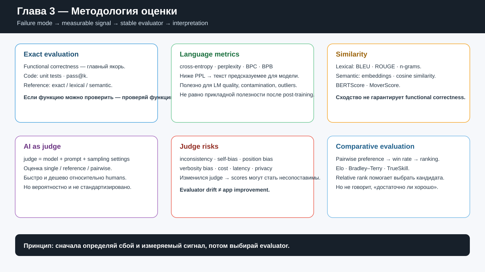
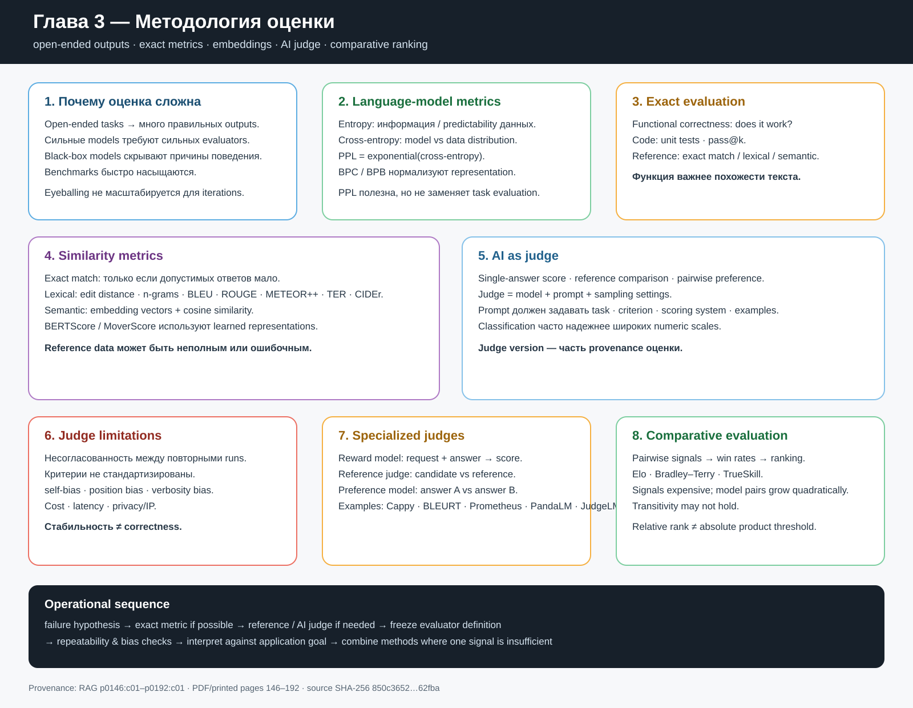

# Глава 3 — Методология оценки

Практические и концептуальные заметки по главе 3 книги «AI-инженерия. Построение приложений с использованием базовых моделей».

## Идентификация

- Book ID: `ai-engineering-chip-huyen-ru`
- Глава: 3
- Название: «Методология оценки»
- Slug: `evaluation-methodology`
- Chapter-analysis request: `BIBLIOTEKA-VSP-CHAPTER-ANALYSIS-REQUEST v1.2`
- Artifact collection: `BIBLIOTEKA-VSP-CHAPTER-ARTIFACT-COLLECTION v1.6`
- Readiness contract: `BIBLIOTEKA-VSP-BOOK-READINESS v1.2`
- Source policy: `rag_only`
- External sources: запрещены
- Model memory: запрещена
- Прямой доступ к canonical source: не использовался
- Book-level readiness: `READY` по canonical repository evidence до retrieval главы

## Provenance

- RAG chunks: `p0146:c01`–`p0192:c01`
- Source format: `pdf`
- Source locator range: `PDF pages 146–192`
- PDF page range: `146–192`
- EPUB spine range: `[Not applicable]`
- Printed page range: `146–192`
- `p0146:c01` начинается заголовком «ГЛАВА 3. Методология оценки».
- `p0191:c01`–`p0192:c01` содержат явный chapter-end раздел «Резюме».
- `p0193:c01` начинается заголовком «ГЛАВА 4. Оценка систем AI».
- Chapter boundary verified: yes
- Source SHA-256: `850c365211ba0e3d68a8ff8e7d7d48fb95188e24228270d11c0ec954c2062fba`

## Содержимое

- [cheatsheet.md](cheatsheet.md) — рабочая рамка выбора метода оценки и контроля evaluator drift.
- [commands.md](commands.md) — source-confirmed метрики, оценочные действия, инструменты и prompt-patterns; shell-команды отсутствуют.
- [diagram.md](diagram.md) — Mermaid-карты выбора метода оценки и жизненного цикла AI-судьи.
- [visual-cheatsheet.svg](visual-cheatsheet.svg) — компактный обзор.
- [visual-cheatsheet-detailed.svg](visual-cheatsheet-detailed.svg) — подробный обзор всей главы.
- [summary.md](summary.md) — chapter-end «Резюме» из `p0191:c01`–`p0192:c01`.

`review-questions.md` и `review-answers.md` не создавались: после явного раздела «Резюме» следующий addressable chunk `p0193:c01` уже начинает главу 4; отдельного блока контрольных вопросов или упражнений в границе главы не обнаружено.

## Карта главы

1. Почему оценка базовых моделей сложнее традиционной ML-оценки:
   - задачи и ответы открытого типа;
   - рост сложности задач;
   - black-box характер моделей;
   - быстрое насыщение общедоступных benchmarks;
   - необходимость не только проверять известные способности, но и открывать новые.
2. Метрики языкового моделирования:
   - энтропия;
   - кросс-энтропия;
   - BPC и BPB;
   - перплексия;
   - интерпретация перплексии и сценарии применения.
3. Точная оценка:
   - функциональная корректность;
   - `pass@k`;
   - сравнение с эталонными ответами;
   - exact match;
   - лексическое сходство;
   - семантическое сходство и embeddings.
4. Метрики сходства:
   - edit distance / fuzzy matching;
   - n-gram similarity;
   - BLEU, ROUGE, METEOR++, TER, CIDEr;
   - cosine similarity;
   - BERTScore и MoverScore.
5. Эмбеддинги:
   - численное представление смысла;
   - сравнение через cosine similarity;
   - зависимость качества semantic similarity от embedding model.
6. «AI в роли судьи»:
   - оценка одного ответа;
   - сравнение с эталоном;
   - pairwise comparison;
   - model + prompt + sampling settings как единая система evaluator-а.
7. Ограничения AI-судей:
   - несогласованность;
   - неоднозначность критериев;
   - drift evaluator-а;
   - стоимость и latency;
   - self-bias;
   - position bias;
   - verbosity bias;
   - privacy/IP constraints.
8. Специализированные AI-судьи:
   - reward models;
   - reference-based judges;
   - preference models.
9. Сравнительная оценка:
   - pointwise vs pairwise;
   - win rate;
   - Elo, Bradley–Terry, TrueSkill;
   - масштабируемость;
   - транзитивность;
   - контроль качества сигналов;
   - отличие relative ranking от absolute usefulness.

## Краткий анализ главы

Глава задает ключевой инженерный принцип: оценка нужна не как декоративная таблица метрик, а как механизм снижения риска и локализации сбоев. Если непонятно, где система может сломаться, увеличение количества метрик само по себе не сделает систему надежнее.

Базовые модели усложняют оценку по нескольким причинам. Они работают с открытыми ответами, для которых невозможно перечислить все допустимые варианты. Чем сильнее модели, тем больше экспертизы требуется для проверки их результатов. При этом детали обучения и архитектуры часто скрыты, поэтому разработчик приложения вынужден судить о модели преимущественно по наблюдаемому поведению.

Метрики языкового моделирования — кросс-энтропия, перплексия, BPC и BPB — помогают понимать исходную способность модели прогнозировать последовательности. Низкая перплексия обычно означает более предсказуемый для модели текст, но глава предупреждает: после SFT/RLHF или других преобразований перплексия не обязана напрямую отражать прикладное качество. Она также может быть полезна для обнаружения contamination, необычных текстов и дедупликации.

Для прикладной оценки глава сначала отделяет точные методы от субъективных. Если можно проверить фактическое выполнение функции, функциональная корректность предпочтительна: например, запустить сгенерированный код на тестах. Для code benchmarks используется `pass@k`: задача считается решенной, если хотя бы один из k сгенерированных вариантов проходит все тесты.

Если функциональная корректность недоступна, ответы можно сравнивать с эталонами. Exact match подходит только для очень ограниченных задач. Лексические метрики измеряют совпадение формы, но могут штрафовать правильные перефразирования и не гарантируют функциональную правильность. Семантическое сходство работает через embeddings и cosine similarity, но переносит часть неопределенности на качество embedding model.

Для задач, где жесткая метрика плохо описывает качество, глава вводит «AI в роли судьи». AI-судья может оценить один ответ, сравнить его с эталоном или выбрать лучший из двух. Важное operational замечание: AI-судья — это не просто модель, а система `model + prompt + sampling settings`. Любое изменение этой системы способно изменить оценки.

Именно поэтому метрики от разных AI-судей нельзя автоматически считать сопоставимыми. Даже критерий с одинаковым названием — например, «достоверность» — может означать разные prompt, шкалу и decision rule в MLflow, Ragas или LlamaIndex. Если evaluator меняется между двумя итерациями приложения, изменение score нельзя уверенно приписать приложению.

AI-судьи дешевле и быстрее людей, но остаются вероятностными и предвзятыми. Глава выделяет self-bias, position bias и preference for verbosity. Увеличение числа примеров в evaluator prompt может повысить согласованность, но увеличивает стоимость; высокая согласованность сама по себе не гарантирует правильность.

Сравнительная оценка решает другую задачу: определить, какая из моделей предпочтительнее. Pairwise feedback часто проще получить, чем абсолютный балл. Однако relative ranking не отвечает на вопрос, достаточно ли хороша модель для конкретного приложения. Модель B может выигрывать у A в 51% сравнений, но это не говорит, достигнут ли продуктовый порог качества или оправдана ли более высокая стоимость.

Итоговая позиция главы — автоматическую оценку следует строить как систему из дополняющих методов. Точные метрики и функциональные проверки дают воспроизводимый якорь; AI-судьи и comparative evaluation расширяют покрытие открытых и субъективных задач; человеческая экспертная оценка остается важной для проверки разумности и случаев, где автоматизация недостаточно надежна.

## Основной принцип

Оценивать нужно не «модель вообще», а конкретные failure modes и свойства системы:

`failure hypothesis → measurable signal → exact metric where possible → AI/human judgment where necessary → repeatable evaluator definition → interpretation in application context`.

Любое изменение evaluator-а следует рассматривать как изменение измерительного инструмента, а не как нейтральную деталь.

## Ограничения

- Глава объясняет методы оценки, но полноценный application-specific evaluation pipeline переносится в главу 4.
- Shell/CLI workflow в главе отсутствует.
- Некоторые provider/tool examples отражают состояние на момент написания книги; их текущий API и набор встроенных критериев без внешней проверки остаются `[Needs confirmation]`.
- Результаты AI-судей зависят от модели, prompt и sampling settings и не являются стандартизированной абсолютной шкалой.
- RAG извлекает текст, подписи и табличный текст, но не представляет рисунки и формулы как независимые мультимодальные объекты.
