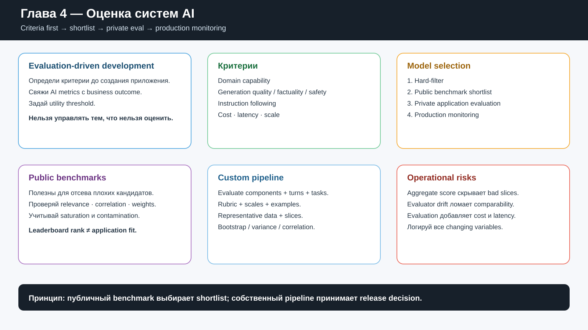
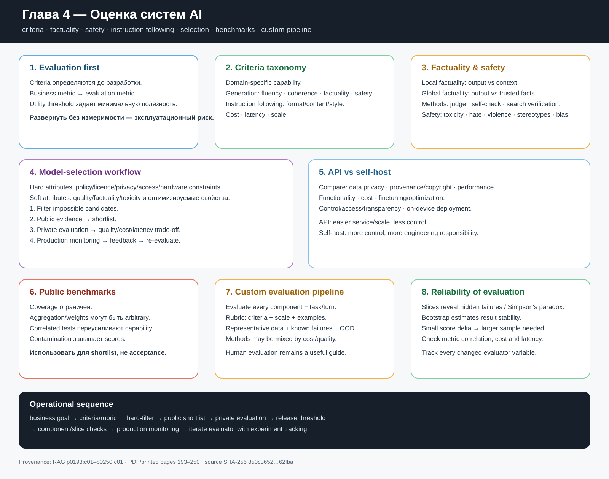

# Глава 4 — Оценка систем AI

Практические и концептуальные заметки по главе 4 книги «AI-инженерия. Построение приложений с использованием базовых моделей».

## Идентификация

- Book ID: `ai-engineering-chip-huyen-ru`
- Глава: 4
- Название: «Оценка систем AI»
- Slug: `evaluating-ai-systems`
- Chapter-analysis request: `BIBLIOTEKA-VSP-CHAPTER-ANALYSIS-REQUEST v1.2`
- Artifact collection: `BIBLIOTEKA-VSP-CHAPTER-ARTIFACT-COLLECTION v1.6`
- Readiness contract: `BIBLIOTEKA-VSP-BOOK-READINESS v1.2`
- Source policy: `rag_only`
- External sources: запрещены
- Model memory: запрещена
- Прямой доступ к canonical source: не использовался
- Book-level readiness: `READY` по canonical repository evidence до retrieval главы

## Provenance

- RAG chunks: `p0193:c01`–`p0250:c01`
- Source format: `pdf`
- Source locator range: `PDF pages 193–250`
- PDF page range: `193–250`
- EPUB spine range: `[Not applicable]`
- Printed page range: `193–250`
- `p0193:c01` начинается заголовком «ГЛАВА 4. Оценка систем AI».
- `p0249:c01`–`p0250:c01` содержат явный chapter-end раздел «Резюме».
- `p0251:c01` начинается заголовком «ГЛАВА 5. Промт-инжиниринг».
- Chapter boundary verified: yes
- Source SHA-256: `850c365211ba0e3d68a8ff8e7d7d48fb95188e24228270d11c0ec954c2062fba`

## Содержимое

- [cheatsheet.md](cheatsheet.md) — operational рамка оценки приложения, выбора модели и проектирования собственного evaluation pipeline.
- [commands.md](commands.md) — source-confirmed evaluation tools, metrics и actions; shell-команды в главе отсутствуют.
- [diagram.md](diagram.md) — Mermaid-карты model selection и custom evaluation pipeline.
- [visual-cheatsheet.svg](visual-cheatsheet.svg) — компактный обзор.
- [visual-cheatsheet-detailed.svg](visual-cheatsheet-detailed.svg) — подробный обзор всей главы.
- [summary.md](summary.md) — chapter-end «Резюме» из `p0249:c01`–`p0250:c01`.

`review-questions.md` и `review-answers.md` не создавались: после явного раздела «Резюме» следующий addressable chunk `p0251:c01` уже начинает главу 5; отдельного блока контрольных вопросов или упражнений в границе главы не обнаружено.

## Карта главы

1. Evaluation-driven development:
   - критерии оценки определяются до создания приложения;
   - AI-метрики должны связываться с бизнес-целями и порогом полезности.
2. Четыре группы критериев:
   - domain-specific capabilities;
   - generation capabilities;
   - instruction following;
   - cost and latency.
3. Domain-specific evaluation:
   - функциональная корректность;
   - MCQ/classification;
   - accuracy, F1, precision, recall;
   - эффективность выполнения и удобочитаемость как дополнительные свойства.
4. Generation quality:
   - fluency и coherence;
   - factual consistency;
   - safety;
   - application-specific subjective criteria.
5. Factual consistency:
   - local consistency с предоставленным контекстом;
   - global consistency с внешними фактами;
   - AI judge;
   - SelfCheckGPT;
   - search-augmented verification;
   - NLI/classification-style evaluators.
6. Safety:
   - inappropriate/harmful output;
   - hate, violence, stereotypes and bias;
   - general AI judges;
   - специализированные toxicity/moderation classifiers.
7. Instruction following:
   - structured output;
   - keyword/length/language/format constraints;
   - IFEval;
   - INFOBench;
   - application-specific instruction tests.
8. Cost and latency:
   - TTFT, per-token/inter-token/request latency;
   - token cost;
   - Pareto/multi-objective trade-offs.
9. Model selection:
   - hard vs soft attributes;
   - filter → public evidence → private experiments → production monitoring.
10. API vs self-hosting:
   - data/privacy;
   - data provenance/copyright;
   - performance;
   - functionality;
   - cost;
   - control/access/transparency;
   - on-device deployment;
   - licensing and finetuning constraints.
11. Public benchmarks:
   - coverage limits;
   - benchmark selection and aggregation;
   - correlation between benchmarks;
   - leaderboard interpretation;
   - contamination/data leakage.
12. Custom evaluation pipeline:
   - evaluate each system component and each task/turn level;
   - create an evaluation guide;
   - define criteria and scoring scales with examples;
   - connect evaluation metrics to business metrics;
   - select evaluation methods and datasets;
   - annotate representative production data;
   - slice datasets;
   - use bootstrap/repeated evaluation to assess reliability;
   - analyze correlation, variance, cost and latency;
   - iterate while tracking all changing variables.

## Краткий анализ главы

Глава 4 переводит методы из главы 3 в application-level процесс. Центральная идея — не выбирать «самую лучшую модель вообще», а заранее определить, что означает хорошая работа конкретного приложения, и строить выбор модели вокруг этих требований.

Автор вводит разработку на основе оценки: критерии оценки формулируются до разработки приложения. Такой порядок позволяет заранее ответить на вопрос, каким наблюдаемым сигналом будет подтверждена полезность системы. Если приложение уже развернуто, но команда не понимает, работает ли оно, это становится эксплуатационным и бизнес-риском.

На верхнем уровне критерии делятся на четыре группы: способности в конкретной области, качество генерации, способность следовать инструкциям, а также стоимость и время отклика. Это важно, потому что один высокий общий score скрывает разные свойства. Модель может хорошо знать предметную область, но нарушать формат; генерировать качественный текст, но быть слишком дорогой; быть быстрой, но недостаточно надежной.

Для domain-specific задач глава рекомендует точные методы там, где они возможны: functional correctness для кода, accuracy/F1/precision/recall для классификации, MCQ для закрытых проверок знаний и рассуждений. Но MCQ измеряет способность выбрать правильный ответ и не обязательно отражает способность самостоятельно генерировать хороший ответ.

Для open-ended generation важны критерии вроде factual consistency и safety. Factual consistency делится на локальную — соответствие предоставленному контексту — и глобальную — соответствие фактам вне контекста. Для нее можно применять AI judges, самопроверку через несколько генераций, search-augmented verification и специализированные классификаторы. Глава подчеркивает, что проблема начинается еще раньше: сначала нужно определить, каким источникам доверять и что считать фактом.

Instruction following оценивается отдельно от предметной способности. Если модель знает правильный класс, но выводит значение вне разрешенного набора, она не выполнила инструкцию. Для автоматически проверяемых ограничений подходят проверки формата, длины, ключевых слов и языка; более сложные ограничения требуют критериев и субъективного/AI evaluator-а. Общедоступные IFEval и INFOBench полезны как примеры, но автор прямо рекомендует создавать собственный benchmark под реальные инструкции приложения.

Стоимость и latency являются полноценными критериями выбора, а не эксплуатационной деталью после выбора модели. Глава предлагает рассматривать model selection как многокритериальную задачу: сначала исключить варианты, нарушающие жесткие требования, а затем выбирать лучший trade-off между качеством, стоимостью и временем отклика.

Model-selection workflow состоит из четырех этапов: фильтрация по hard attributes, shortlist по общедоступной информации, private evaluation на собственном pipeline и production monitoring. Hard/soft classification зависит от контекста: например, latency может быть soft attribute для самостоятельно размещаемой модели и hard attribute для внешнего API.

Отдельный блок посвящен API versus self-hosting. Решение зависит от privacy/data boundary, provenance/copyright, производительности, функциональности, стоимости, контроля и возможности edge deployment. Для self-hosting выше контроль и доступ к внутренним характеристикам модели, но выше инженерная нагрузка. Для API проще deployment/scale и часто лучше frontier performance, но появляются vendor limits, privacy boundary и риск изменения/прекращения доступа.

Публичные benchmarks полезны прежде всего как фильтр плохих кандидатов. Они не заменяют собственную evaluation system: набор benchmark-ов ограничен, их агрегирование отражает выбранные веса, коррелирующие benchmarks могут переусиливать одно свойство, а contamination способен искусственно завышать оценки. Поэтому высокий рейтинг модели в публичной таблице лидеров — сигнал для shortlist, а не acceptance criterion приложения.

Последний блок главы формирует практический evaluation pipeline. Нужно оценивать компоненты системы по отдельности, чтобы локализовать сбой; оценивать не только отдельные turns, но и completion задачи; сформулировать rubric с положительными и отрицательными примерами; связать score с бизнес-эффектом и utility threshold; собрать репрезентативные evaluation sets; анализировать slices и статистическую устойчивость результатов.

Надежность evaluation pipeline также подлежит оценке. Глава предлагает проверять повторяемость, variance между выборками, correlation метрик и влияние evaluation на cost/latency. При изменении критериев, scales, prompts или evaluator configuration необходимо логировать эти переменные, иначе historical scores теряют сопоставимость.

## Основной принцип

`business goal → evaluation criteria → hard constraints → public shortlist → private evaluation → production monitoring → iterative evaluator improvement`.

Публичный benchmark — инструмент предварительного отбора. Acceptance должен опираться на собственный application-specific evaluation pipeline.

## Ограничения

- Глава не задает готовый универсальный набор метрик: критерии должны следовать из конкретного приложения.
- Shell/CLI workflow отсутствует.
- Конкретные benchmark rankings, цены, API capabilities и vendor behavior отражают состояние на момент написания книги и без внешней проверки не считаются текущими.
- Для global factuality внешние факты и trusted sources должны быть определены приложением; chapter-level RAG не задает универсальный источник истины.
- RAG извлекает текст, подписи и табличный текст, но не представляет рисунки и таблицы как независимые мультимодальные объекты.
