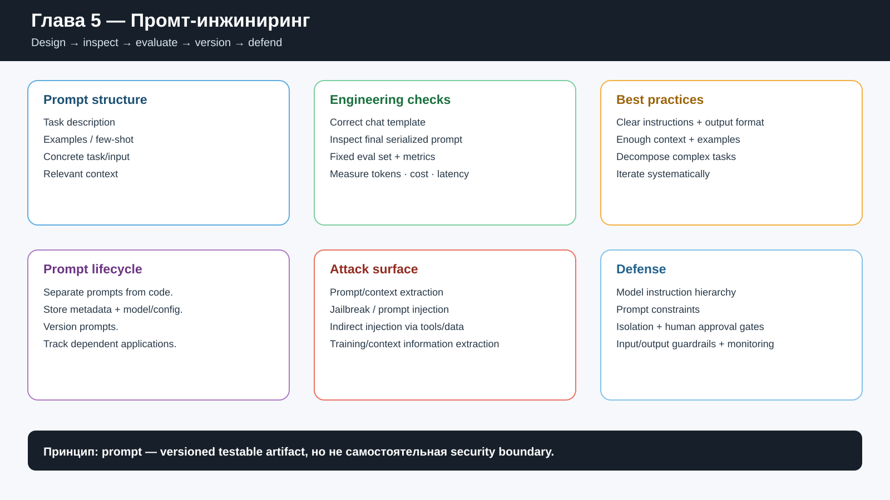
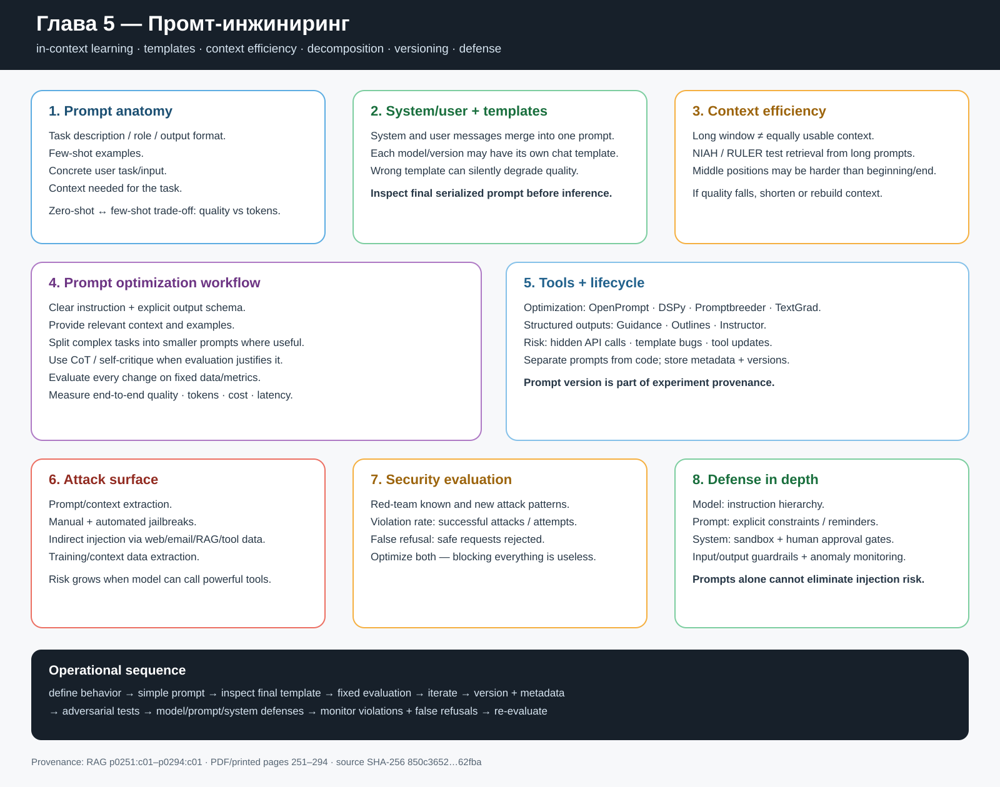

# Глава 5 — Промт-инжиниринг

Практические и концептуальные заметки по главе 5 книги «AI-инженерия. Построение приложений с использованием базовых моделей».

## Идентификация

- Book ID: `ai-engineering-chip-huyen-ru`
- Глава: 5
- Название: «Промт-инжиниринг»
- Slug: `prompt-engineering`
- Chapter-analysis request: `BIBLIOTEKA-VSP-CHAPTER-ANALYSIS-REQUEST v1.2`
- Artifact collection: `BIBLIOTEKA-VSP-CHAPTER-ARTIFACT-COLLECTION v1.6`
- Readiness contract: `BIBLIOTEKA-VSP-BOOK-READINESS v1.2`
- Source policy: `rag_only`
- External sources: запрещены
- Model memory: запрещена
- Прямой доступ к canonical source: не использовался
- Book-level readiness: `READY` по canonical repository evidence до retrieval главы

## Provenance

- RAG chunks: `p0251:c01`–`p0294:c01`
- Source format: `pdf`
- Source locator range: `PDF pages 251–294`
- PDF page range: `251–294`
- EPUB spine range: `[Not applicable]`
- Printed page range: `251–294`
- `p0251:c01` начинается заголовком «ГЛАВА 5. Промт-инжиниринг».
- `p0294:c01` содержит явный chapter-end раздел «Резюме».
- `p0295:c01` начинается заголовком «ГЛАВА 6. RAG и агенты».
- Chapter boundary verified: yes
- Source SHA-256: `850c365211ba0e3d68a8ff8e7d7d48fb95188e24228270d11c0ec954c2062fba`

## Содержимое

- [cheatsheet.md](cheatsheet.md) — operational рамка проектирования, тестирования, версионирования и защиты промтов.
- [commands.md](commands.md) — source-confirmed tools, code patterns и defensive actions; shell-команды в главе отсутствуют.
- [diagram.md](diagram.md) — Mermaid-карты prompt lifecycle и defensive prompt engineering.
- [visual-cheatsheet.svg](visual-cheatsheet.svg) — компактный обзор.
- [visual-cheatsheet-detailed.svg](visual-cheatsheet-detailed.svg) — подробный обзор главы.
- [summary.md](summary.md) — chapter-end «Резюме» из `p0294:c01`.

`review-questions.md` и `review-answers.md` не создавались: после «Резюме» следующий addressable chunk `p0295:c01` начинает главу 6; отдельного блока контрольных вопросов или упражнений в границе главы не обнаружено.

## Карта главы

1. Что такое промт-инжиниринг:
   - адаптация поведения модели без изменения весов;
   - систематические эксперименты и оценка;
   - промт как коммуникационный интерфейс между человеком и моделью.
2. Структура промта:
   - описание задачи;
   - примеры;
   - конкретная задача;
   - контекст.
3. Контекстное обучение:
   - zero-shot и few-shot;
   - примеры как способ задать поведение без изменения весов;
   - компромисс между количеством примеров, качеством, длиной контекста и стоимостью.
4. System prompt и user prompt:
   - инструкции разработчика и пользовательский ввод;
   - объединение через model-specific chat template;
   - риск тихого падения качества при неверном шаблоне.
5. Длина и эффективность контекста:
   - максимальная длина не равна эффективной длине;
   - NIAH/RULER как способы проверки использования длинного контекста;
   - информация в середине длинного контекста может использоваться хуже.
6. Лучшие практики:
   - четкие и однозначные инструкции;
   - роль/образ;
   - примеры;
   - явный формат вывода;
   - достаточный релевантный контекст;
   - разделение сложной задачи на подзадачи;
   - CoT / пошаговое рассуждение;
   - самокритика;
   - систематическая итерация.
7. Разбиение промтов:
   - monitoring промежуточных результатов;
   - локализация ошибок;
   - parallelization независимых шагов;
   - trade-off между качеством, cost и latency.
8. Инструменты prompt engineering:
   - OpenPrompt, DSPy;
   - Promptbreeder, TextGrad;
   - Guidance, Outlines, Instructor;
   - скрытые API calls и ошибки шаблонов как operational risks.
9. Организация и версионирование:
   - отделять prompts от application code;
   - хранить metadata;
   - поддерживать версии;
   - учитывать зависимые приложения;
   - хранить model, sampling settings, input/output schema и другие execution parameters.
10. Оборонительный промт-инжиниринг:
   - prompt extraction;
   - jailbreak/prompt injection;
   - information extraction.
11. Классы риска:
   - несанкционированный tool/code execution;
   - data leakage;
   - social harm;
   - misinformation;
   - service disruption/sabotage;
   - brand risk.
12. Prompt attacks:
   - manual jailbreaks;
   - automated attacks;
   - indirect prompt injection через внешние tools/data;
   - extraction memorized/context data.
13. Защита:
   - red teaming;
   - violation rate и false refusal rate;
   - model-level instruction hierarchy;
   - prompt-level explicit constraints;
   - system-level isolation;
   - human approval для опасных state changes;
   - input/output guardrails;
   - anomaly/use-pattern detection.

## Краткий анализ главы

Глава рассматривает промт-инжиниринг как инженерную дисциплину, а не как набор «магических фраз». Запросы должны изменяться систематически, а их варианты — оцениваться на фиксированных данных и метриках. Промт является одним из самых дешевых способов адаптации модели, но production-ready система требует также evaluation, experiment tracking, data work и инженерной дисциплины.

Базовый prompt состоит из описания задачи, примеров, конкретной задачи и контекста. Через in-context learning модель может менять поведение без обновления весов. Few-shot examples особенно полезны, когда нужно показать формат, стиль или специфичное для домена поведение, но увеличивают длину контекста, стоимость и latency.

System и user prompts в конечном итоге собираются в model-specific chat template. Поэтому правильный шаблон является частью корректности интеграции. Неверный template или даже небольшие изменения форматирования могут вызвать тихое ухудшение качества. Практический diagnostic check из главы — перед отправкой распечатать окончательный prompt и проверить его соответствие ожидаемому шаблону.

Длинный context window не гарантирует одинаково эффективное использование всего контекста. NIAH-подобные проверки показывают, что модели часто лучше используют информацию в начале и в конце длинного prompt, чем в середине. Если performance падает при росте context length, следует рассмотреть сокращение контекста или другой способ его построения.

Лучшие практики главы в основном сводятся к снижению неоднозначности. Нужно явно задавать задачу, шкалу/ограничения, формат вывода и нужный уровень краткости, давать достаточный релевантный контекст и примеры. Сложные запросы стоит разбивать на более простые этапы. Это улучшает наблюдаемость и отладку, позволяет параллелить независимые шаги и даже использовать разные модели для разных подзадач.

CoT и self-critique используются как способы заставить модель уделить задаче больше вычислительного времени. Они могут улучшить качество, но увеличивают latency и cost, особенно если система порождает длинные последовательности промежуточных шагов. Поэтому такие техники должны оцениваться на уровне всей системы, а не только локального ответа.

Prompt optimization tools могут автоматизировать поиск эффективных формулировок, однако создают собственный слой риска: скрытые model calls, длинные цепочки вызовов, ошибки chat templates и изменения default prompts. Глава рекомендует сначала понимать ручной workflow, а затем контролировать, что именно инструмент генерирует и сколько API calls он создает.

Промты являются production artifacts и требуют организации. Их полезно отделять от кода, снабжать metadata и versioning, связывать с model/configuration, input/output schema и dependent applications. При совместном использовании prompts простое хранение рядом с кодом может затруднить pinning старой версии, поэтому для большого количества приложений отдельный versioned prompt catalog может быть надежнее.

Вторая половина главы рассматривает безопасность. Способность модели следовать инструкциям одновременно является источником полезности и уязвимостью. Attack surface включает extraction системных prompts/context, jailbreak/prompt injection и extraction memorized information. Особенно опасно indirect prompt injection, когда вредоносные инструкции поступают не непосредственно от пользователя, а из веб-страницы, письма, RAG-document или output подключенного tool.

Защита не сводится к более строгому system prompt. Автор делит defenses на model, prompt и system levels. На уровне модели полезна приоритизация инструкций. На уровне prompt — явные ограничения и напоминания. На уровне системы — isolation, human approval для опасных операций, фильтрация input/output, detection подозрительных запросов и контроль pattern-of-use. Самый важный boundary: модель не должна самостоятельно получать право на опасный state change только потому, что сгенерировала соответствующую команду.

Для security evaluation одновременно нужны violation rate и false refusal rate. Система, блокирующая всё, может иметь нулевой violation rate, но быть бесполезной. Поэтому безопасность — это trade-off между устойчивостью к атакам и сохранением полезного поведения.

## Основной принцип

`define behavior → build prompt → inspect final template → evaluate → version → monitor → harden model/prompt/system boundaries → re-evaluate`.

Промт — это versioned, testable production artifact. Он не является security boundary сам по себе.

## Ограничения

- Конкретные модели, prompt techniques, tools и provider behavior отражают состояние на момент написания книги.
- Shell/CLI-команды для перечисленных tools в главе не приводятся.
- CoT/self-critique рассматриваются как prompt techniques; глава не задает универсальную гарантию улучшения качества.
- Защита prompts не устраняет prompt-injection risk полностью.
- Для high-impact actions необходимы system-level controls; конкретная implementation/rollback procedure зависит от приложения и в главе не задана.
- RAG извлекает текст и подписи, но не представляет рисунки/скриншоты как независимые мультимодальные объекты.
