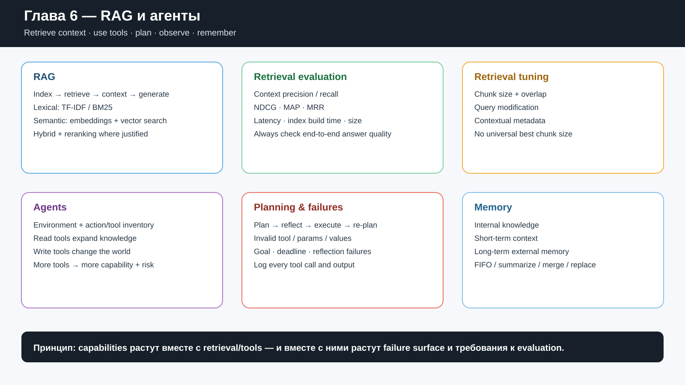
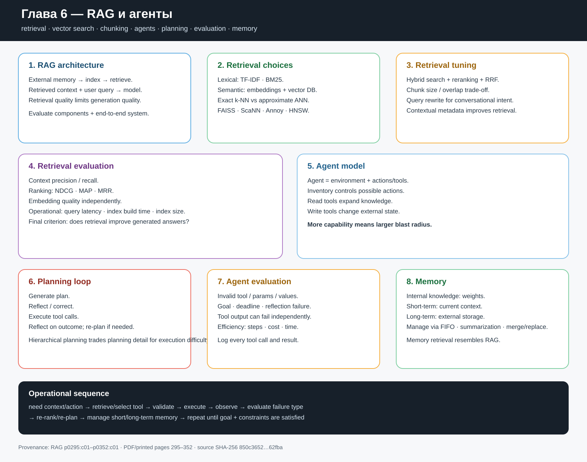

# Глава 6 — RAG и агенты

Практические и концептуальные заметки по главе 6 книги «AI-инженерия. Построение приложений с использованием базовых моделей».

## Идентификация

- Book ID: `ai-engineering-chip-huyen-ru`
- Глава: 6
- Название: «RAG и агенты»
- Slug: `rag-and-agents`
- Chapter-analysis request: `BIBLIOTEKA-VSP-CHAPTER-ANALYSIS-REQUEST v1.2`
- Artifact collection: `BIBLIOTEKA-VSP-CHAPTER-ARTIFACT-COLLECTION v1.6`
- Readiness contract: `BIBLIOTEKA-VSP-BOOK-READINESS v1.2`
- Source policy: `rag_only`
- External sources: запрещены
- Model memory: запрещена
- Прямой доступ к canonical source: не использовался
- Book-level readiness: `READY` по canonical repository evidence до retrieval главы

## Provenance

- RAG chunks: `p0295:c01`–`p0352:c01`
- Source format: `pdf`
- Source locator range: `PDF pages 295–352`
- PDF page range: `295–352`
- EPUB spine range: `[Not applicable]`
- Printed page range: `295–352`
- `p0295:c01` начинается заголовком «ГЛАВА 6. RAG и агенты».
- `p0351:c01`–`p0352:c01` содержат явный chapter-end раздел «Резюме».
- `p0353:c01` начинается заголовком «ГЛАВА 7. Дообучение, или Тонкая настройка».
- Chapter boundary verified: yes
- Source SHA-256: `850c365211ba0e3d68a8ff8e7d7d48fb95188e24228270d11c0ec954c2062fba`

## Содержимое

- [cheatsheet.md](cheatsheet.md) — operational рамка проектирования и оценки RAG/agent systems.
- [commands.md](commands.md) — source-confirmed retrieval algorithms, metrics, tools, SQL example и agent actions.
- [diagram.md](diagram.md) — Mermaid-карты RAG pipeline, agent loop и failure localization.
- [visual-cheatsheet.svg](visual-cheatsheet.svg) — компактный обзор.
- [visual-cheatsheet-detailed.svg](visual-cheatsheet-detailed.svg) — подробный обзор главы.
- [summary.md](summary.md) — chapter-end «Резюме» из `p0351:c01`–`p0352:c01`.

`review-questions.md` и `review-answers.md` не создавались: после «Резюме» следующий addressable chunk `p0353:c01` начинает главу 7; отдельного блока контрольных вопросов или упражнений в границе главы не обнаружено.

## Карта главы

1. RAG как построение релевантного контекста:
   - retrieve → generate;
   - внешняя память;
   - index + query;
   - chunking и post-processing.
2. Поиск:
   - term-based / lexical search;
   - TF, IDF, TF-IDF, BM25;
   - embedding-based / semantic search;
   - vector database;
   - k-NN и ANN.
3. Векторный поиск:
   - FAISS, ScaNN, Annoy, Hnswlib;
   - LSH, HNSW, product quantization, IVF.
4. Оценка retrieval:
   - context precision / recall;
   - NDCG, MAP, MRR;
   - embedding quality;
   - end-to-end RAG output;
   - latency, index build time, index size.
5. Улучшение retrieval:
   - hybrid search;
   - reranking;
   - reciprocal rank fusion;
   - chunking strategy и overlap;
   - query modification;
   - contextual retrieval.
6. Нетекстовый RAG:
   - multimodal retrieval;
   - multimodal embeddings;
   - tabular data и SQL.
7. Агенты:
   - environment + actions/tools;
   - read-only и write actions;
   - inventory;
   - knowledge/capability/action tools.
8. Планирование:
   - task decomposition;
   - reflection;
   - execution;
   - re-planning;
   - function/tool calls;
   - hierarchical planning.
9. Агентные риски:
   - накопление ошибок;
   - более высокие последствия write-actions;
   - tool misuse;
   - goal failure;
   - time-limit failure;
   - reflection failure.
10. Оценка агентов:
    - valid plan rate;
    - число планов до допустимого;
    - valid/invalid tool calls;
    - parameter/value errors;
    - independent tool evaluation;
    - steps/cost/time efficiency.
11. Память:
    - internal knowledge;
    - short-term context;
    - long-term external memory;
    - memory management;
    - retrieval from memory;
    - FIFO, summarization и conflict handling.

## Краткий анализ главы

Глава связывает две идеи вокруг одной проблемы: модели требуется релевантная информация, которая часто не помещается в ее внутренние знания или контекст. RAG решает это через поиск нужной информации, а агент расширяет модель инструментами и планированием, позволяя не только получать сведения, но и выполнять действия.

RAG описывается как двухэтапная схема: сначала retrieval, затем generation. Поэтому качество retrieval — самостоятельный инженерный объект. Если поиск возвращает нерелевантные или пропускает нужные документы, генератор не может надежно исправить этот дефект. Глава рекомендует оценивать retrieval отдельно, embedding layer отдельно и весь RAG end-to-end.

Term-based search является простым и надежным baseline. TF-IDF/BM25 используют лексические сигналы, поэтому легко объясняются и реализуются, но не понимают семантическую эквивалентность. Embedding search сравнивает смысл через vector representations и vector search, но добавляет стоимость embedding generation, indexing и approximate nearest-neighbor infrastructure.

Для production retrieval типична комбинация методов. Hybrid search объединяет term и embedding retrieval; reranking позволяет сначала дешево собрать candidates, а затем применить более точный и дорогой scorer. При параллельном использовании retrieval methods rankings можно объединять, например через RRF.

Chunking является частью retrieval design, а не технической мелочью. Слишком крупные chunks тратят context budget и могут смешивать темы; слишком мелкие теряют связность, увеличивают число embeddings и размер search space. Overlap снижает риск потери информации на границах, но увеличивает объем данных. Универсального размера chunk или overlap глава не задает — их нужно выбирать экспериментально.

Query modification решает проблему неавтономных или контекстно зависимых запросов. Поисковый запрос должен отражать фактический информационный intent пользователя. Если для переформулирования не хватает фактов, система не должна выдумывать сущности. Contextual retrieval добавляет metadata/контекст к chunk до indexing, чтобы retrieval layer мог лучше понять, о чем фрагмент.

RAG распространяется и на нетекстовые данные. Для image/text retrieval нужен общий embedding space, а tabular retrieval может строиться через генерацию/исполнение SQL. Смысл остается тем же: получить только релевантный внешний контекст и добавить его к запросу модели.

Агент определяется средой и доступными действиями. Его возможности растут вместе с tool inventory, но растет и blast radius. Глава прямо разделяет read-only и write-actions: чтение расширяет знания, а запись меняет окружающую среду. Write-capability требует значительно более строгого safety boundary, потому что ошибка модели может превратиться в реальное изменение данных или действие.

Сложные agent tasks требуют planning. Базовый цикл главы: plan → reflect → execute → reflect/re-plan. Планирование — это поиск пути к цели под ограничениями. Модель может составить правдоподобный, но неисполнимый план, поэтому нужно логировать конкретные tool calls и параметры, а не оценивать только естественно-языковое описание плана.

Для agent evaluation автор предлагает failure-oriented подход. Ошибки планирования делятся на invalid tool, invalid parameters, wrong parameter values, goal failure, deadline/time failure и reflection failure. Tool failures нужно тестировать отдельно от planner failures. Efficiency тоже является метрикой: число шагов, стоимость и время выполнения должны измеряться наряду с успешностью.

В конце глава связывает RAG и agents через memory. Internal knowledge хранится в весах, short-term memory — в текущем context, long-term memory — во внешнем хранилище. Память нужна для overflow, cross-session continuity, consistency и structured state. Но short-term context ограничен, поэтому система должна решать, какую информацию сохранить, переместить, суммировать или удалить.

## Основной принцип

`context need → retrieve/use tools → evaluate component outputs → execute only allowed actions → observe failures → manage memory → re-plan/retrieve`.

Для RAG: хороший generator не компенсирует систематически плохой retrieval.  
Для agents: tool access увеличивает возможности и одновременно увеличивает последствия ошибок.

## Ограничения

- Конкретные библиотеки, модели и benchmarks отражают состояние на момент написания книги.
- Shell/CLI runbook для retrieval/agent frameworks в главе не приводится.
- Универсального chunk size, overlap, retrieval algorithm или agent inventory глава не задает.
- Agent planning остается развивающейся и экспериментальной областью.
- Write-actions требуют строгих защитных механизмов; конкретная authorization/rollback implementation зависит от приложения и в главе не задана.
- RAG главы поддерживает textual extraction; визуальные рисунки не представлены как независимые мультимодальные объекты в этом repository RAG.
