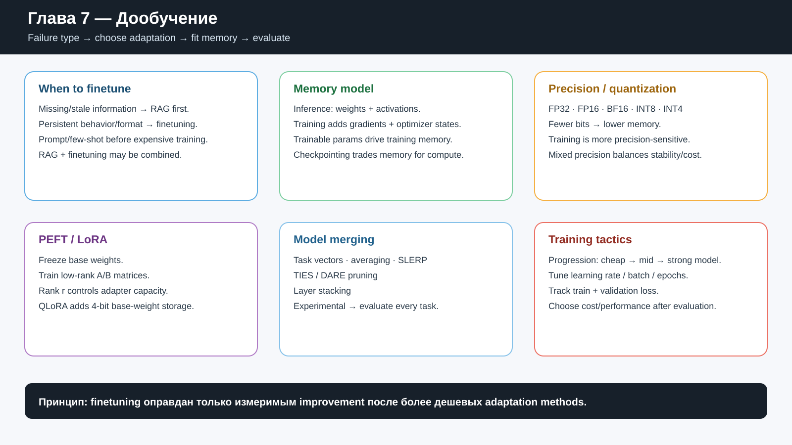
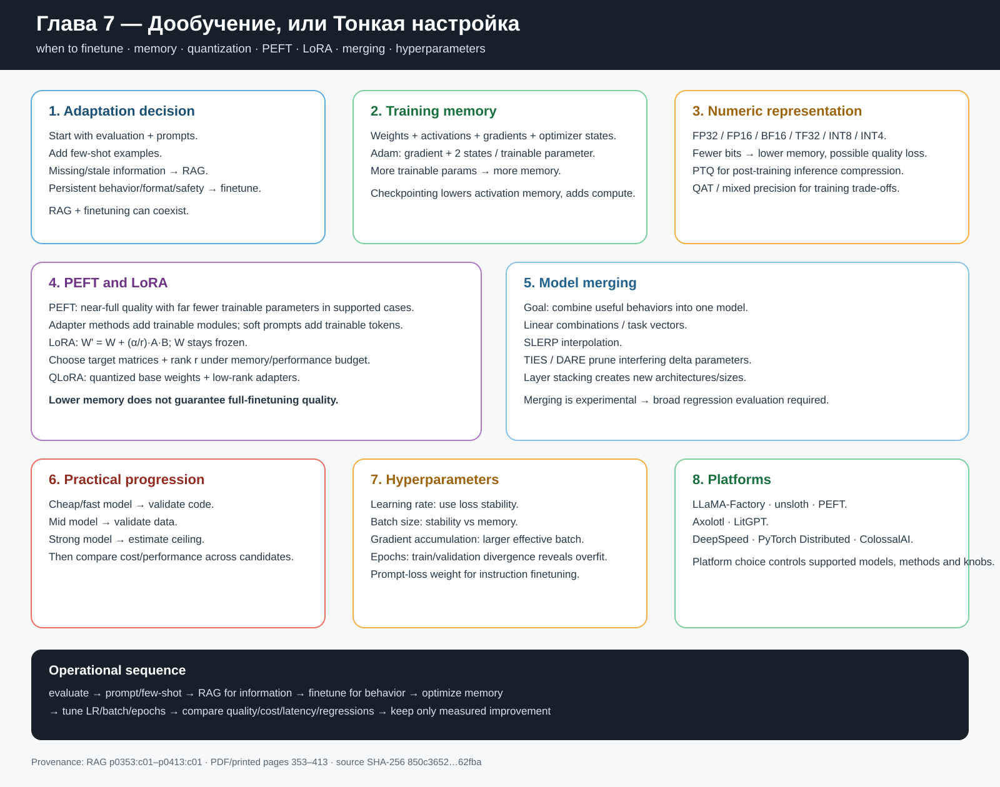

# Глава 7 — Дообучение, или Тонкая настройка

Практические и концептуальные заметки по главе 7 книги «AI-инженерия. Построение приложений с использованием базовых моделей».

## Идентификация

- Book ID: `ai-engineering-chip-huyen-ru`
- Глава: 7
- Название: «Дообучение, или Тонкая настройка»
- Slug: `finetuning`
- Chapter-analysis request: `BIBLIOTEKA-VSP-CHAPTER-ANALYSIS-REQUEST v1.2`
- Artifact collection: `BIBLIOTEKA-VSP-CHAPTER-ARTIFACT-COLLECTION v1.6`
- Readiness contract: `BIBLIOTEKA-VSP-BOOK-READINESS v1.2`
- Source policy: `rag_only`
- External sources: запрещены
- Model memory: запрещена
- Прямой доступ к canonical source: не использовался
- Book-level readiness: `READY` по canonical repository evidence до retrieval главы

## Provenance

- RAG chunks: `p0353:c01`–`p0413:c01`
- Source format: `pdf`
- Source locator range: `PDF pages 353–413`
- PDF page range: `353–413`
- EPUB spine range: `[Not applicable]`
- Printed page range: `353–413`
- `p0353:c01` начинается заголовком «ГЛАВА 7. Дообучение, или Тонкая настройка».
- `p0412:c01`–`p0413:c01` содержат явный chapter-end раздел «Резюме».
- `p0414:c01` начинается заголовком «ГЛАВА 8. Проектирование наборов данных».
- Chapter boundary verified: yes
- Source SHA-256: `850c365211ba0e3d68a8ff8e7d7d48fb95188e24228270d11c0ec954c2062fba`

## Содержимое

- [cheatsheet.md](cheatsheet.md) — operational рамка решения «prompt/RAG vs finetuning», memory planning и выбора метода.
- [commands.md](commands.md) — source-confirmed formulas, techniques, hyperparameters, platforms and tools; shell-команды в главе отсутствуют.
- [diagram.md](diagram.md) — Mermaid-карты decision flow, memory pressure и PEFT/LoRA lifecycle.
- [visual-cheatsheet.svg](visual-cheatsheet.svg) — компактный обзор.
- [visual-cheatsheet-detailed.svg](visual-cheatsheet-detailed.svg) — подробный обзор главы.
- [summary.md](summary.md) — chapter-end «Резюме» из `p0412:c01`–`p0413:c01`.

`review-questions.md` и `review-answers.md` не создавались: после «Резюме» следующий addressable chunk `p0414:c01` начинает главу 8; отдельного блока контрольных вопросов или упражнений в границе главы не обнаружено.

## Карта главы

1. Обзор дообучения:
   - transfer learning;
   - adaptation by updating model weights;
   - full vs partial finetuning.
2. Когда дообучать:
   - behavior failure vs missing-information failure;
   - prompts first;
   - few-shot examples;
   - RAG for missing/updated information;
   - finetuning for persistent behavioral failures.
3. RAG и дообучение:
   - не взаимоисключающие методы;
   - information failure → RAG;
   - behavior/format/safety failure → finetuning;
   - evaluation pipeline присутствует на всех этапах.
4. Memory constraints:
   - inference vs training memory;
   - weights, activations, gradients, optimizer states;
   - trainable vs frozen parameters;
   - gradient checkpointing.
5. Numeric representations:
   - FP32, FP16, BF16, TF32;
   - INT8/INT4;
   - quantization;
   - PTQ, QAT, low-precision and mixed-precision training.
6. PEFT:
   - full finetuning vs partial finetuning;
   - adapters;
   - soft prompts;
   - parameter/data efficiency.
7. LoRA:
   - low-rank factorization;
   - frozen base weights;
   - trainable A/B matrices;
   - rank `r` and scaling `α`;
   - target weight matrices;
   - mergeable adapters;
   - QLoRA.
8. Model merging:
   - simultaneous/sequential/multi-task alternatives;
   - task vectors / delta parameters;
   - linear combination;
   - SLERP;
   - TIES / DARE pruning;
   - layer stacking;
   - concatenation.
9. Finetuning tactics:
   - progression;
   - distillation path;
   - choose base model, method and platform;
   - start with LoRA/adapter methods before full finetuning in many practical cases.
10. Finetuning platforms:
    - LLaMA-Factory;
    - unsloth;
    - Hugging Face PEFT;
    - Axolotl;
    - LitGPT;
    - DeepSpeed;
    - PyTorch Distributed;
    - ColossalAI.
11. Hyperparameters:
    - learning rate;
    - batch size;
    - gradient accumulation;
    - number of epochs;
    - prompt-loss weight.

## Краткий анализ главы

Глава 7 проводит четкую границу между методами, основанными на входных данных, и изменением самой модели. Prompt engineering и RAG адаптируют поведение через инструкции, контекст и инструменты; finetuning меняет веса модели. Поэтому дообучение должно появляться не первым шагом, а после того, как команда определила failure mode и уже построила evaluation pipeline.

Decision rule главы основан на типе сбоя. Если модели не хватает фактов, приватных данных или актуальной информации, первичный кандидат — RAG. Если факты доступны, но модель стабильно ведет себя не так, как требуется: нарушает формат, стиль, релевантность или другие behavioral constraints, — finetuning становится более естественным кандидатом. Эти методы можно комбинировать.

Дообучение требует значительно больше памяти, чем inference, потому что training хранит не только model weights и activations, но также gradients и optimizer states. Поэтому ключевыми переменными становятся общее число параметров, число trainable parameters, numeric representation, sequence/batch workload и optimization techniques.

Глава дает простую оценку inference memory: для весов приблизительно `N × M`, где `N` — число параметров, `M` — bytes per parameter. С учетом activations/KV-like working memory автор приводит грубую оценку порядка `N × M × 1.2` для некоторых сценариев. Для training memory добавляются gradients и optimizer states. При Adam каждому trainable parameter нужны gradient и два optimizer-state values.

Memory pressure породил два класса optimization: уменьшение числа trainable parameters и уменьшение bits per value. PEFT решает первую задачу; quantization и mixed precision — вторую. Gradient checkpointing уменьшает activation memory ценой дополнительных вычислений.

PEFT стремится получить качество, близкое к full finetuning, при на порядки меньшем числе trainable parameters. Ранние adapter methods добавляли отдельные modules и могли увеличивать inference latency. LoRA решает эту проблему иначе: low-rank update можно объединить с базовой weight matrix, поэтому после merge дополнительный layer в forward path не обязателен.

LoRA представляет update как произведение двух меньших matrices `A` и `B`; base matrix остается frozen. Rank `r` определяет capacity low-rank adaptation, а `α` масштабирует ее вклад. Практическая сложность состоит в выборе target matrices и rank под memory/performance budget.

QLoRA комбинирует low-rank adaptation с quantized base weights. В описанном источником варианте base weights хранятся в 4-bit NF4, а для вычислений деквантуются в BF16. Это значительно снижает memory footprint, но добавляет quantization/dequantization overhead и может увеличить training time.

Model merging рассматривается как дополнение к finetuning. Вместо последовательного обучения одной модели на нескольких задачах можно дообучать модели/адаптеры отдельно и затем объединять их. Это помогает исследовать multi-task behavior и снижать риск catastrophic forgetting, но merging остается экспериментальной областью и требует отдельной evaluation.

В практической части глава предлагает начинать не с дорогого full finetuning, а с дешевых экспериментов. Progression: сначала проверить код на дешевой модели, затем данные на модели средней мощности, потом подтвердить потенциал на сильной модели и только затем сравнить cost/performance нескольких вариантов. Distillation path: использовать сильную модель на небольшом наборе, затем сгенерировать дополнительные данные и обучить более дешевую модель.

Hyperparameter tuning остается обязательным. Learning rate диагностируется по loss curve; batch size ограничивается hardware memory и влияет на stability; gradient accumulation компенсирует невозможность использовать большой physical batch; число epochs выбирается с учетом train/validation losses; instruction finetuning может по-разному взвешивать prompt и answer tokens.

## Основной принцип

`define failure → prompts/examples → RAG for missing information → finetune for persistent behavior → reduce trainable params / precision if memory-bound → evaluate every change`.

Дообучение — не замена evaluation, RAG или prompt engineering. Это более дорогой следующий уровень адаптации, оправданный только измеримым improvement.

## Ограничения

- Глава предполагает базовое понимание ML/training internals.
- Конкретные models/platforms/hardware examples отражают состояние на момент написания книги.
- Формулы memory usage являются приближенными и зависят от workload/optimization.
- LoRA/QLoRA не гарантируют качество full finetuning.
- Model merging описывается как перспективный, но экспериментальный подход.
- Shell/CLI runbook не приводится.
- Rollback конкретной trained model/configuration зависит от platform/repository lifecycle и в главе не задан.
