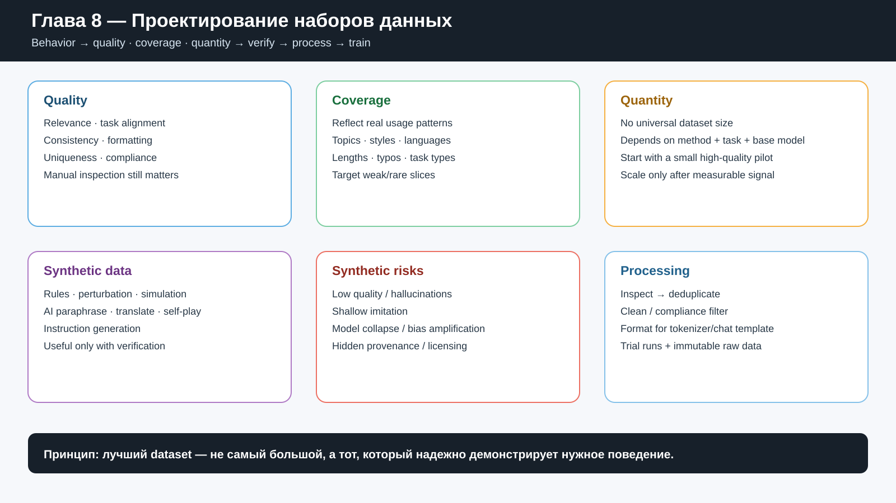
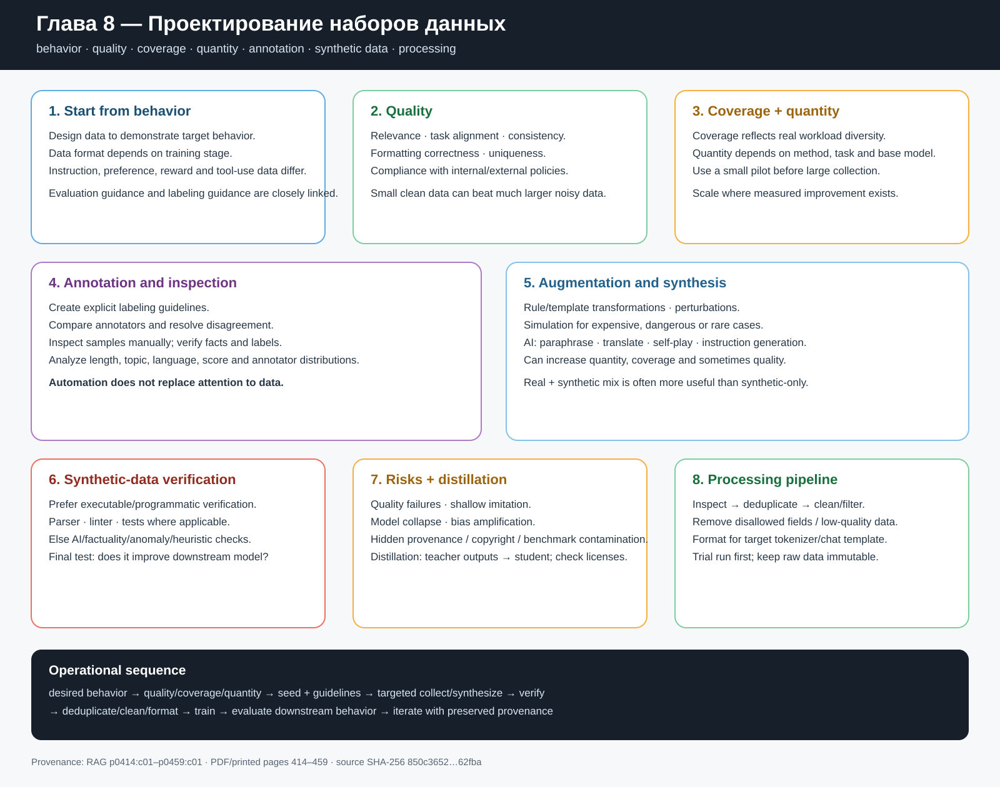

# Глава 8 — Проектирование наборов данных

Практические и концептуальные заметки по главе 8 книги «AI-инженерия. Построение приложений с использованием базовых моделей».

## Идентификация

- Book ID: `ai-engineering-chip-huyen-ru`
- Глава: 8
- Название: «Проектирование наборов данных»
- Slug: `dataset-design`
- Chapter-analysis request: `BIBLIOTEKA-VSP-CHAPTER-ANALYSIS-REQUEST v1.2`
- Artifact collection: `BIBLIOTEKA-VSP-CHAPTER-ARTIFACT-COLLECTION v1.6`
- Readiness contract: `BIBLIOTEKA-VSP-BOOK-READINESS v1.2`
- Source policy: `rag_only`
- External sources: запрещены
- Model memory: запрещена
- Прямой доступ к canonical source: не использовался
- Book-level readiness: `READY` по canonical repository evidence до retrieval главы

## Provenance

- RAG chunks: `p0414:c01`–`p0459:c01`
- Source format: `pdf`
- Source locator range: `PDF pages 414–459`
- PDF page range: `414–459`
- EPUB spine range: `[Not applicable]`
- Printed page range: `414–459`
- `p0414:c01` начинается заголовком «ГЛАВА 8. Проектирование наборов данных».
- `p0458:c01`–`p0459:c01` содержат явный chapter-end раздел «Резюме».
- `p0460:c01` начинается заголовком «ГЛАВА 9. Оптимизация вывода».
- Chapter boundary verified: yes
- Source SHA-256: `850c365211ba0e3d68a8ff8e7d7d48fb95188e24228270d11c0ec954c2062fba`

## Содержимое

- [cheatsheet.md](cheatsheet.md) — operational рамка проектирования, проверки, синтеза и обработки training data.
- [commands.md](commands.md) — source-confirmed tools, processing actions, checks and data-quality methods; shell-команды в главе отсутствуют.
- [diagram.md](diagram.md) — Mermaid-карты dataset lifecycle, synthetic-data validation and processing flow.
- [visual-cheatsheet.svg](visual-cheatsheet.svg) — компактный обзор.
- [visual-cheatsheet-detailed.svg](visual-cheatsheet-detailed.svg) — подробный обзор главы.
- [summary.md](summary.md) — chapter-end «Резюме» из `p0458:c01`–`p0459:c01`.

`review-questions.md` и `review-answers.md` не создавались: после «Резюме» следующий addressable chunk `p0460:c01` начинает главу 9; отдельного блока контрольных вопросов или упражнений в границе главы не обнаружено.

## Карта главы

1. Data-centric AI:
   - качество модели зависит от данных не меньше, чем от архитектуры;
   - улучшать можно модель, данные или оба слоя.
2. Какие данные нужны:
   - self-supervised data;
   - instruction/response pairs;
   - preference data;
   - reward-model data;
   - single-turn vs multi-turn;
   - CoT/tool-use examples.
3. Три главных критерия:
   - качество;
   - охват/разнообразие;
   - количество.
4. Качество данных:
   - relevance;
   - task alignment;
   - consistency;
   - formatting correctness;
   - sufficient uniqueness;
   - compliance.
5. Coverage:
   - покрытие реальных patterns использования;
   - diversity по темам, стилям, языкам, длинам и типам инструкций;
   - composition должен отражать workload.
6. Quantity:
   - нет универсального числа примеров;
   - требования зависят от метода finetuning, сложности задачи и силы base model;
   - небольшой качественный pilot полезен до масштабирования.
7. Сбор и разметка:
   - annotation guidelines;
   - manual validation;
   - cost/data/compute budget;
   - итеративная корректировка разметки.
8. Augmentation и synthesis:
   - rule-based transformations;
   - perturbation;
   - simulation;
   - AI-generated data;
   - translation/paraphrasing;
   - self-play;
   - synthetic instructions.
9. Проверка synthetic data:
   - functional/programmatic verification where possible;
   - AI verifier;
   - factuality checks;
   - heuristic filtering;
   - downstream model improvement as final test.
10. Ограничения synthetic data:
    - quality control;
    - superficial imitation;
    - model collapse;
    - bias amplification;
    - hidden data provenance.
11. Distillation:
    - teacher → synthetic outputs → student;
    - цель часто в более дешевой/быстрой student model;
    - licensing restrictions matter.
12. Data processing:
    - inspect first;
    - deduplicate;
    - clean/filter;
    - remove disallowed fields;
    - format for target model/chat template;
    - avoid in-place mutation;
    - trial-run processing pipelines.

## Краткий анализ главы

Глава 8 делает данные самостоятельным engineering artifact. Центральная идея проста: если модель должна демонстрировать определенное поведение, training dataset должен это поведение показывать. Поэтому проектирование данных начинается не со сбора максимально большого корпуса, а с определения требуемого поведения и критериев качества.

Автор выделяет три сквозных измерения: качество, охват и количество. Они применимы к разным этапам обучения, хотя конкретная форма данных отличается. Для instruction tuning нужны пары «инструкция — ответ», для preference learning — сравнительные или оценочные данные, а для tool-use и multi-turn workflows требуются более сложные структуры.

Качество определяется не одним показателем. В chapter RAG явно выделены релевантность, соответствие задаче, согласованность разметки, корректность форматирования, достаточная уникальность и compliance. Эти характеристики нужно рассматривать до масштабного сбора данных, потому что увеличение объема плохого или несогласованного dataset не исправляет систематическую проблему.

Coverage означает отражение реального workload. Если пользователи пишут длинные и короткие инструкции, используют разные языки, стили, typo-паттерны или типы задач, dataset должен включать эти режимы. Composition dataset можно строить по observed production distribution или выбирать экспериментально, сравнивая resulting model performance.

Количество данных не имеет универсального optimum. Потребность зависит от метода finetuning, сложности задачи и стартовой способности base model. Глава рекомендует сначала провести небольшой pilot: если качественный небольшой набор уже дает заметный improvement, масштабирование данных имеет смысл; если signal отсутствует, простое увеличение объема редко является первым правильным ответом.

Разметка — один из самых дорогих и сложных этапов. Проблема не только в стоимости annotators, но и в создании labeling guidelines. Guidance должен объяснять, что считается хорошим результатом и как различать близкие оценки. Несогласованная разметка способна запутать модель; поэтому disagreement между annotators нужно измерять и разбирать.

Синтетические данные рассматриваются не как автоматически качественная замена human data, а как инструмент для увеличения quantity, coverage и иногда quality. Rule-based augmentation, simulation и AI generation позволяют быстро создавать редкие, целевые или труднодоступные примеры. AI особенно удобен для paraphrasing, translation, self-play, instruction generation и имитации API/tool outputs.

Однако synthetic data требует отдельной verification system. Там, где output можно исполнить или проверить программно, chapter приводит сильный паттерн: parser/linter/unit tests → repair → accept only passed examples. Там, где exact verification невозможна, используются AI verifiers, factuality checks, anomaly/heuristic filters и downstream evaluation.

Глава отдельно предупреждает о четырех рисках AI-generated data: низком качестве, поверхностной имитации, model collapse и скрытом происхождении данных. Рекурсивное обучение на собственных outputs может сужать distribution и усиливать bias; provenance uncertainty создает copyright и benchmark-contamination risks.

Distillation — частный случай, где synthetic outputs teacher-модели становятся training data для student. Цель обычно — воспроизвести полезное поведение более крупной модели в меньшей и более дешевой, но chapter напоминает, что licensing terms некоторых моделей запрещают использовать outputs для обучения других моделей.

Последний блок главы переводит эти идеи в data-processing pipeline. Сначала нужно исследовать distributions и provenance, затем выполнять deduplication, cleaning/filtering и formatting. Важное operational правило: не менять source data in place, сохранять originals и сначала запускать processing steps на небольшом subset.

## Основной принцип

`desired behavior → dataset requirements → quality/coverage/quantity → collect/label/synthesize → verify → deduplicate/clean/format → train → evaluate → iterate`.

Dataset quality подтверждается не только внутренними checks, но и тем, улучшает ли он target model на нужном workload.

## Ограничения

- Универсального размера dataset глава не задает.
- Оптимальное соотношение real/synthetic data не определено.
- Synthetic-data quality остается application-specific problem.
- AI-generated data может иметь неизвестное происхождение и лицензионные ограничения.
- Dataset composition и formatting зависят от target model/training stage.
- Shell/CLI runbook для перечисленных tools не приводится.
- Точная storage/versioning/rollback implementation для datasets в главе не задана.
