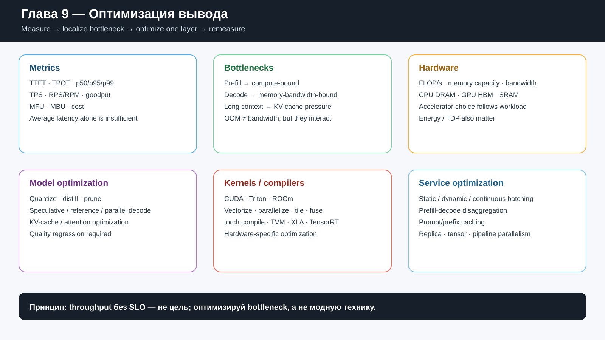
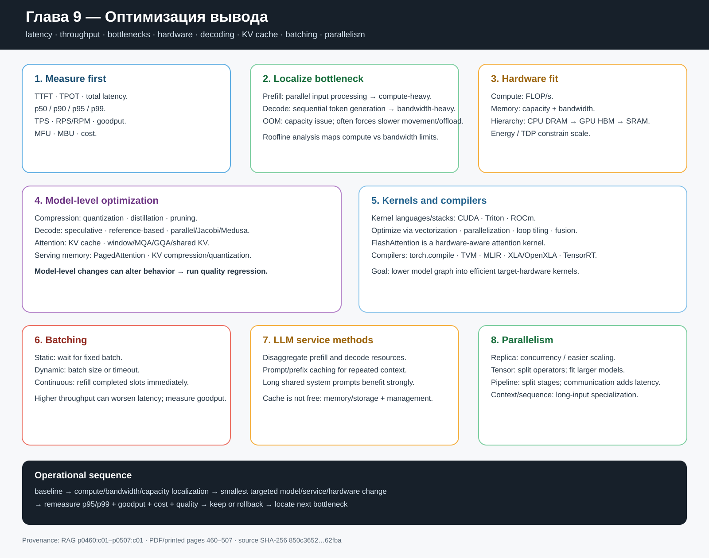

# Глава 9 — Оптимизация вывода

Практические и концептуальные заметки по главе 9 книги «AI-инженерия. Построение приложений с использованием базовых моделей».

## Идентификация

- Book ID: `ai-engineering-chip-huyen-ru`
- Глава: 9
- Название: «Оптимизация вывода»
- Slug: `inference-optimization`
- Chapter-analysis request: `BIBLIOTEKA-VSP-CHAPTER-ANALYSIS-REQUEST v1.2`
- Artifact collection: `BIBLIOTEKA-VSP-CHAPTER-ARTIFACT-COLLECTION v1.6`
- Readiness contract: `BIBLIOTEKA-VSP-BOOK-READINESS v1.2`
- Source policy: `rag_only`
- External sources: запрещены
- Model memory: запрещена
- Прямой доступ к canonical source: не использовался
- Book-level readiness: `READY` по canonical repository evidence до retrieval главы

## Provenance

- RAG chunks: `p0460:c01`–`p0507:c01`
- Source format: `pdf`
- Source locator range: `PDF pages 460–507`
- PDF page range: `460–507`
- EPUB spine range: `[Not applicable]`
- Printed page range: `460–507`
- `p0460:c01` начинается заголовком «ГЛАВА 9. Оптимизация вывода».
- `p0506:c01`–`p0507:c01` содержат явный chapter-end раздел «Резюме».
- `p0508:c01` начинается заголовком «ГЛАВА 10. Архитектура AI-инженерии и обратная связь от пользователей».
- Chapter boundary verified: yes
- Source SHA-256: `850c365211ba0e3d68a8ff8e7d7d48fb95188e24228270d11c0ec954c2062fba`

## Содержимое

- [cheatsheet.md](cheatsheet.md) — operational схема поиска bottleneck и выбора оптимизации.
- [commands.md](commands.md) — source-confirmed metrics, formulas, tools, APIs and optimization actions.
- [diagram.md](diagram.md) — Mermaid-карты inference path, bottleneck localization and optimization flow.
- [visual-cheatsheet.svg](visual-cheatsheet.svg) — компактный обзор.
- [visual-cheatsheet-detailed.svg](visual-cheatsheet-detailed.svg) — подробный обзор главы.
- [summary.md](summary.md) — chapter-end «Резюме» из `p0506:c01`–`p0507:c01`.

`review-questions.md` и `review-answers.md` не создавались: после «Резюме» следующий addressable chunk `p0508:c01` начинает главу 10; отдельного блока контрольных вопросов или упражнений в границе главы не обнаружено.

## Карта главы

1. Основы inference:
   - inference server;
   - inference service;
   - online / batch workload;
   - streaming.
2. Bottleneck classes:
   - compute-bound;
   - memory-bandwidth-bound;
   - memory-capacity/OOM as related but distinct constraint.
3. LLM phases:
   - prefill — преимущественно compute-bound;
   - decode — преимущественно memory-bandwidth-bound.
4. Performance metrics:
   - end-to-end latency;
   - TTFT;
   - TPOT / TBT / ITL;
   - p50/p90/p95/p99;
   - throughput TPS/RPS/RPM;
   - goodput;
   - MFU;
   - MBU.
5. Hardware:
   - FLOP/s;
   - memory capacity/bandwidth;
   - CPU DRAM / GPU HBM / on-chip SRAM;
   - energy / TDP;
   - accelerator choice by workload.
6. Model-level optimization:
   - quantization;
   - distillation;
   - pruning;
   - speculative decoding;
   - reference-based decoding;
   - parallel decoding.
7. Attention optimization:
   - KV cache;
   - local/window attention;
   - multi-query/grouped-query/cross-layer sharing;
   - PagedAttention;
   - KV-cache compression/quantization;
   - FlashAttention.
8. Kernels and compilers:
   - CUDA;
   - Triton;
   - ROCm;
   - vectorization;
   - parallelization;
   - loop tiling;
   - operator fusion;
   - torch.compile;
   - Apache TVM;
   - MLIR;
   - XLA/OpenXLA;
   - TensorRT.
9. Service-level optimization:
   - static/dynamic/continuous batching;
   - prefill/decode disaggregation;
   - prompt/prefix caching.
10. Parallelism:
    - replica parallelism;
    - tensor parallelism;
    - pipeline parallelism;
    - context parallelism;
    - sequence parallelism.

## Краткий анализ главы

Глава 9 рассматривает inference как отдельную системную дисциплину. Главная мысль: оптимизация начинается не с выбора популярной техники, а с измерения bottleneck. Если workload ограничен вычислениями, нужны другие меры, чем при ограничении пропускной способностью памяти.

Для autoregressive LLM автор разделяет inference на prefill и decode. Prefill обрабатывает input tokens параллельно и обычно compute-bound. Decode генерирует токены последовательно и часто memory-bandwidth-bound, потому что на каждом шаге приходится перемещать большие weight matrices. Это объясняет, почему TTFT и TPOT нужно измерять отдельно.

Latency нельзя оценивать только средним значением. Глава рекомендует percentiles, прежде всего p50, p90, p95 и p99. TTFT отражает время до первого токена, TPOT — скорость последующей генерации. Для agent/CoT systems пользовательский TTFT может быть больше model-level TTFT, если промежуточные действия скрыты.

Throughput связан со стоимостью, но высокий throughput сам по себе не гарантирует хороший UX. Goodput учитывает только запросы, удовлетворяющие SLO, поэтому лучше отражает полезную производительность. MFU и MBU нужны для понимания, насколько эффективно используются compute и memory bandwidth; обычный GPU utilization из `nvidia-smi` не показывает, насколько близко workload к реальной пиковой производительности.

Аппаратный слой рассматривается через FLOP/s, memory capacity, bandwidth и energy. GPU выигрывают на параллельных matrix-heavy workloads, но производительность определяется не только FLOP/s: для memory-bound decode критична пропускная способность HBM и движение данных между уровнями памяти.

Model-level optimization может менять behavior, поэтому требует quality regression. Compression включает quantization, distillation и pruning. Для autoregressive decoding глава описывает speculative decoding: draft model предлагает несколько токенов, target model параллельно проверяет их. Также рассмотрены reference-based и parallel decoding.

Отдельный bottleneck — attention/KV cache. KV cache экономит повторное вычисление key/value vectors, но растет с batch size и sequence length и может занять очень большой объем памяти. Глава рассматривает architectural methods, PagedAttention, KV-cache compression/quantization и hardware-aware attention kernels, включая FlashAttention.

Kernels и compilers связывают model graph с конкретным hardware. Источник выделяет vectorization, parallelization, loop tiling и operator fusion. Компиляторы вроде `torch.compile`, TVM, MLIR, XLA/OpenXLA и TensorRT понижают high-level model operations в hardware-specific kernels.

Service-level optimization обычно не меняет weights и поэтому меньше рискует изменить quality. Batching увеличивает throughput ценой latency. Continuous batching позволяет сразу возвращать завершившиеся requests и заполнять освободившиеся slots. Prefill/decode disaggregation разделяет две фазы на разные instances с разными resource profiles.

Prompt/prefix caching полезен там, где requests имеют длинные повторяющиеся prefixes: system prompts, документы, история диалога. Это уменьшает повторную обработку, но расходует memory/storage и требует отдельной реализации или поддержки inference provider.

Parallelism выбирается по constraints. Replica parallelism проще и увеличивает concurrency. Tensor parallelism позволяет обслуживать большую модель и снижать latency, но добавляет communication overhead. Pipeline parallelism также позволяет разделить модель, но может увеличить per-request latency. Context/sequence parallelism ориентированы на длинные input sequences.

## Основной принцип

`measure workload → classify bottleneck → choose model/service/hardware optimization → remeasure latency/throughput/cost/quality → keep only verified improvement`.

Оптимизация без baseline и SLO легко переносит bottleneck, ухудшает latency или меняет model behavior.

## Ограничения

- Конкретные hardware/examples отражают состояние на момент написания книги.
- Оптимальные TTFT/TPOT/throughput значения зависят от workload и UX.
- MFU/MBU нельзя оценивать вне контекста model/hardware/workload.
- Model-level optimization может менять output quality.
- Service-level optimization тоже может влиять на latency trade-offs, даже если model weights не меняются.
- Точные deployment/rollback procedures для inference stack зависят от implementation и в главе не заданы.
