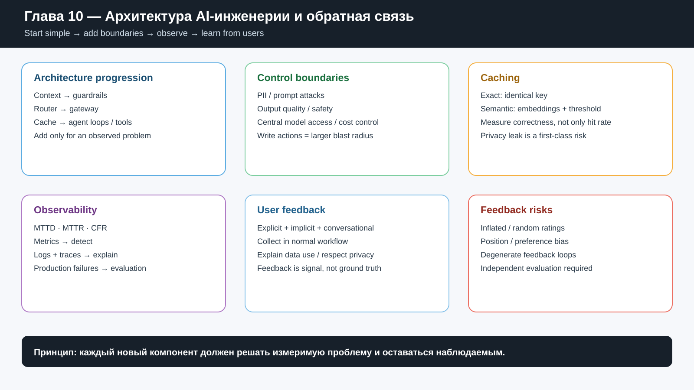
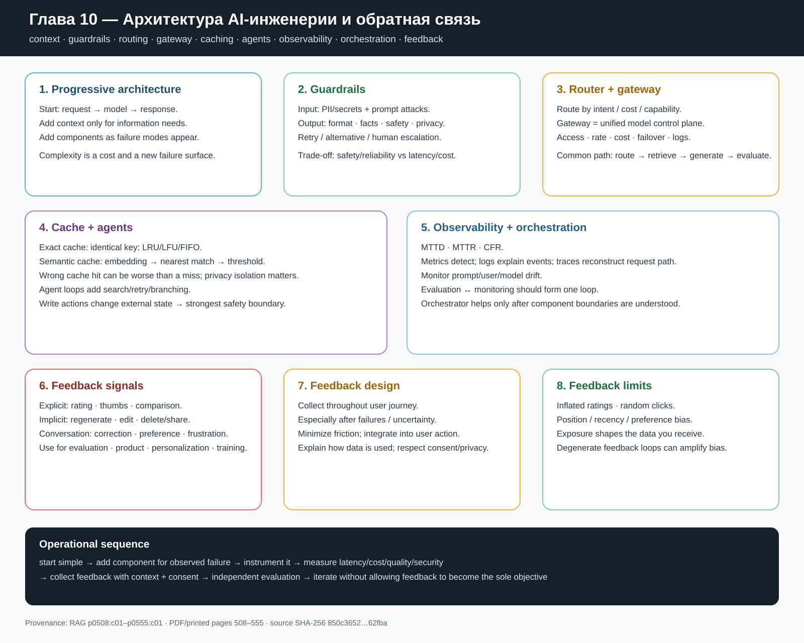

# Глава 10 — Архитектура AI-инженерии и обратная связь от пользователей

Практические и концептуальные заметки по главе 10 книги «AI-инженерия. Построение приложений с использованием базовых моделей».

## Идентификация

- Book ID: `ai-engineering-chip-huyen-ru`
- Глава: 10
- Название: «Архитектура AI-инженерии и обратная связь от пользователей»
- Slug: `ai-engineering-architecture-user-feedback`
- Chapter-analysis request: `BIBLIOTEKA-VSP-CHAPTER-ANALYSIS-REQUEST v1.2`
- Artifact collection: `BIBLIOTEKA-VSP-CHAPTER-ARTIFACT-COLLECTION v1.6`
- Readiness contract: `BIBLIOTEKA-VSP-BOOK-READINESS v1.2`
- Source policy: `rag_only`
- External sources: запрещены
- Model memory: запрещена
- Прямой доступ к canonical source: не использовался
- Book-level readiness: `READY` по canonical repository evidence до retrieval главы

## Provenance

- RAG chunks: `p0508:c01`–`p0555:c01`
- Source format: `pdf`
- Source locator range: `PDF pages 508–555`
- PDF page range: `508–555`
- EPUB spine range: `[Not applicable]`
- Printed page range: `508–555`
- `p0508:c01` начинается заголовком «ГЛАВА 10. Архитектура AI-инженерии и обратная связь от пользователей».
- `p0554:c01`–`p0555:c01` содержат явный chapter-end раздел «Резюме».
- `p0556:c01` начинается заголовком «Эпилог».
- Chapter boundary verified: yes
- Source SHA-256: `850c365211ba0e3d68a8ff8e7d7d48fb95188e24228270d11c0ec954c2062fba`

## Содержимое

- [cheatsheet.md](cheatsheet.md) — operational схема постепенного построения AI-приложения, observability и feedback loop.
- [commands.md](commands.md) — source-confirmed tools, components, code patterns and actions; shell-runbook в главе отсутствует.
- [diagram.md](diagram.md) — Mermaid-карты архитектуры, observability и feedback lifecycle.
- [visual-cheatsheet.svg](visual-cheatsheet.svg) — компактный обзор.
- [visual-cheatsheet-detailed.svg](visual-cheatsheet-detailed.svg) — подробный обзор главы.
- [summary.md](summary.md) — chapter-end «Резюме» из `p0554:c01`–`p0555:c01`.

`review-questions.md` и `review-answers.md` не создавались: после «Резюме» следующий addressable chunk `p0556:c01` начинает эпилог; отдельного блока контрольных вопросов или упражнений в границе главы не обнаружено.

## Карта главы

1. Постепенная архитектура AI-приложения:
   - minimal request → model → response;
   - context expansion;
   - guardrails;
   - model router + model gateway;
   - caching;
   - agentic loops and write actions;
   - monitoring/observability;
   - orchestration.
2. Context construction:
   - text/image/tabular retrieval;
   - tools/APIs;
   - provider-specific limits;
   - external information as part of model input.
3. Guardrails:
   - input leakage/PII protection;
   - prompt-attack mitigation;
   - output quality/safety checks;
   - retries, parallel alternatives and human escalation;
   - latency/safety trade-offs.
4. Routing:
   - intent classification;
   - specialized models;
   - cheap vs expensive models;
   - out-of-scope handling;
   - common pattern: route → retrieve → generate → evaluate.
5. Model gateway:
   - unified interface;
   - access control;
   - cost/rate control;
   - failover/retries;
   - load balancing;
   - logging/analytics;
   - optional caching/guardrails.
6. System caching:
   - exact caching;
   - semantic caching;
   - LRU/LFU/FIFO;
   - personalization/privacy hazards;
   - similarity-threshold risk.
7. Agent patterns:
   - loops;
   - parallel branches;
   - conditional routing;
   - write actions;
   - higher capability with larger blast radius.
8. Monitoring/observability:
   - MTTD;
   - MTTR;
   - CFR;
   - failure-oriented metrics;
   - logs;
   - traces;
   - drift detection;
   - evaluation ↔ monitoring feedback.
9. Orchestration:
   - define components;
   - compose chain;
   - validate data contracts;
   - branch/parallel/error handling;
   - avoid premature orchestration.
10. User feedback:
    - explicit vs implicit;
    - natural-language corrections/preferences;
    - regeneration;
    - conversation organization;
    - conversation length/diversity;
    - comparative feedback.
11. Feedback design:
    - collect throughout user journey;
    - especially at failures and uncertainty;
    - minimize friction;
    - explain data use;
    - respect privacy.
12. Feedback limitations:
    - inflated ratings;
    - random feedback;
    - position bias;
    - preference/recency bias;
    - degenerate feedback loops;
    - sycophancy/behavioral drift.

## Краткий анализ главы

Глава 10 собирает предыдущие методы книги в системную архитектуру. Важный architectural rule: не начинать с «полной платформы». Сначала минимальный путь `request → model → response`, затем добавлять компоненты только тогда, когда появляется конкретная проблема, которую этот компонент решает.

Первое расширение — context construction. Система получает доступ к внешним данным и инструментам, чтобы формировать релевантный контекст для запроса. Это связывает архитектуру с RAG и tool use из главы 6 и вводит первый новый failure domain: качество retrieval/tool outputs и ограничения сторонних provider APIs.

Guardrails рассматриваются как boundary вокруг input и output. Input guardrails уменьшают риск утечки PII/секретов и вредоносных запросов; output guardrails выявляют format, factuality, safety и privacy failures. Важный компромисс — reliability/security против latency и cost. Retry может исправить probabilistic failure, но каждый повторный model call увеличивает задержку и стоимость. Human escalation остается допустимым fallback для сложных случаев.

Router решает, куда направить request: специализированной модели, дешевому model tier, retrieval, человеку или out-of-scope handler. Это превращает model selection в runtime decision. Типовой source pattern — `routing → retrieval → generation → evaluation`.

Model gateway создает центральную control plane точку между приложениями и моделями. Он скрывает различия provider APIs, централизует access control, usage/cost policies, failover, logging и может включать caching/guardrails. Для инфраструктурного мышления это security boundary: приложения не получают прямой доступ к provider credentials; они работают через контролируемый gateway.

Caching разделен на exact и semantic. Exact cache безопаснее интерпретировать: reuse происходит только для идентичного ключа. Semantic cache повышает hit rate за счет embeddings/similarity, но может вернуть incorrect cached answer при ошибочном similarity match. Особенно опасен cache poisoning/privacy leak, когда персонализированный ответ ошибочно классифицирован как общий и возвращен другому пользователю.

Agent patterns увеличивают capability за счет loops, branching и write actions. Одновременно растет число failure modes и сложность трассировки. Write actions являются наиболее сильной границей риска, поскольку система начинает менять внешнюю среду, а не только генерировать текст.

Наблюдаемость должна проектироваться вместе с системой. Monitoring отвечает на вопрос «что ухудшилось», observability — «почему». Source предлагает связывать evaluation и production monitoring: evaluation metrics должны переноситься в monitoring, а production failures — возвращаться в evaluation corpus. MTTD, MTTR и CFR дают системный взгляд на обнаружение и восстановление.

Metrics выбираются от failure modes, а не наоборот. Если риск — hallucination, нужен сигнал, связанный с groundedness; если риск — budget exhaustion, нужны token/cost/cache metrics. Metrics дают агрегированное состояние, logs — события, traces — end-to-end path запроса через components, retrieved documents, tool calls, model calls, latency и cost.

Оркестратор полезен только после того, как архитектура понятна. Он определяет components и chain, обеспечивает data flow, branching, parallel execution и error handling. Source отдельно предупреждает: раннее добавление orchestration framework может скрыть важные системные детали и затруднить debugging.

Вторая половина главы трактует user feedback как production data source. Explicit feedback проще интерпретировать, но оно редкое и biased. Implicit feedback дешевле собирать: regeneration, deletion, rename/share/bookmark, conversation length, edits and actions can signal success/failure, но интерпретация зависит от контекста.

Conversational interface дает richer natural-language feedback: пользователь может явно исправить модель, уточнить предпочтение, попросить более короткий ответ или сообщить, что результат неверен. Эти данные можно использовать для evaluation, product development и personalization, но только с учетом privacy и согласия.

Feedback mechanism должен быть частью user workflow, а не отдельной бюрократической формой. Наиболее сильный signal возникает, когда действие пользователя одновременно помогает ему решить задачу и сообщает системе, какой output полезен. Однако feedback не является ground truth: inflated ratings, random clicks, position bias, recency and preference bias distort signals.

Наиболее опасный системный риск — degenerate feedback loop: model outputs влияют на то, что пользователи видят; user feedback обучает следующую model iteration; initial bias усиливается. Поэтому feedback-driven optimization требует controlled evaluation, exposure analysis и независимых quality/safety criteria.

## Основной принцип

`start simple → add a component only for an observed problem → instrument every boundary → collect feedback with consent → close evaluation/monitoring/data loops without letting feedback become the sole objective`.

Сложность должна быть оправдана измеримой функцией, безопасностью или эффективностью.

## Ограничения

- Архитектура является high-level pattern, а не обязательным topology blueprint.
- Границы router/gateway/guardrail/orchestrator могут перекрываться.
- Конкретные provider/tool examples отражают состояние на момент написания книги.
- Exact retry/failover, authorization, retention and rollback policies зависят от implementation и остаются `[Needs confirmation]`.
- Semantic cache требует application-specific similarity validation.
- Неявный user feedback является noisy signal, а не ground truth.
- Privacy/consent requirements зависят от продукта и политики; chapter не задает универсальную юридическую процедуру.
