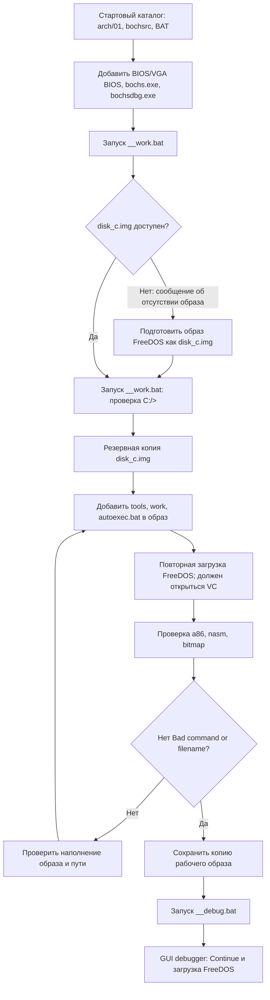

# Глава 1 — логика подготовки среды

**Источник:** `rag/chunks/p0001-p0100/p0015-c01.md`–`p0019-c01.md` (PDF p. 15–19). Схема отражает последовательность книги, не является универсальным troubleshooting playbook.

**Boundary:** `gui_debug` добавляется только к конфигурации `bochsdbg.exe` через `debug_on.txt`; не делать его постоянной опцией общего `bochsrc` (p. 18).

**Риски:** операции удаления каталога и форматирование USB из p. 16–18 не автоматизированы на схеме. Процедуры возврата для них в RAG не расписаны: [Needs confirmation].
