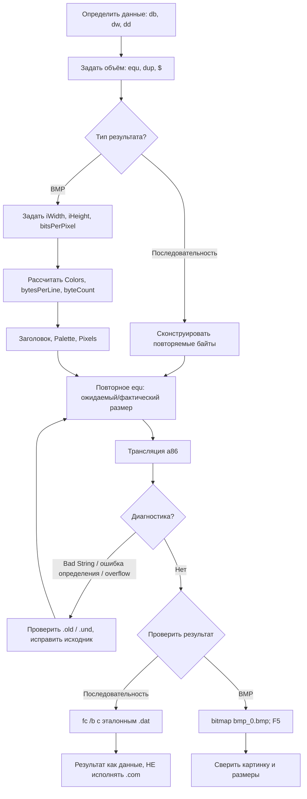

# Диаграмма главы 2 — от исходных данных к проверенным байтам

**Источник:** RAG PDF p. 21–30, `p0021:c01`–`p0030:c01`. Это учебная последовательность главы, а не универсальный алгоритм других ассемблеров.

## Структурные инварианты

1. `sz equ $ - seq` сверяет объём повторённой последовательности (p. 23).
2. Для BMP `Colors` сопоставляется с `($ - Palette) / 4`, `zero` с остатком от деления размера палитры на 4, `byteCount` с `$ - Pixels` (p. 27–28).
3. При расширении 1 → 4 → 8 бит на пиксель меняются и число цветов, и количество данных на пиксель: одной правки `bitsPerPixel` недостаточно (p. 28–29).

## Отдельно о безопасности

`a86` может изменять входной файл при ошибках, а data-only COM опасно запускать как исполняемую программу. Ветвь «исправить исходник» предполагает сохранение исходной версии до опытов; точный rollback — [Needs confirmation].
