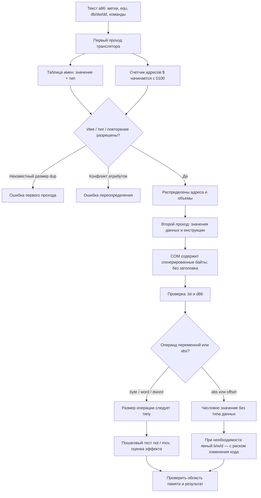

# Глава 3 — схема работы a86 с именами и типами

**Источник:** канонические RAG-чанки `p0031:c01`–`p0055:c01`, PDF 31–55. Схема отражает текст главы.

## Логические инварианты

- **Имя переменной = адрес + тип**; при `byte1` и `word1` адресная арифметика может указывать на один адрес, но `not` затронет разные объёмы (p. 40–44).
- **Проход 1** узнаёт размеры, формирует `$`, вычисляет `equ`; **проход 2** генерирует значения байтов и коды (p. 46–49). Размер `dup` должен быть известен на первом проходе.
- В a86 повторное определение допускается лишь при прежних значении и типе; отдельный режим локальных имён `>l1` допускает последующее переопределение (p. 50–51).
- Встроенные `ax/mov/b/w/d` нельзя вводить повторно; `end` особо опасен (p. 52–53).

**Безопасность:** не исполнять data-only COM; при опытах с `not` выполнять только контролируемый single step и наблюдать последствия. Процедура rollback в главе не дана: [Needs confirmation].
