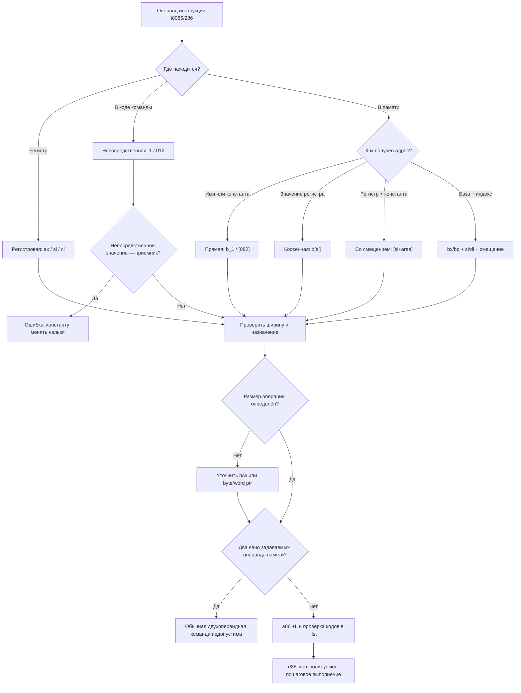
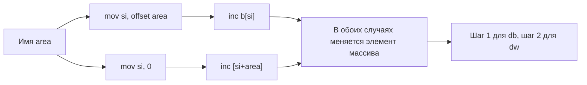

# Глава 4 — выбор способа адресации

**Источник:** canonical RAG `p0057:c01`–`p0068:c01`, PDF p. 57–68. Схема основана на разделе «Способы адресации операндов» и листингах 4.3–4.15.

## Различие способов обхода массива

**Ограничения модели:** для i8086/286 косвенно доступны `si/di/bx/bp`; пара — база `bx/bp` и индекс `si/di` (p. 64, 66). При прямой адресации `not [082]` размер неопределён (p. 61). Непосредственный операнд не может быть приёмником (p. 60). `movsw` отличается неявным заданием обоих адресов памяти (p. 67).

**Безопасность:** схема диагностическая; шаги `inc`/ручное изменение PSP записывают данные, а показанные в главе циклы `jmp l1` не имеют условия останова.
