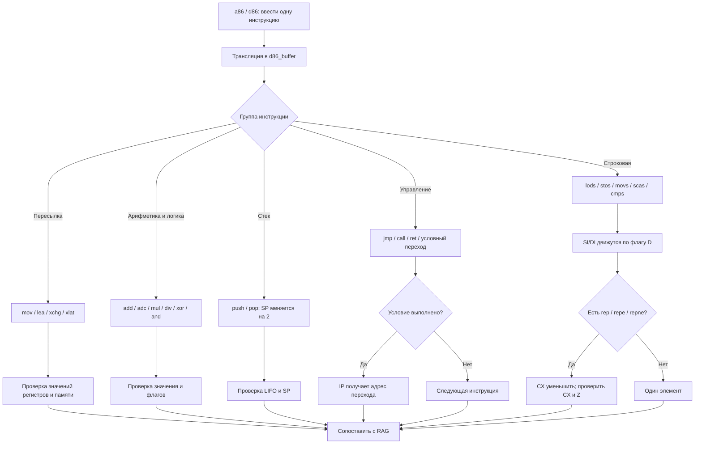
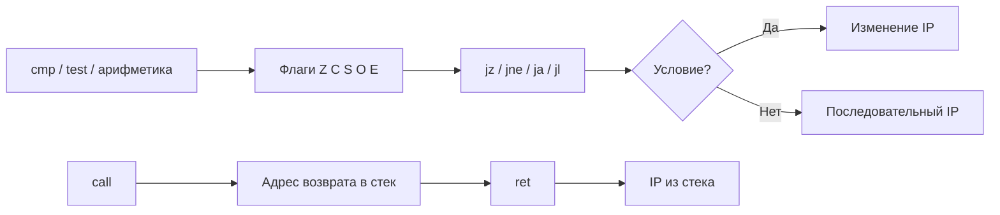

# Глава 5 — диаграммы исполнения команд i8086

**RAG:** PDF 69–84, чанки `p0069:c01`–`p0084:c01`. Схемы реконструированы из описаний автора, не являются результатом запуска `d86`.

## Флаги и переходы

**Системные инварианты:** `inc/dec` не меняют `c` (p. 81); `loop` изменяет `cx` перед проверкой (p. 79); `repne scasb` может найти совпадение на последнем элементе при `cx=0` (p. 83). Знаковое и беззнаковое сравнение при `0ff` различаются (p. 78).

**Предохранитель:** непосредственные команды перехода в `d86` могут обойти буферную точку останова. Для исследования использовать `exa2.8` с `m1–m7` и `int 3` (p. 75–77). Процедура отката **[Needs confirmation]**.
