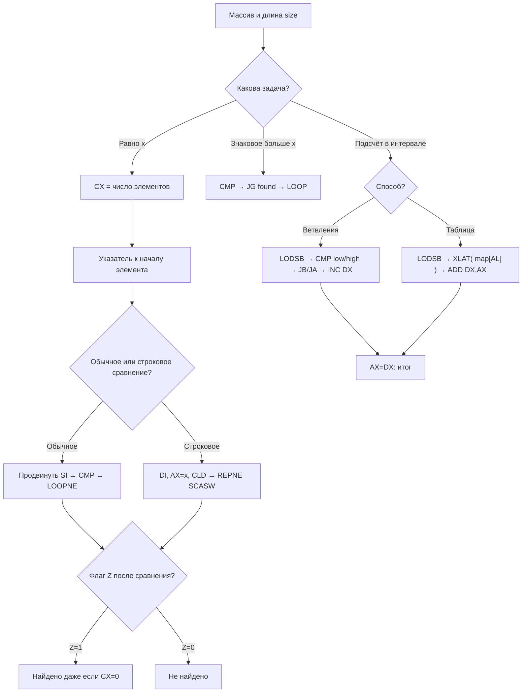
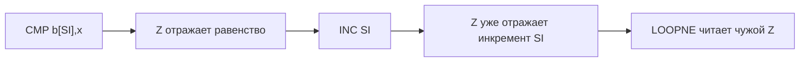

# Глава 6 — схема поиска и подсчёта в циклах

**Основание:** RAG p0085:c01–p0092:c01, PDF 85–92, листинги 6.1–6.9.

## Почему неверен листинг 6.2

**Ограничения:** массив слов требует вдвое меньше повторений и двухбайтового шага (p. 87). `SCASW` опирается на `DI`, а `REPNE` проверяет `CX/Z` (p. 87–88). Условие `JG` не поддерживается семейством `LOOP<x>`, поэтому используется отдельная ветвь (p. 89). В листинге 6.7 исходная подготовка для `SCASB` неясна, см. `source-findings.md`.

**Verification:** учебные тесты — совпадение последним элементом, отсутствие совпадения, совпадение первым элементом; сверять `CX/Z` и ветвление (p. 86). **Rollback:** [Needs confirmation].
