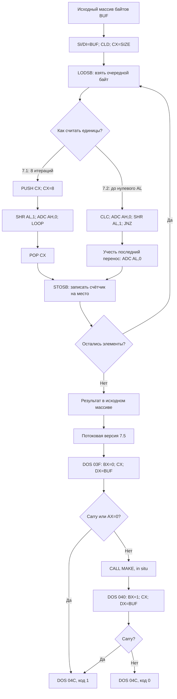
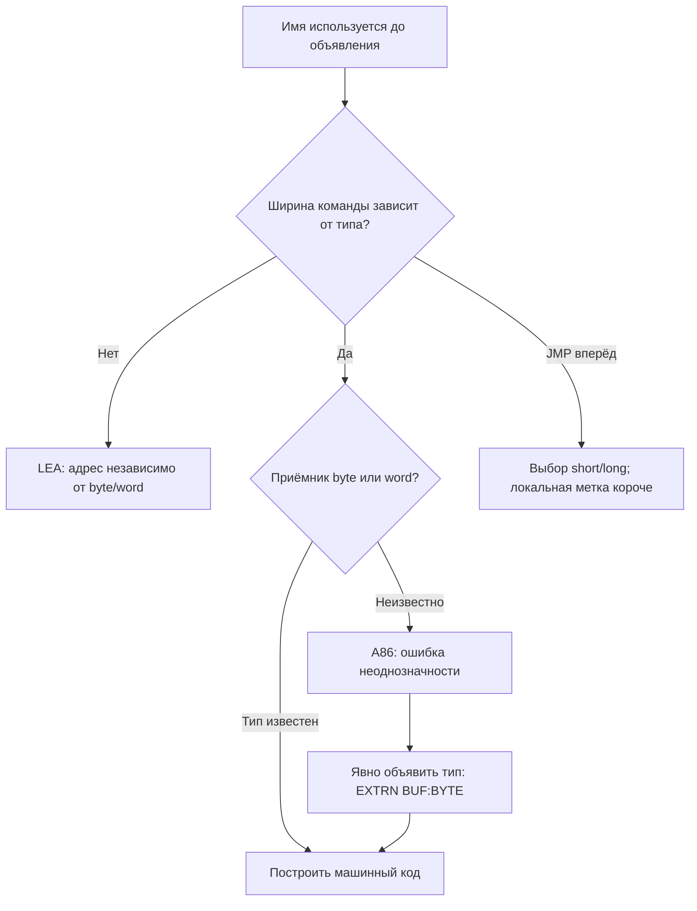
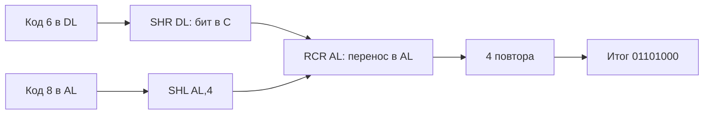

# Глава 7 — диаграмма пути от отладочного массива к программе с потоками

**Основание:** canonical RAG PDF 93–110, листинги 7.1–7.10. Это схема алгоритмов автора, а не результат выполнения команд.

## Условия трансляции опережающих ссылок

## Упаковка четырёхбитовых данных

**Риски и проверка:** `>` обнуляет существующий выходной файл (p. 95). `push cx/pop cx` необходимы, когда оба `loop` используют `cx` (p. 94). Пример 7.5 не содержит подтверждённого цикла повторных чтений потока большего размера (p. 97). `extrn` разрешает неоднозначность типа, но не отменяет двухпроходных ограничений a86 (p. 98–100). **Rollback:** [Needs confirmation].
