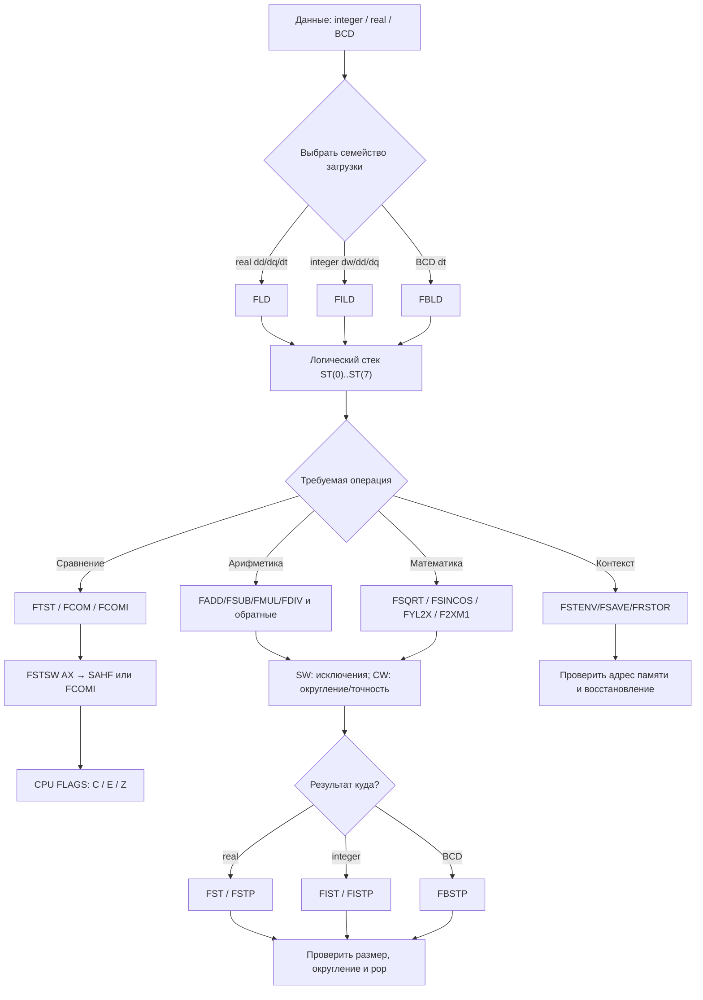
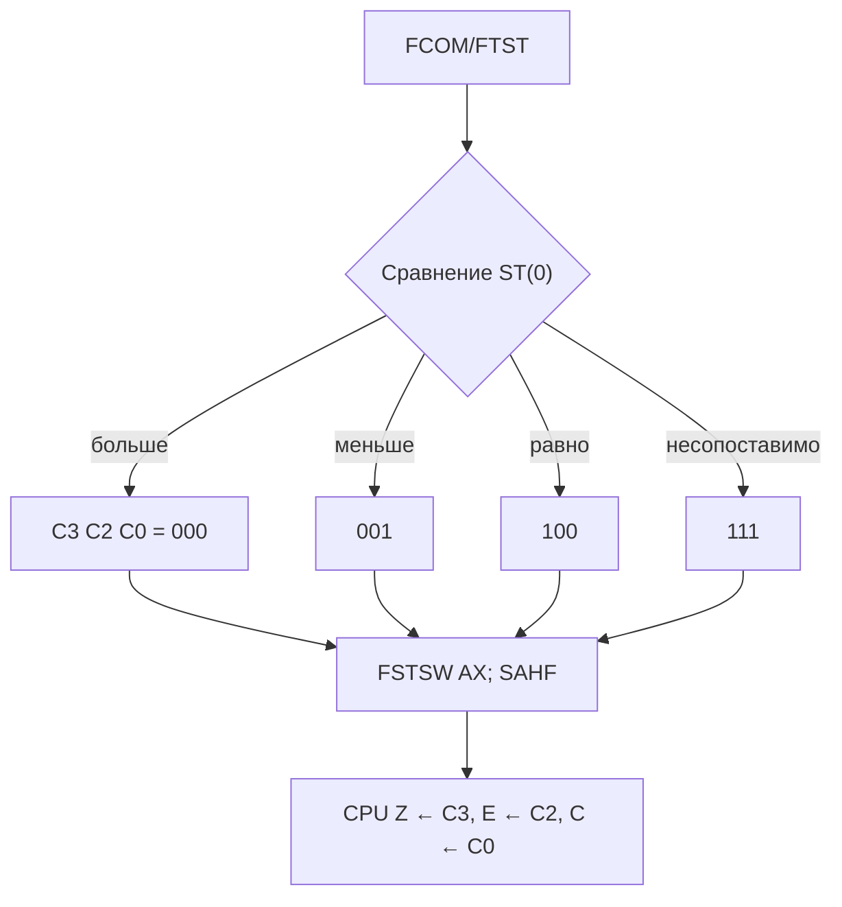

# Глава 8 — концептуальная схема работы FPU

**Источник:** канонический RAG PDF 111–148, p0111:c01–p0148:c01. Это схема механики авторских примеров, не восстановление исходных рисунков и не исполняемый код.

## Постфиксная запись и глубина стека

## Сравнения и флаги

**Частные ограничения:** `fld 2.0` в a86 — макроконстанта, а `fld 2` — номер регистра (p. 112). Безоперандное `fdiv/fsub` использует `st(1)` как первый операнд (p. 114, 131). В `fsave.8` адрес `[0]` — часть PSP COM (p. 143), не типовой буфер. При преобразовании к 32/64 битам могут возникнуть `UE/OE/PE` (p. 122). Для возврата настройки cw можно сохранить её через `fstcw` и восстановить через `fldcw`, но rollback всех данных **[Needs confirmation]**.
