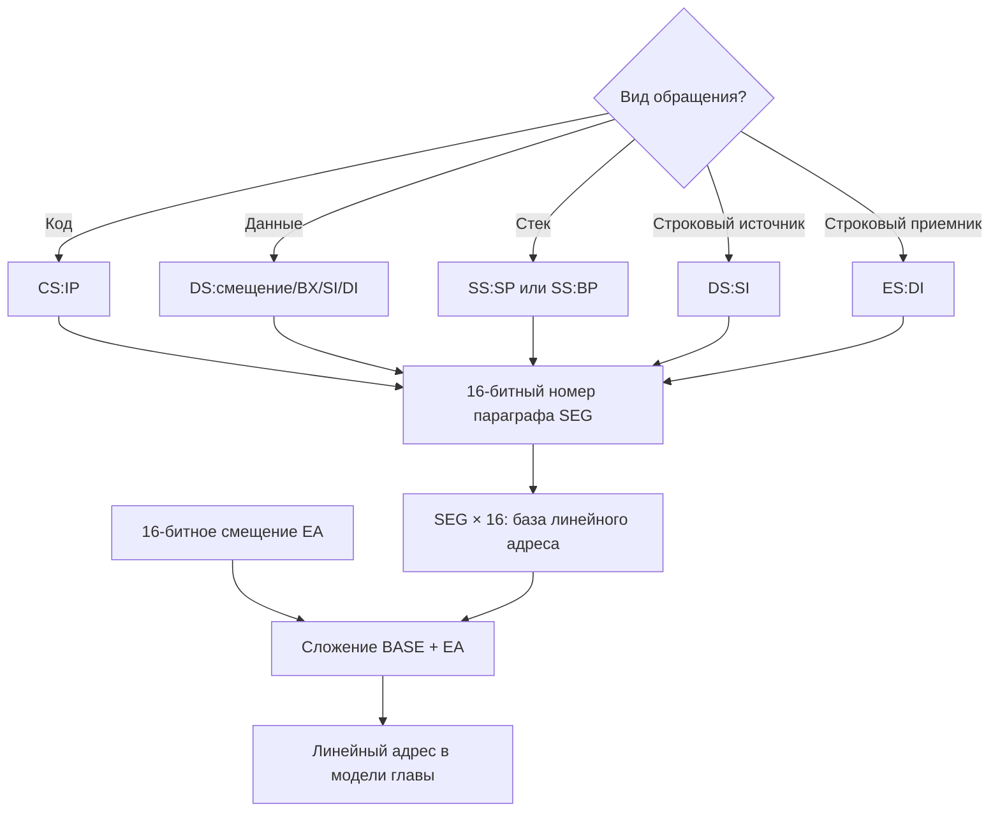
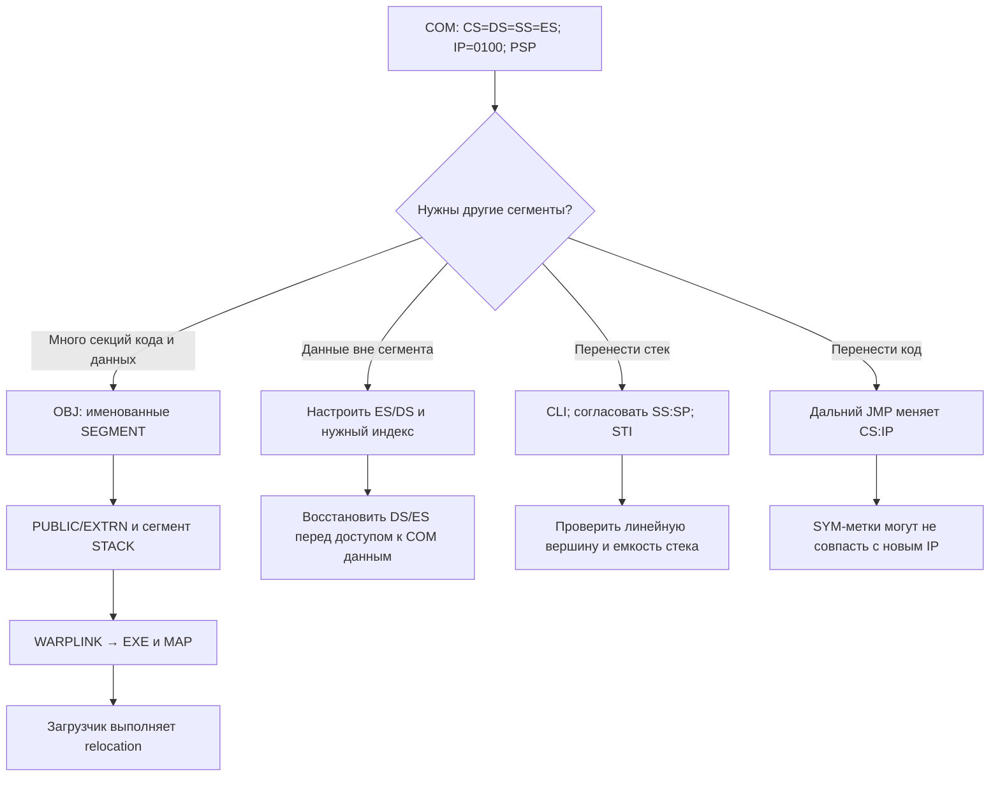
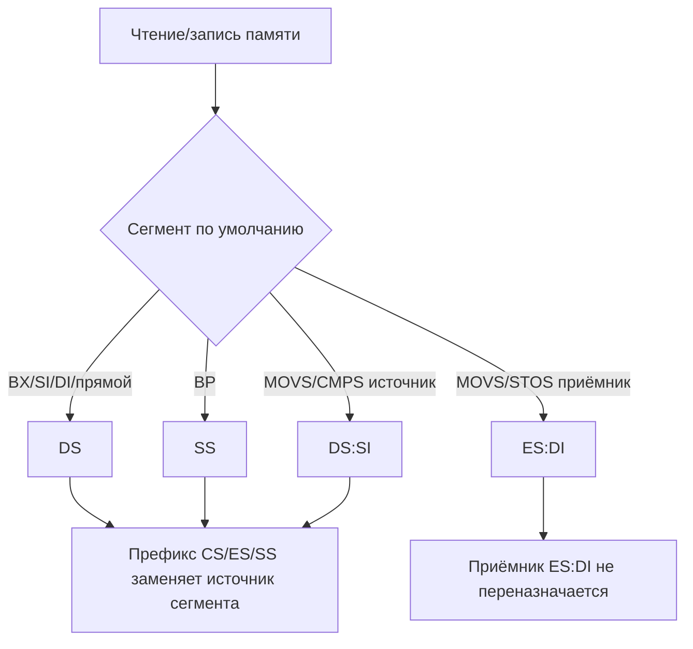

# Глава 9 — архитектура сегментной адресации и путь COM → EXE

**Источник:** PDF 149–176, canonical RAG p0149:c01–p0176:c01. Диаграммы аналитические, не исходные рис. 9.1–9.4.

**Эталонные адреса:** `06312:0107=063227`; `0b800:0c80=0b8c80` (p. 152–155). Вызов `call far` между секциями требует `retf` (p. 163–165). В опытах с `DS` возможна порча PSP или неправильный доступ к коду (p. 159), а `SS:SP` меняет глубину стека (p. 156). Условия опасных опытов с TSR/вектором 0 сохраняются **только как текст заданий**; выполнение и rollback не проверены.
