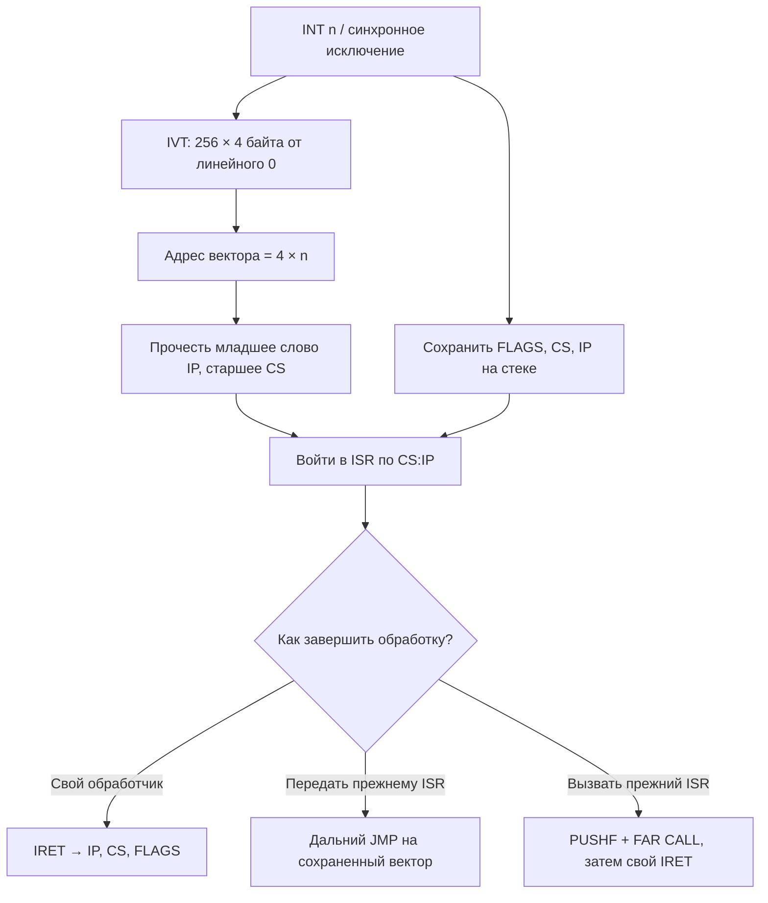
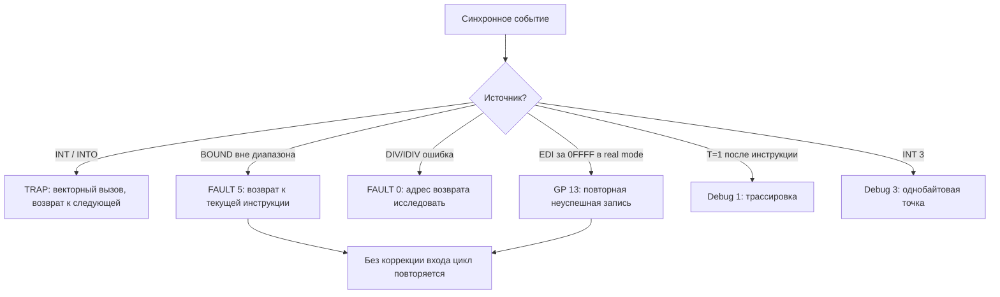
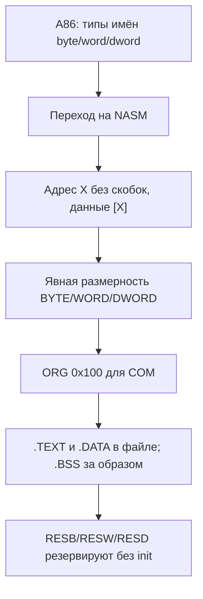

# Глава 10 — схемы механизма исключений

**Provenance:** canonical RAG PDF 177–196, p0177:c01–p0196:c01. Схемы созданы аналитически, не восстановлены из рис. 10.1–10.3.

**Инварианты безопасности:** писать по линейному адресу 0 — значит переписывать системную таблицу векторов; перехват `int 021` требует сохранения старого ISR и непротиворечивого восстановления; fault, у которого сохранён текущий IP, без исправления причины повторяется (p. 182–187). В 10.18 при превышении буфера меняются сохранённые `IP` и `T`, чтобы не остаться в бесконечной трассировке (p. 195–196). Это разбор, не команда на запуск.
