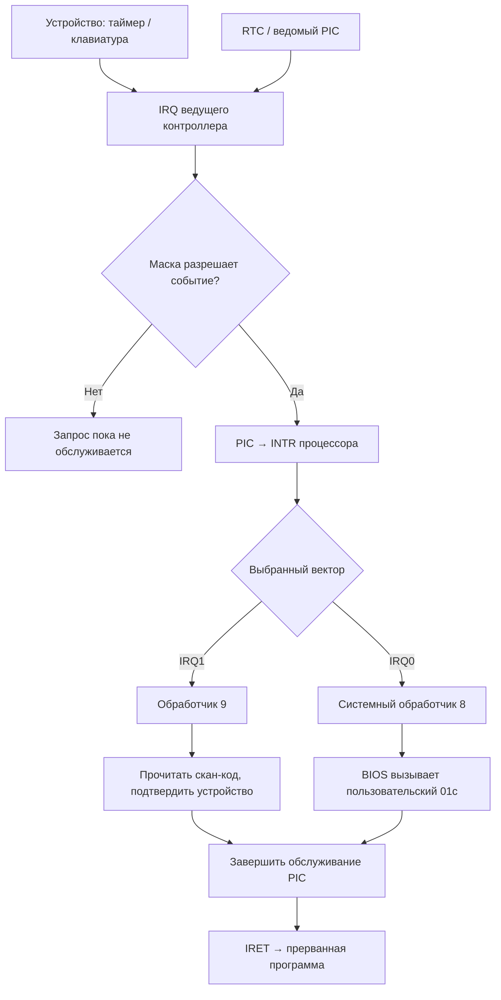
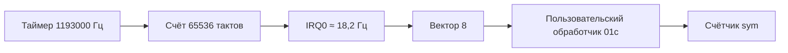
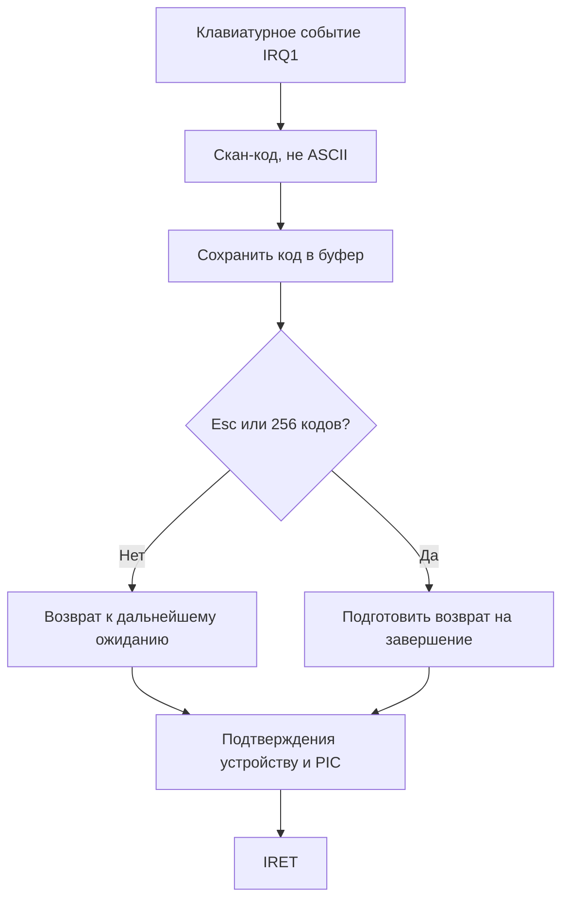

# Глава 11 — концептуальные диаграммы внешних IRQ

**Provenance:** canonical RAG PDF 197–204, p0197:c01–p0204:c01. Схемы не являются восстановлением исходного рис. 11.1.

Реализация из книги зависит от установленного BIOS, PIC и Bochs. Обслуживание внешней IRQ не эквивалентно вызову пользовательского вектора из приложения: контекст, стек и доступность регистров могут различаться. В главе отдельно отмечено неточное моделирование RTC (с. 203). **Запуск и восстановление после изменения системного состояния не проверены**.
