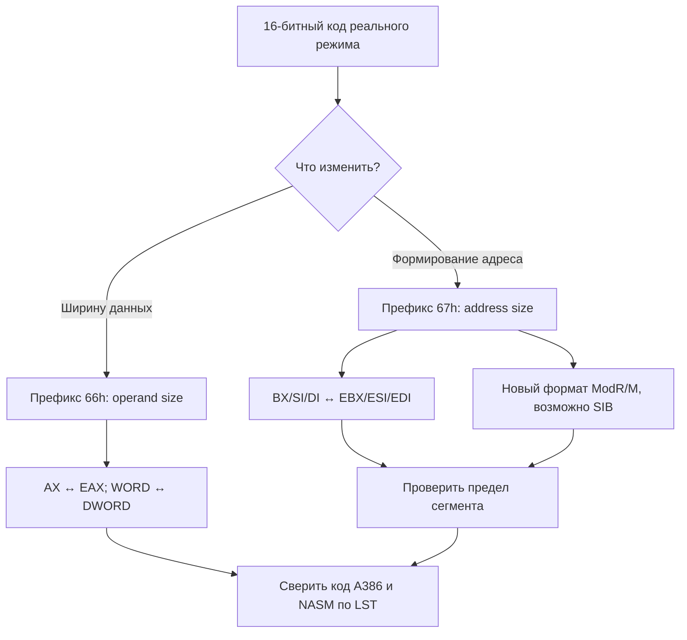
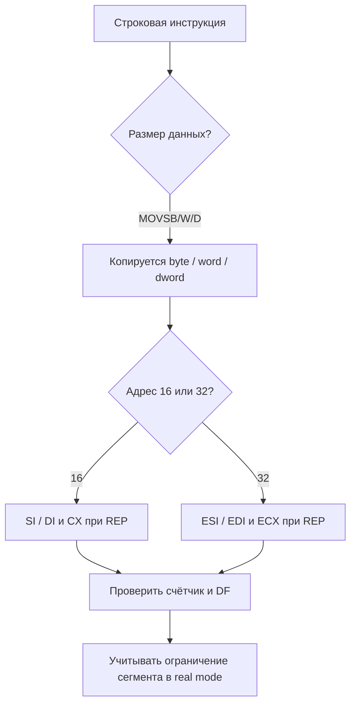
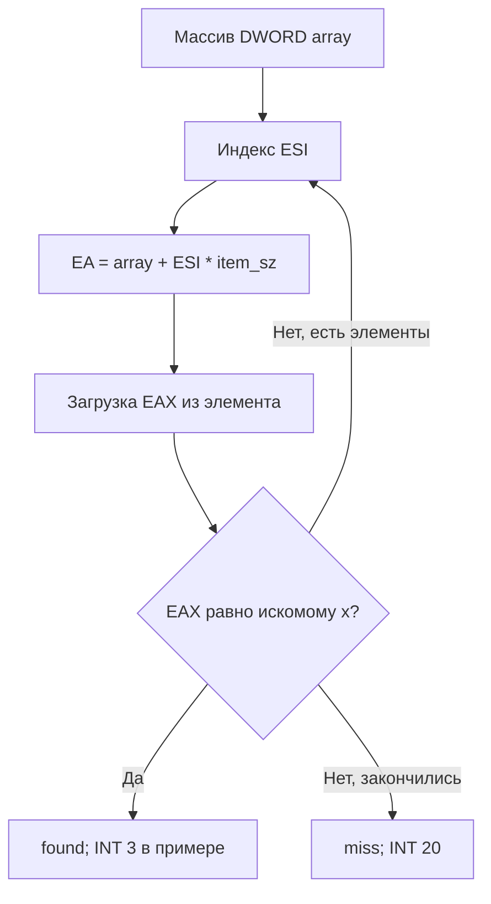
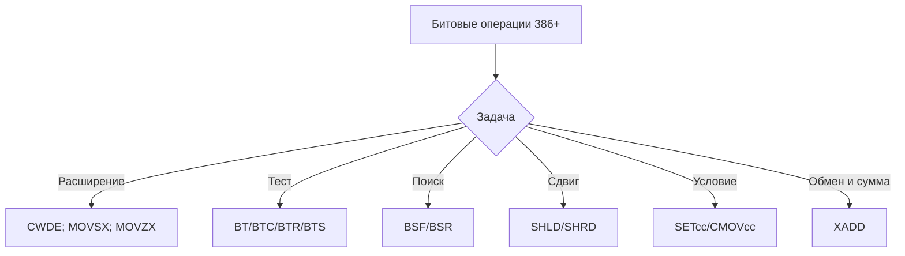

# Глава 12 — схемы 32-битных данных и адресации

**Provenance:** canonical RAG PDF 205–215, p0205:c01–p0215:c01. Это аналитические схемы, а не реконструкция рис. 12.1–12.4.

**Ограничения:** в 12.2 NASM усекает длинный адрес при подразумеваемой 16-битной адресации, хотя автор рассматривает unreal mode отдельно (p. 207); 12.3–12.5 могут провоцировать GP 13 в обычном real mode (p. 208–209). На p. 215 дан несовместимый с собственным описанием `movzx` результат — не представлять его как проверенный. Бинарные исполнения и изображения источника [Needs confirmation].
