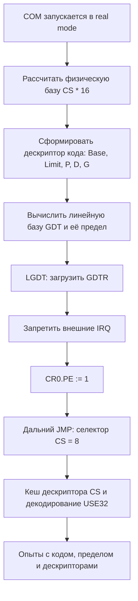
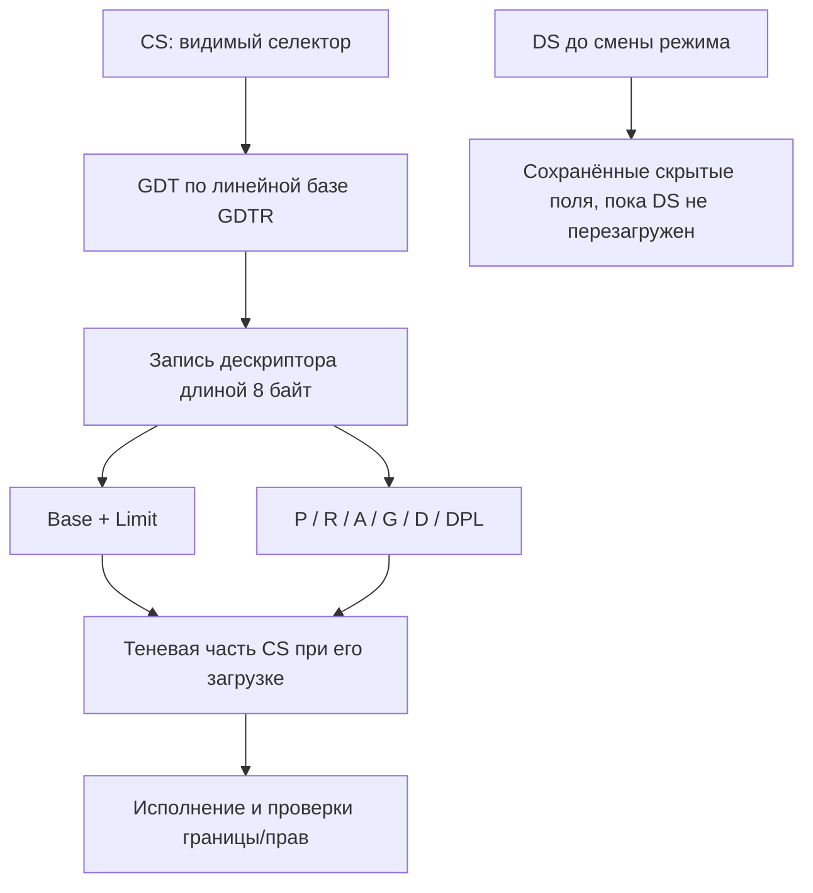
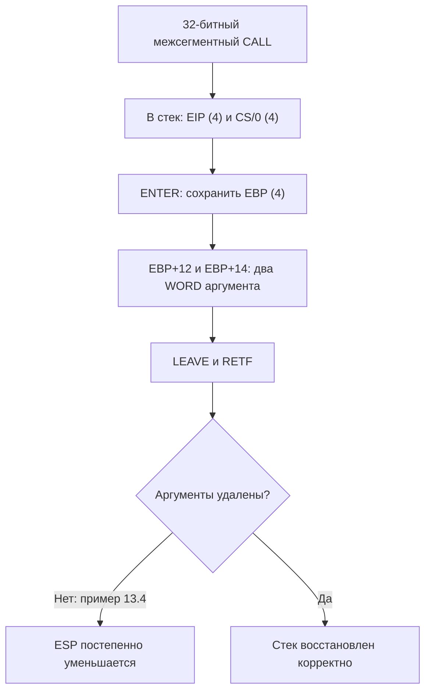
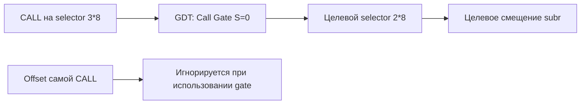

# Глава 13 — логика защищённого режима

**Provenance:** canonical RAG PDF 219–234. Схемы аналитические; внешние рисунки Intel, на которые ссылается автор, не представлены самостоятельными RAG-объектами.

**Неподтверждённое:** выполнение сконструированных программ в Bochs, точные дампы GDT и скрытых регистров, результаты нарушения дескрипторов, обобщённая процедура возврата. Опыты p. 225–227 потенциально останавливают виртуальную машину; показывать их как аналитические сценарии, а не запускать.
