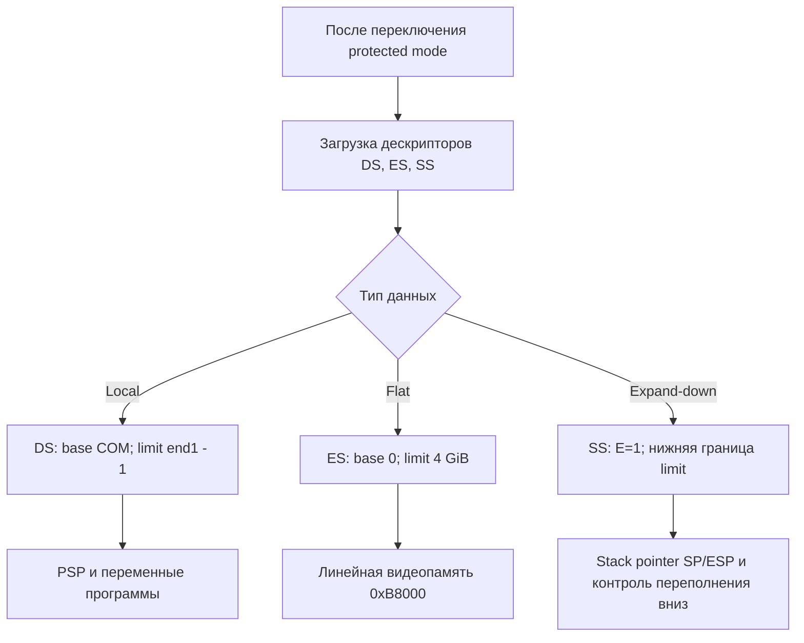
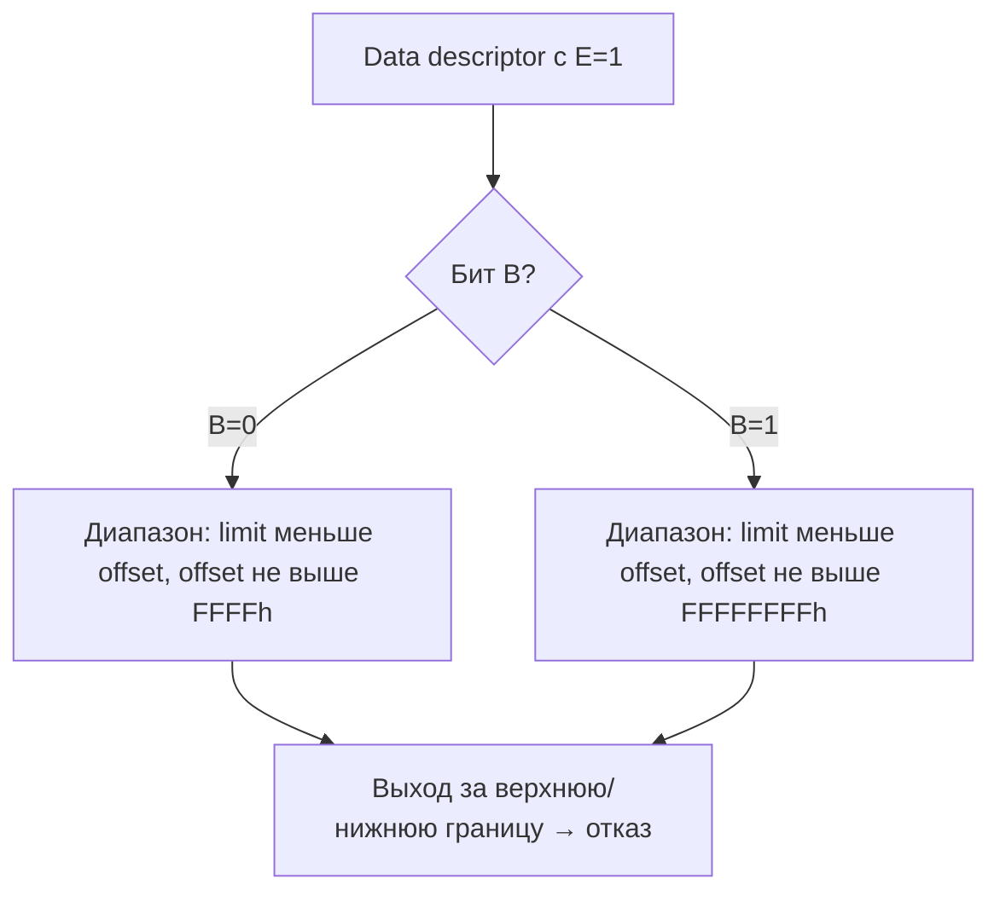
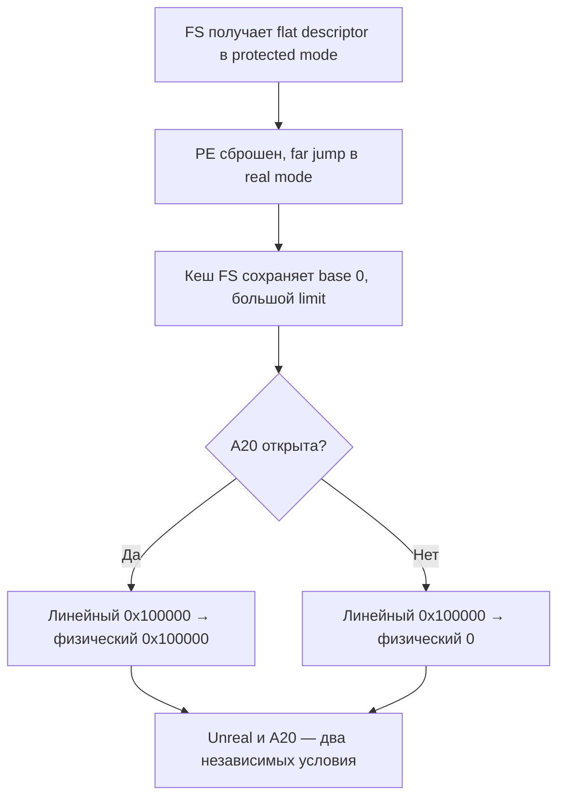
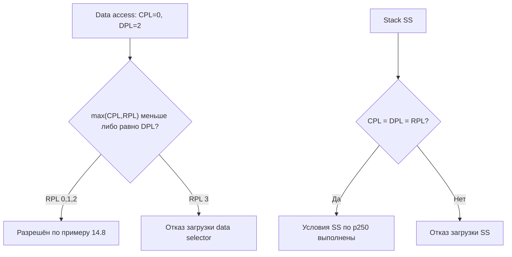

# Глава 14 — схемы сегментов данных, стека и A20

**Источник:** canonical RAG PDF 235–252. Эти диаграммы аналитические, не снимки оригинальных рисунков.

**Контроль источника:** p. 245 содержит опечатку в сравнении («3 меньше 2»), хотя сам код и отказ относятся к `3>2`. Формулировки доступа к flat DS/ES на p.237 требуют осторожности, потому что в коде ES получает базу 0, а DS — базу COM. Эти расхождения внесены в [source-findings.md](source-findings.md).

**Безопасность:** ни диаграмма, ни глава не дают разрешения изменять физический нулевой адрес, A20 или SS в действующей машине. Проверки только на уровне RAG.
