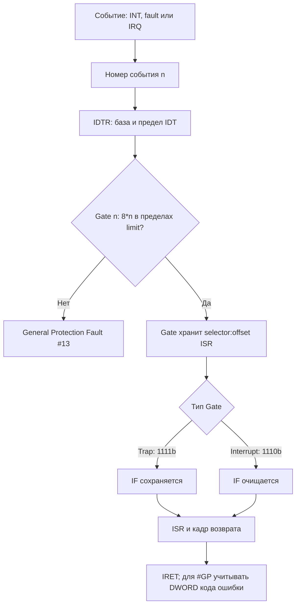
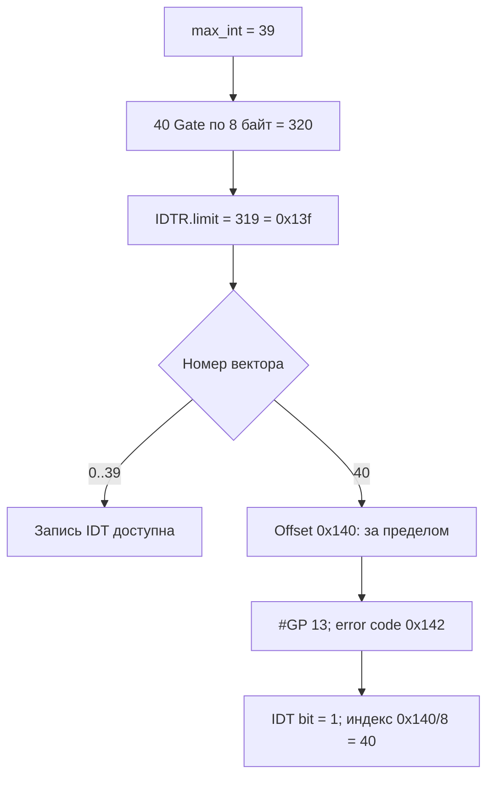
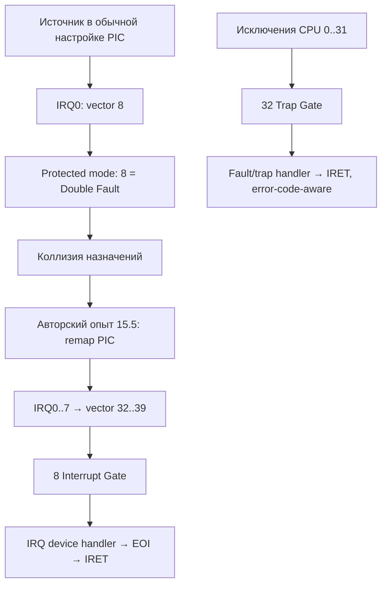
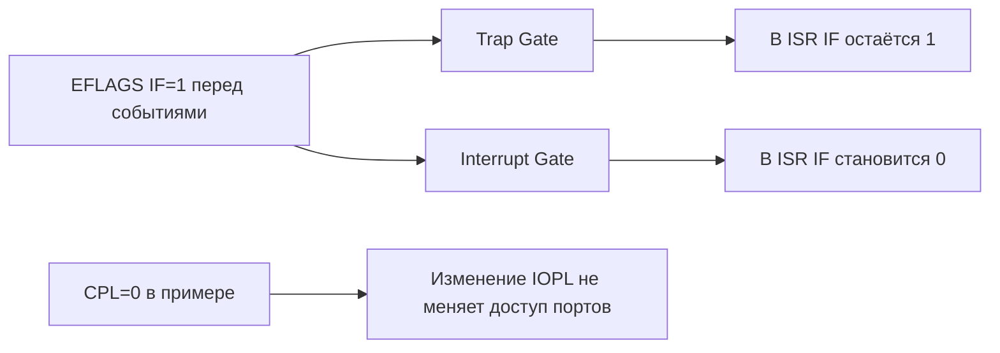

# Глава 15 — диаграммы IDT, fault и внешних IRQ

**Источник:** canonical RAG PDF 253–268, листинги 15.1–15.7. Эти диаграммы аналитические, не снимки Bochs и не аппаратная спецификация вне книги.

В диаграммах «EOI» относится к внешним аппаратным прерываниям, а дополнительный DWORD ошибки — только к соответствующим fault-исключениям, например #GP, не ко всем `int`. Сценарии переполнения IDT, #GP и перенастройки PIC не исполнялись. Точные сообщения Bochs и значения регистров — [Needs confirmation].
