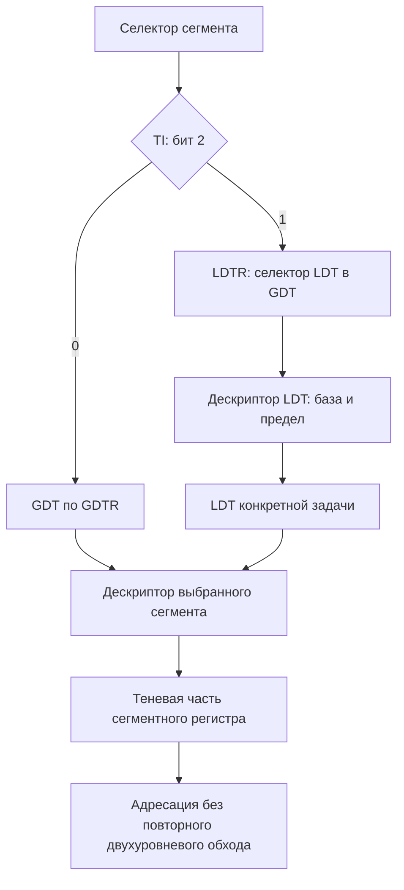
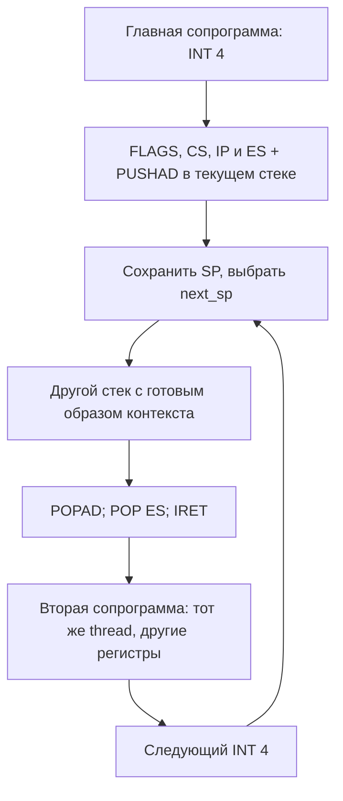
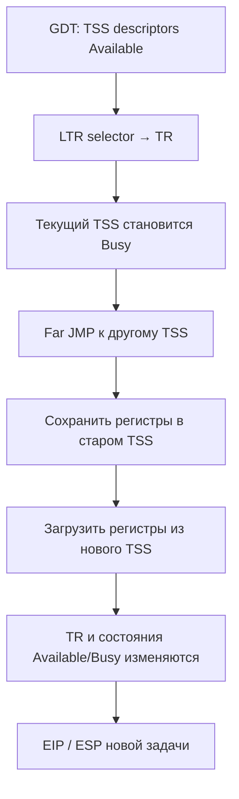
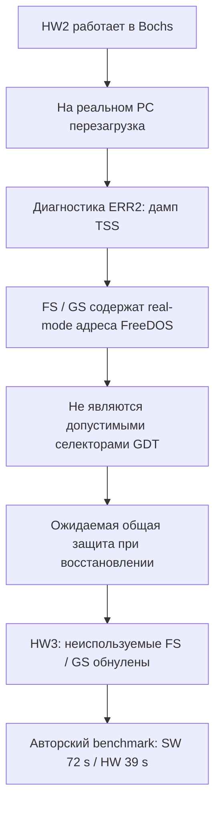

# Глава 16 — диаграммы LDT и TSS

Источник: canonical RAG PDF 269–286. **Схемы аналитические**, не реконструкция рис. 16.1–16.3.

Критические допущения: программный контекст не содержит полного набора сегментов/FPU; аппаратное исполнение зависит от содержимого TSS и GDT; одинаковый `ESP` двух задач допустим только при пустом стеке (p. 276, 284–285). Работа с механизмами в реальной DOS/Bochs **не выполнялась**.
