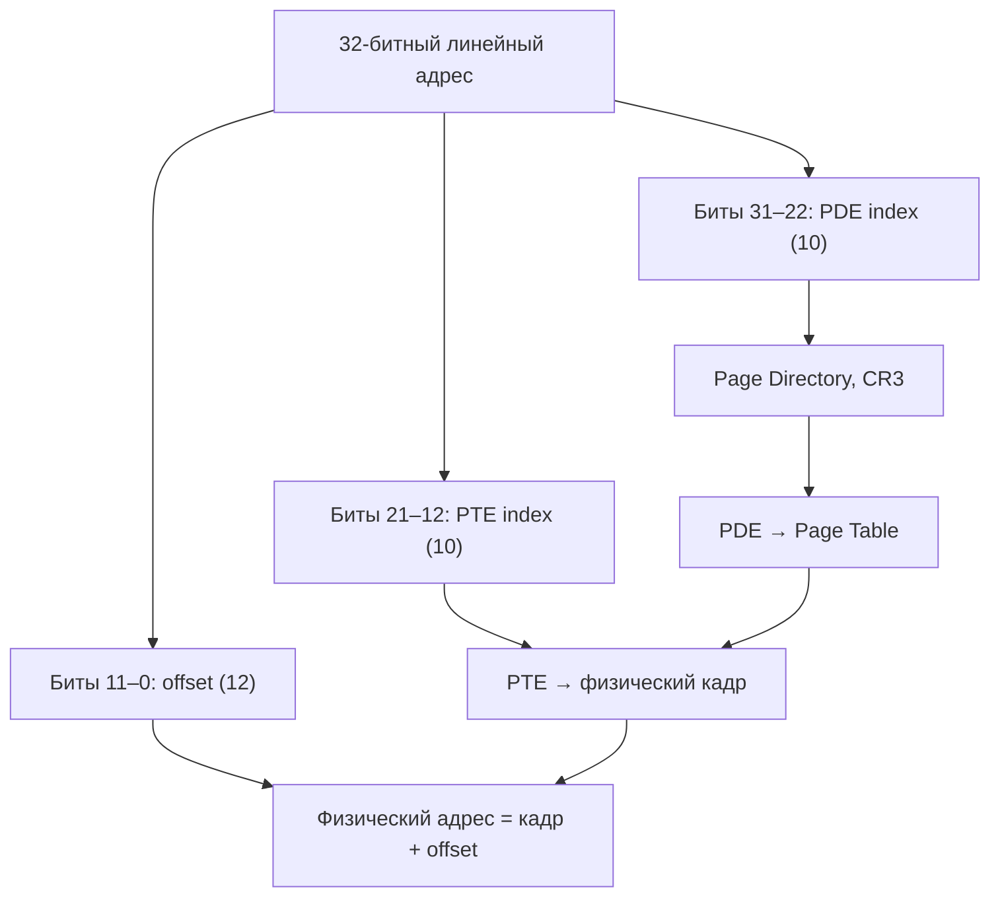
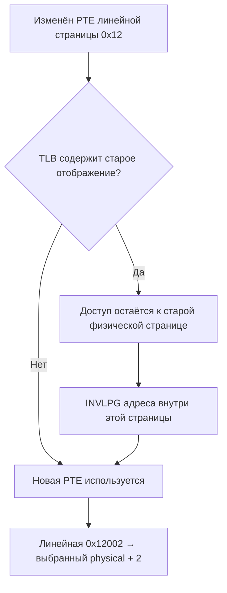
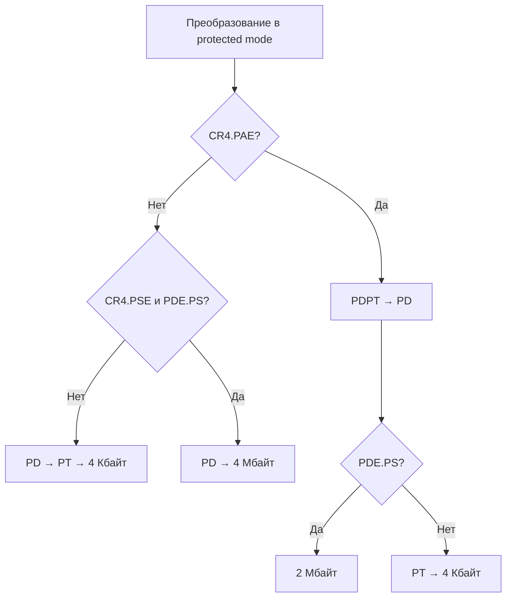

# Глава 17 — архитектурные схемы преобразования адресов

**Основание:** canonical RAG PDF 287–306. Mermaid — новые диаграммы, не копия рисунков автора.

Нарушение отображения в примерах #PF 14 и изменение CR0/CR3/CR4 следует **анализировать, не запускать**. Bochs может неверно показывать large-page PAE mapping в меню View при корректной работе CPU в проверенных автором тестах (p. 297–301).
