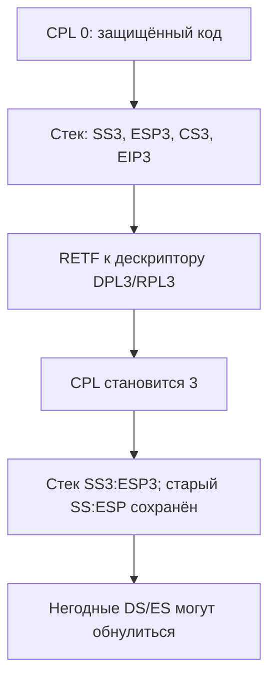
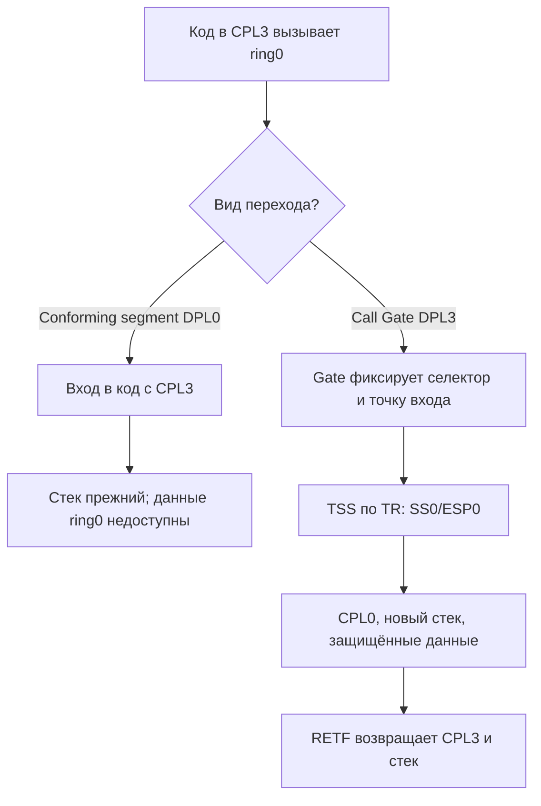
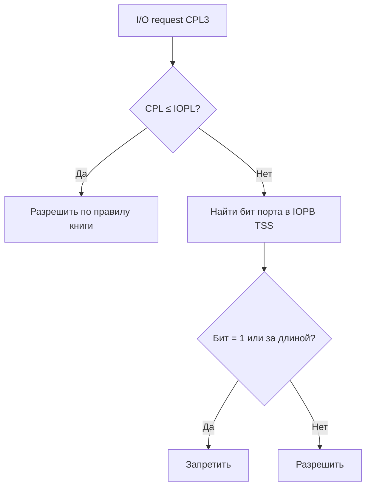
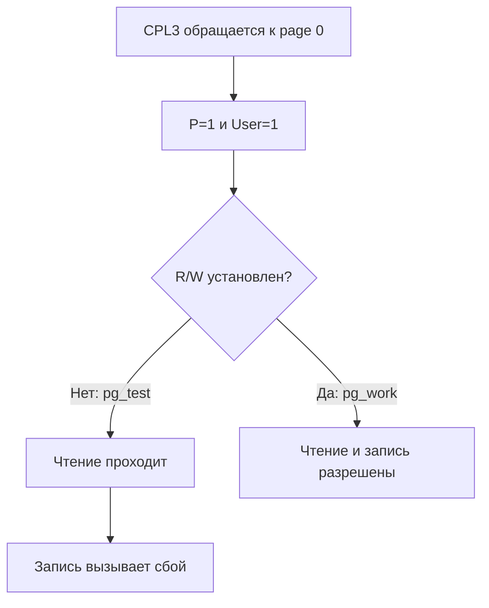

# Глава 18 — концептуальные диаграммы привилегий

Источник: canonical RAG PDF 307–320; все схемы авторские аналитические, не реконструкции рисунков внешних спецификаций.

**Замечание к источнику:** p317 противопоставляет комбинации IOPL 0–2 и 3 в порядке, который не соответствует собственной формуле доступа. Диаграмма изображает **явно указанное правило**, а не сомнительный эмпирический результат. Все fault-генерирующие примеры — только предмет анализа.
