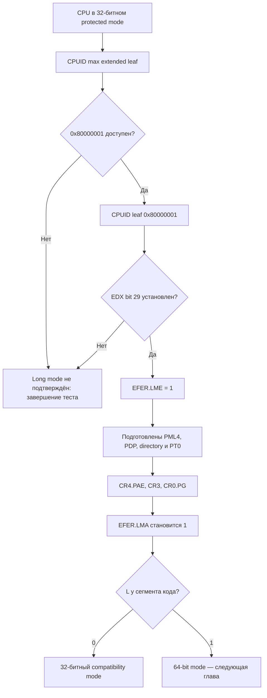
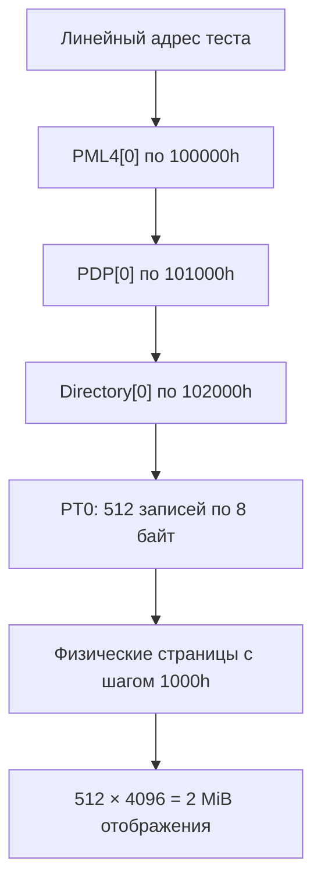
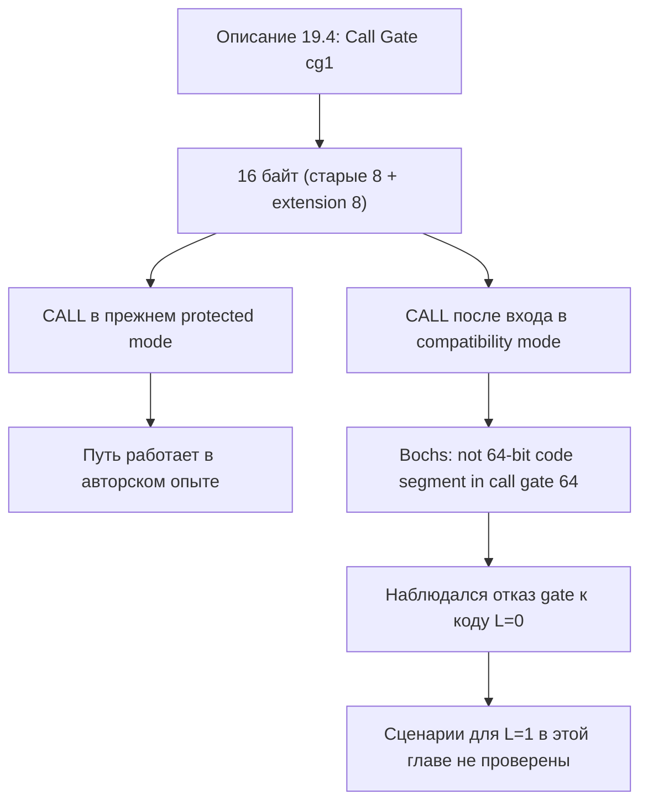

# Глава 19 — диаграммы перехода в compatibility mode

**Provenance:** RAG PDF 323–330, макросы 19.1–19.4. Диаграммы — новые аналитические материалы, не оригинальные рис. 19.1–19.3.

## Контроль интерпретации

В 19.2 только LME: проверка LMA удерживает программу в цикле. В 19.3 LMA становится 1 после включения paging, но L=0 сохраняет 32-битные операции. В 19.4 в GDT могут соседствовать дескрипторы длиной 8 и 16 байт, их селекторы определяются **смещением от начала GDT**, а не порядковым номером смешанных записей (p. 329).

**Ограничение:** работа режимов процессора, реальная запись таблиц, исход ошибки Bochs и последствия gate не воспроизводились и не проверялись вне текста RAG.
