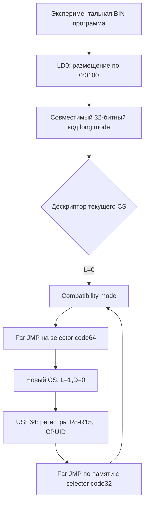
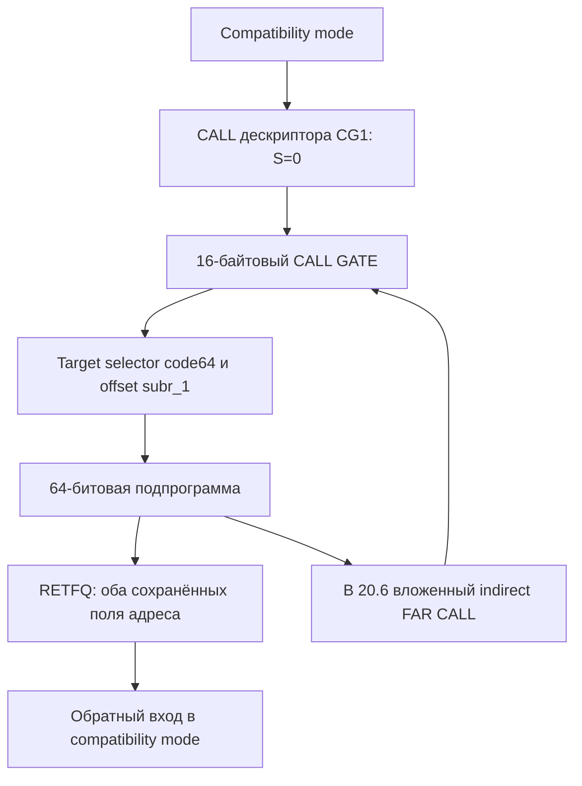
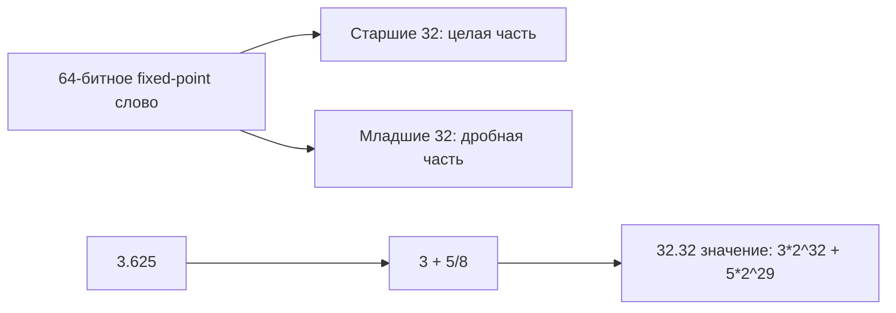

# Глава 20 — диаграммы переключения 64-битного кода

**Источник:** PDF 331–340, canonical RAG. Диаграммы аналитические, не реконструкция рисунков Bochs.

**Важные условия:** в 64-битовом коде сегментные base/limit обычных дескрипторов не контролируют адреса, кроме указанного в источнике исключения FS/GS; страничное преобразование требуется для long mode (p.331,339). **LD0 перезаписывает область IVT**, а рекурсивный код имеет тестовую задержку и не предназначен для работы на обычной машине. Результат выполнения всех схем **[Needs confirmation]**.
