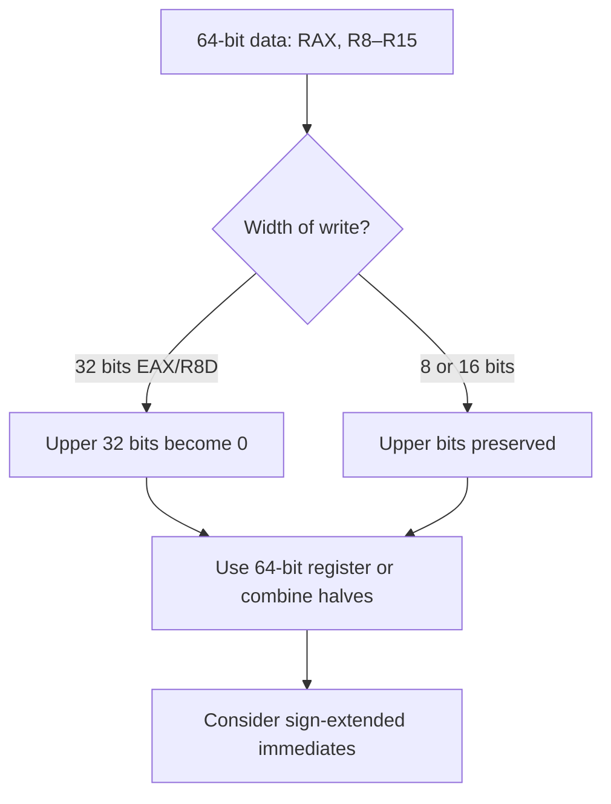
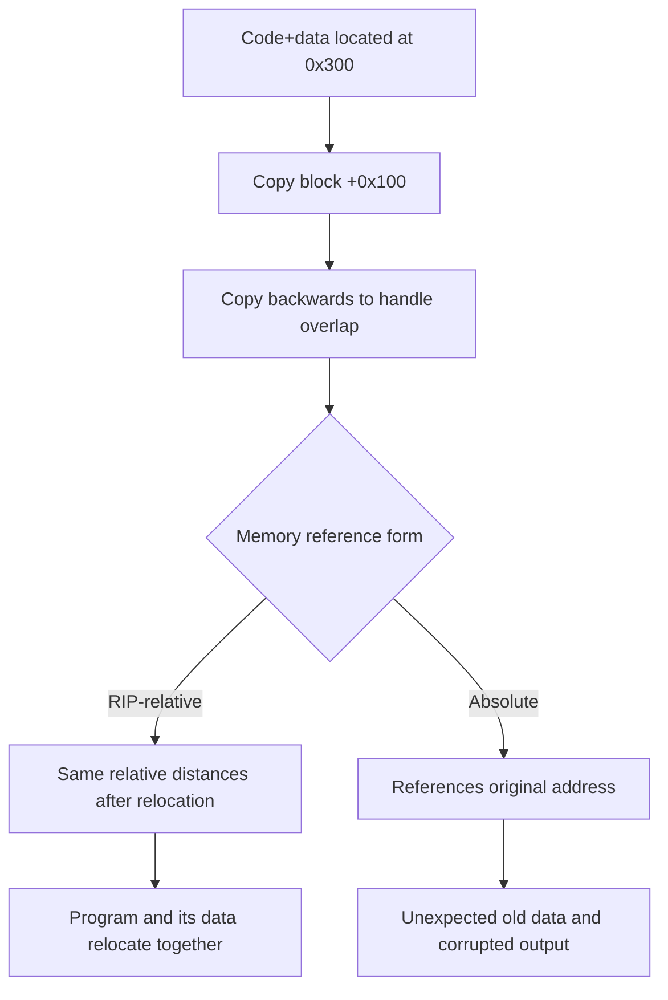
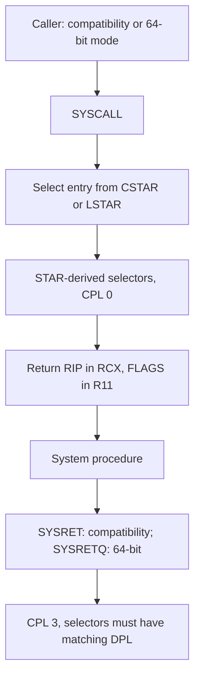
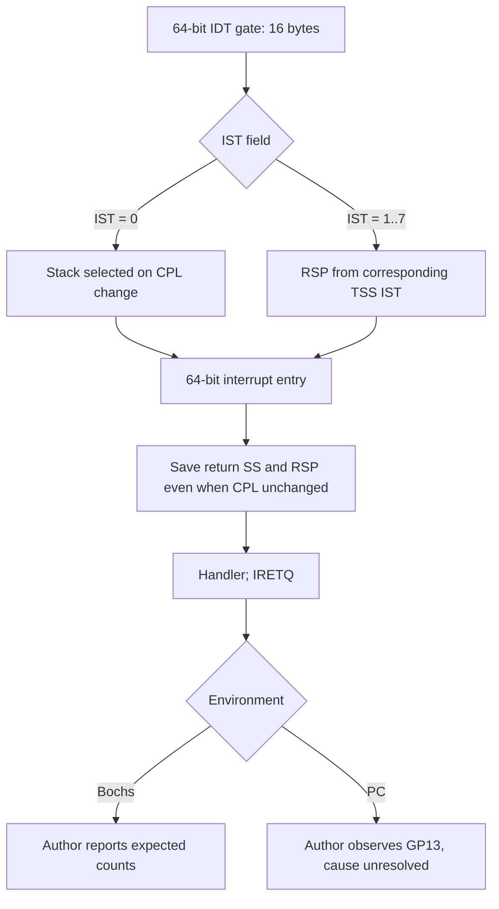

# Глава 21 — концептуальные схемы

**Provenance:** canonical RAG PDF 341–372. Схемы авторские аналитические, не изображения рис. 21.1–21.3. Не являются исполняемыми инструкциями.

**Ограничения:** рисунки и аппаратные журналы не доступны в RAG как самостоятельные мультимодальные объекты. Отличия Bochs/PC на PDF 365–369 — наблюдения автора, не общие гарантии. В примечании 26 (p. 371) указано, что для программных прерываний поле, прочитанное как код ошибки, может быть частью адреса возврата; не интерпретировать его как достоверный selector.
