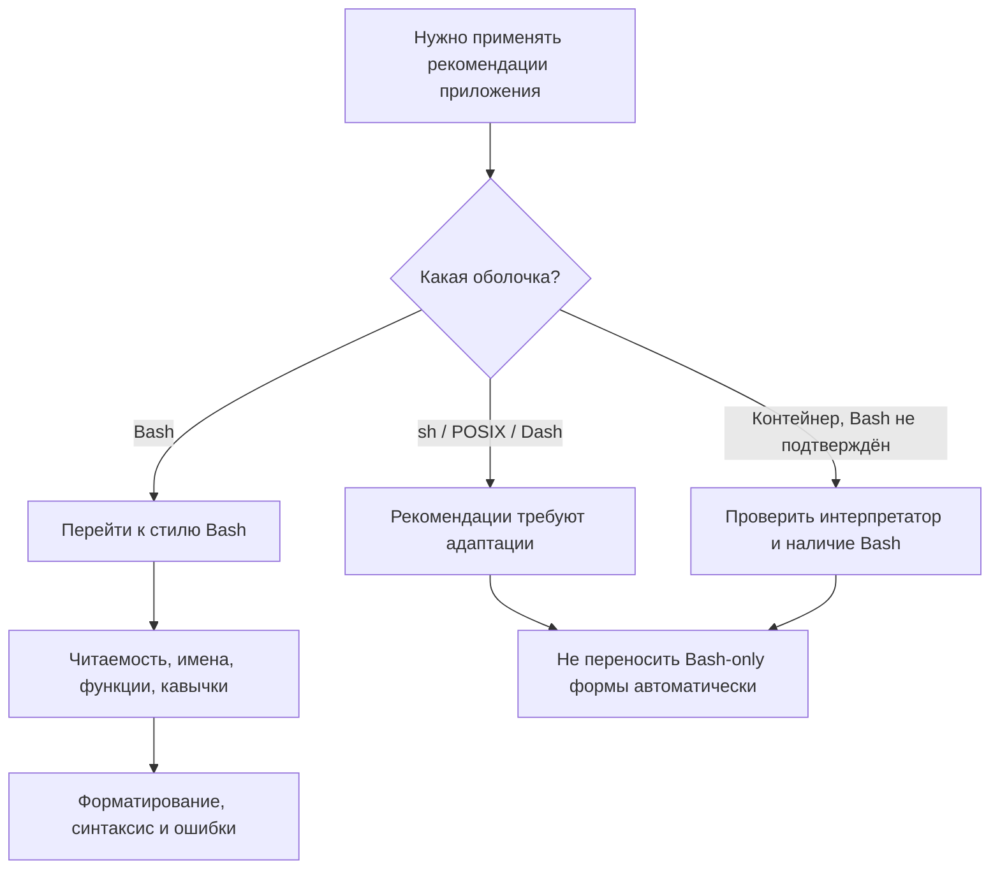
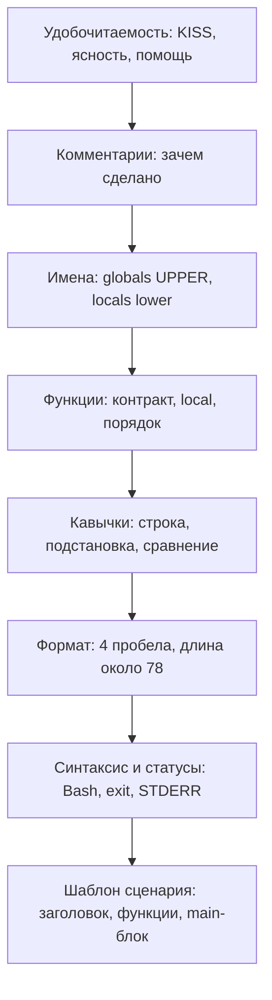
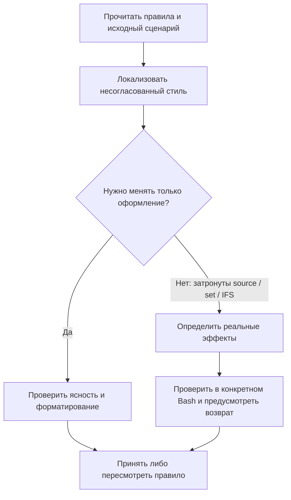
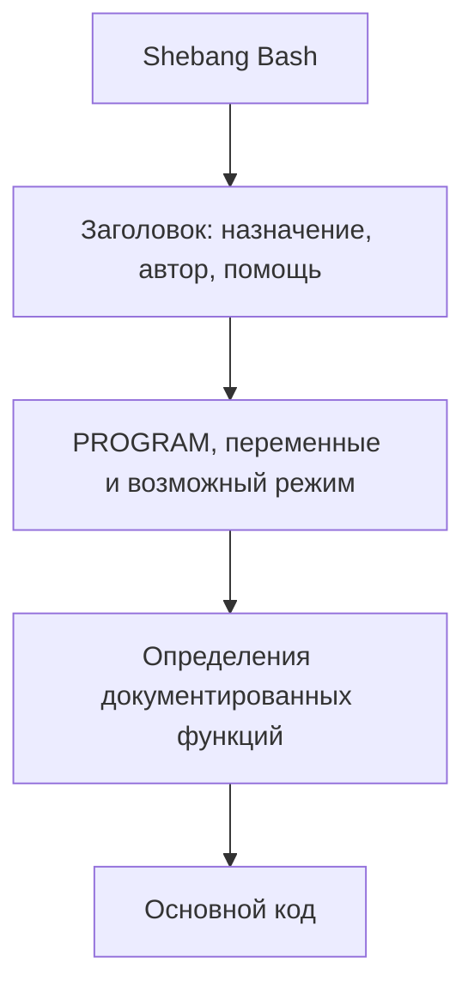

# Приложение — схемы руководства по стилю Bash

**Основание:** только RAG `p0193:c01–p0202:c01` (PDF 193–202). Схемы обобщают разделы приложения, не являются независимым стандартом.

## Проверить применимость правил

Приложение прямо ограничивает рекомендации Bash (PDF 193) и перечисляет области стандартов (PDF 194–200).

## Карта собственного стандарта

Последовательность здесь **порядок разделов приложения** (PDF 194–202), а не новый предписанный алгоритм.

## От проверки к изменению

Контроль влияния при изменении поведения — операционная граница: RAG не содержит конкретной процедуры тестирования и отката для пользовательской системы. **[Needs confirmation]**.

## Структура сценария из приложения

Это разделы демонстрационного шаблона PDF 201–202. Внутри — `...` и placeholders: шаблон не является завершённым исполняемым файлом.
