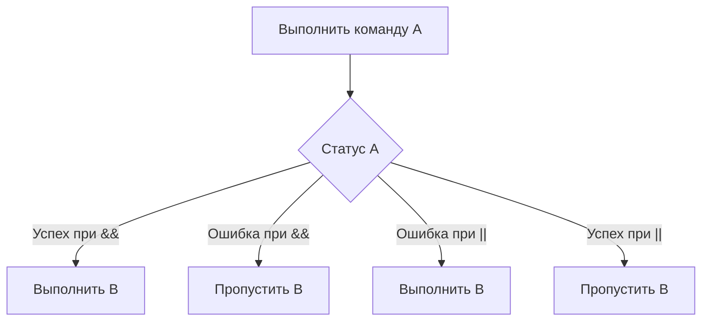
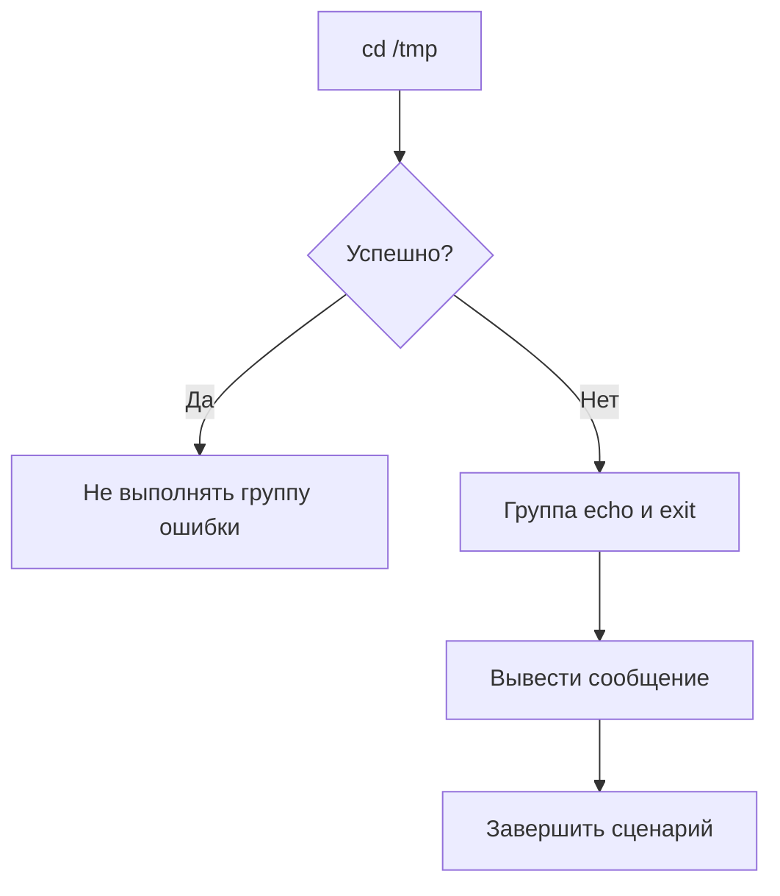

# Глава 1 — управление выполнением

RAG p0021:c01–p0029:c01 · PDF 21–29 · печатные 20–28. Логические ветви из RAG, не исполняемый сценарий.

## Группировка нескольких действий после ошибки

Для `cd /tmp || { echo "cd to /tmp failed." ; exit ; }` обе правые команды входят в ветку ошибки (PDF 25). Без группировки в `cd /tmp || echo "..."; exit` завершающий `exit` выполняется в любом случае (PDF 24–25).

Смешанные `&&` и `||` обрабатываются **слева направо** при равном приоритете (PDF 26). Для сложной логики авторы советуют обычный `if` (PDF 28–29).
