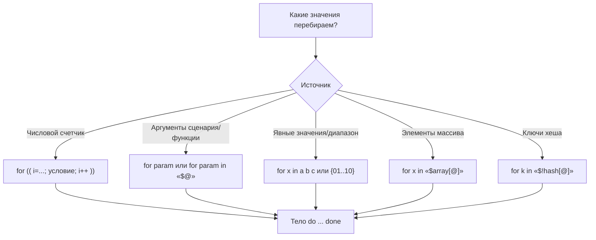
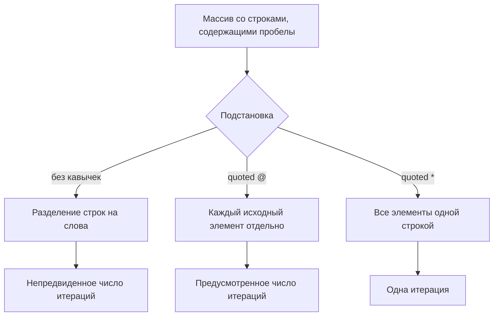
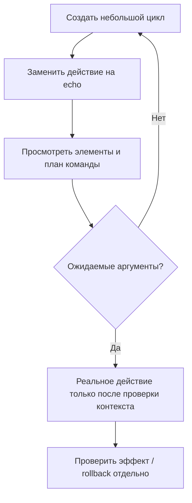

# Глава 2 — схемы циклов

Основание: PDF 30–42, RAG `p0030:c01–p0042:c01`. Схемы отражают концепции главы; конкретные результаты исполнения не тестировались.

## Выбор формы цикла

Примечание: в схеме кавычки «...» служат обозначением двойных кавычек внутри Mermaid-узлов; точные формы `"$@"`, `"${namelist[@]}"` и `"${!hash[@]}"` приведены в [commands.md](commands.md) и RAG. [PDF 31–41]

## Массив и пробелы

## Контролируемая разработка

Схема следует совету авторов начинать просто и тестировать через `echo` (PDF 38–39, 42). Последний шаг — операционный критерий проверки, **не** подтверждение выполненного изменения. Вопрос формулировок `while/until` вынесен в [source-findings.md](source-findings.md), поэтому схема не навязывает непроверенное направление условного перехода. 
