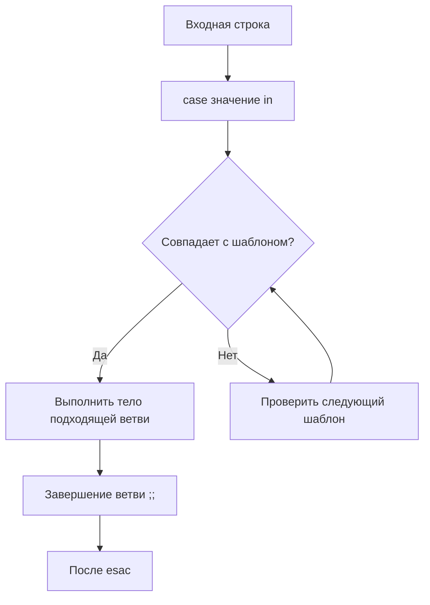
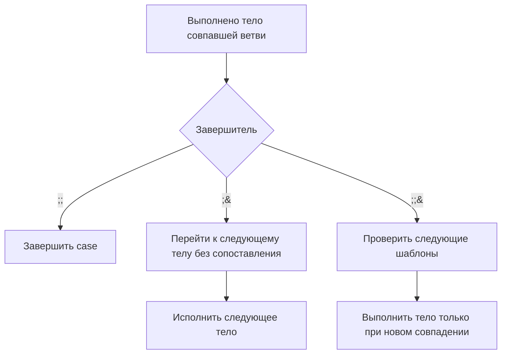
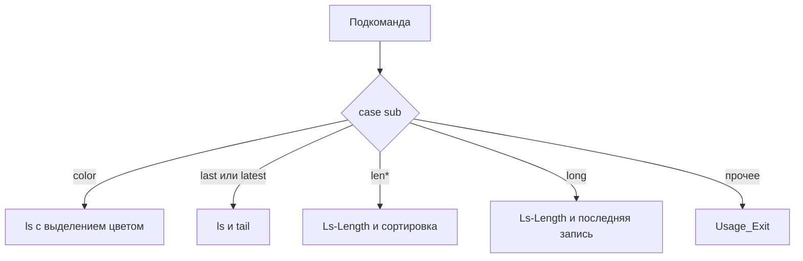

# Глава 3 — схема case

Источник: PDF 43–57, RAG `p0043:c01–p0057:c01`. Это модель потока управления из текста книги, не тест запуска.

## Базовое сопоставление

Шаблон `*` авторы располагают последним для обработки нераспознанных значений. [PDF 45]

## Три разных завершающих оператора

Источник: PDF 55–57. Для `;&` и `;;&` авторы рекомендуют комментарии.

## Сценарий-обёртка list.sh

Источник: PDF 46–48. Блоки `index`, `rerun`, `cleanup` в более сложной обёртке могут изменять файлы (PDF 51–52), поэтому они намеренно не добавлены в схему безопасного просмотра.
