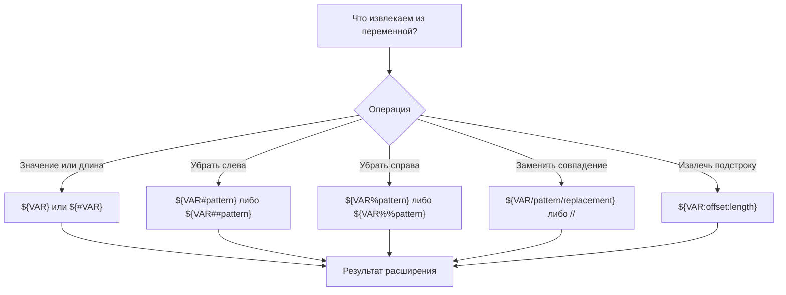
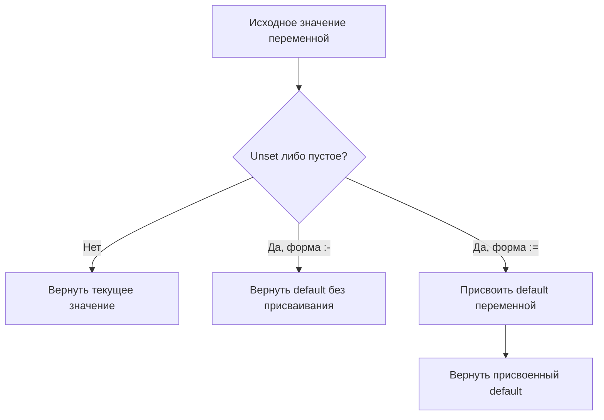
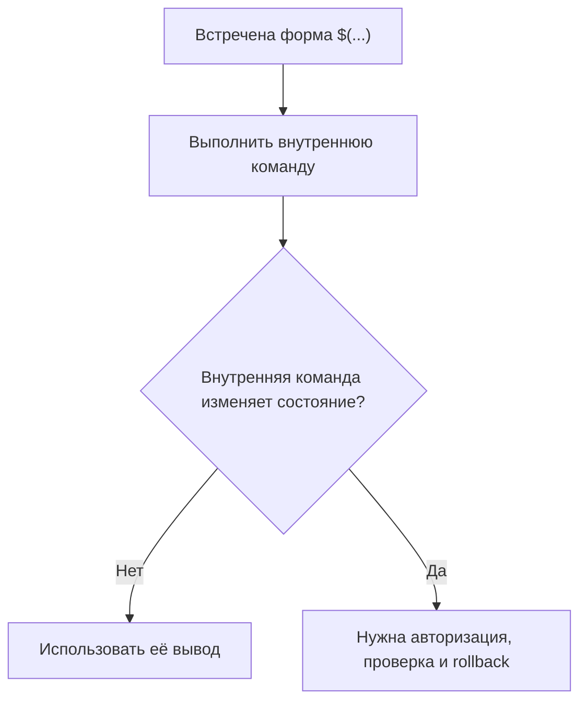

# Глава 4 — схемы расширений переменных

Источник: PDF 58–72, RAG `p0058:c01–p0072:c01`. Примерная логика относится к подстановкам из книги, не к проверенным результатам в конкретной системе.

## Выбор строкового преобразования

Источник: PDF 58–65. Результат расширения и запись результата в другую переменную — разные действия.

## Условные подстановки и побочные эффекты

Источник: PDF 67–69. В случае без двоеточия источник отличает проверку только unset.

## Подстановка результата команды

По RAG PDF 70–71 вложение `$(...)` может содержать чтение данных или команду создания облачных ресурсов. «Результат выглядит как строка» **не означает**, что вложенная команда безопасна.

## Оговорка

Временный каталог вида `$TMP/myscript.$RANDOM` авторы прямо считают примером с состоянием гонки; использование `mktemp` предложено для рассмотрения, без полного проверенного рецепта и отката. [PDF 70]
