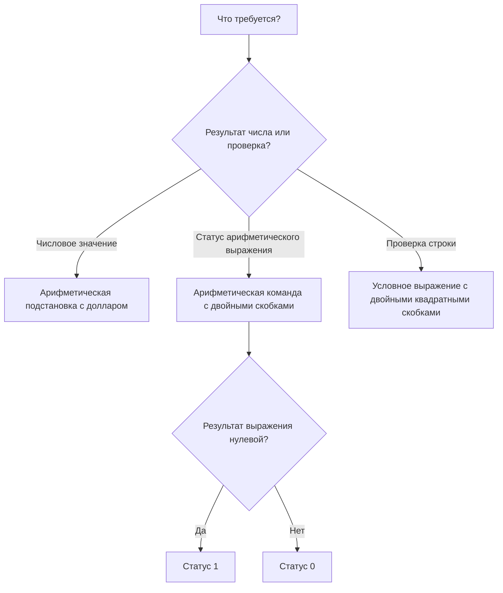
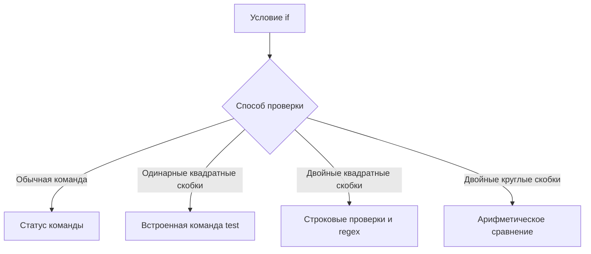
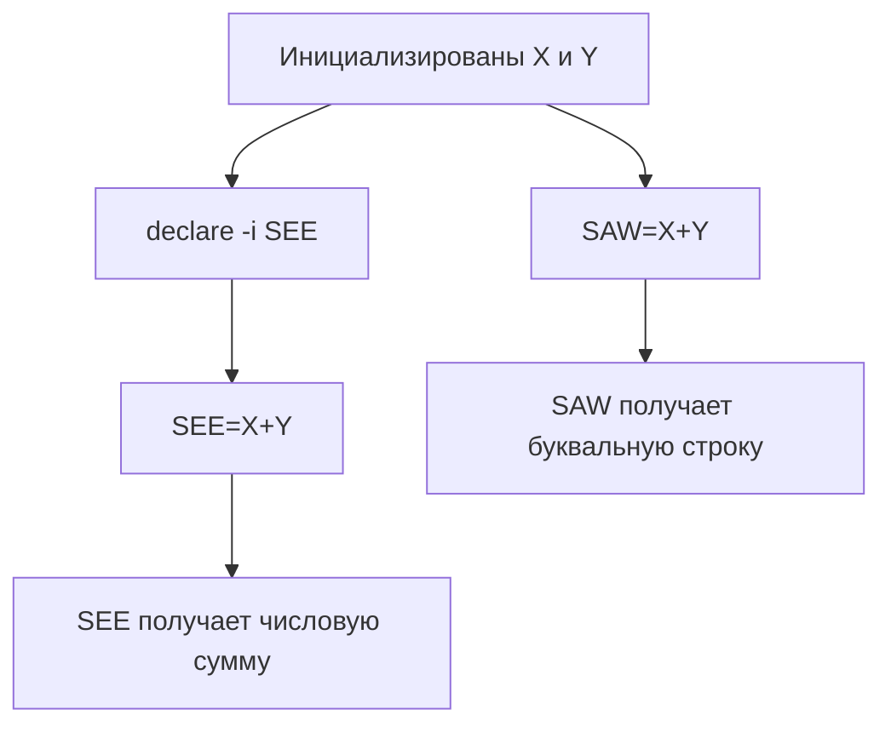

# Глава 5 — диаграммы выражений

Источник: RAG `p0073:c01–p0082:c01`, PDF 73–82. Диаграммы описывают учебную логику, а не выполненный тест.

## Выбрать синтаксис по цели

Формы соответствуют `$(( expression ))`, `(( expression ))`, `[[ expression ]]`; первая выдаёт вычисленное значение, вторая — статус (PDF 74–75). Схема не подразумевает отсутствие присваиваний внутри выражения.

## Сравнение видов условий

Источник: PDF 78–82. Для `[[ ... ]]` показана поддержка `=~`, а для арифметики авторы рекомендуют `(( ... ))`.

## Арифметическое присваивание

Третий вариант из учебного `seesaw.sh` — `SUM=$X+$Y`, дающий строку `9+3` при `X=9`, `Y=3`. [PDF 77]
