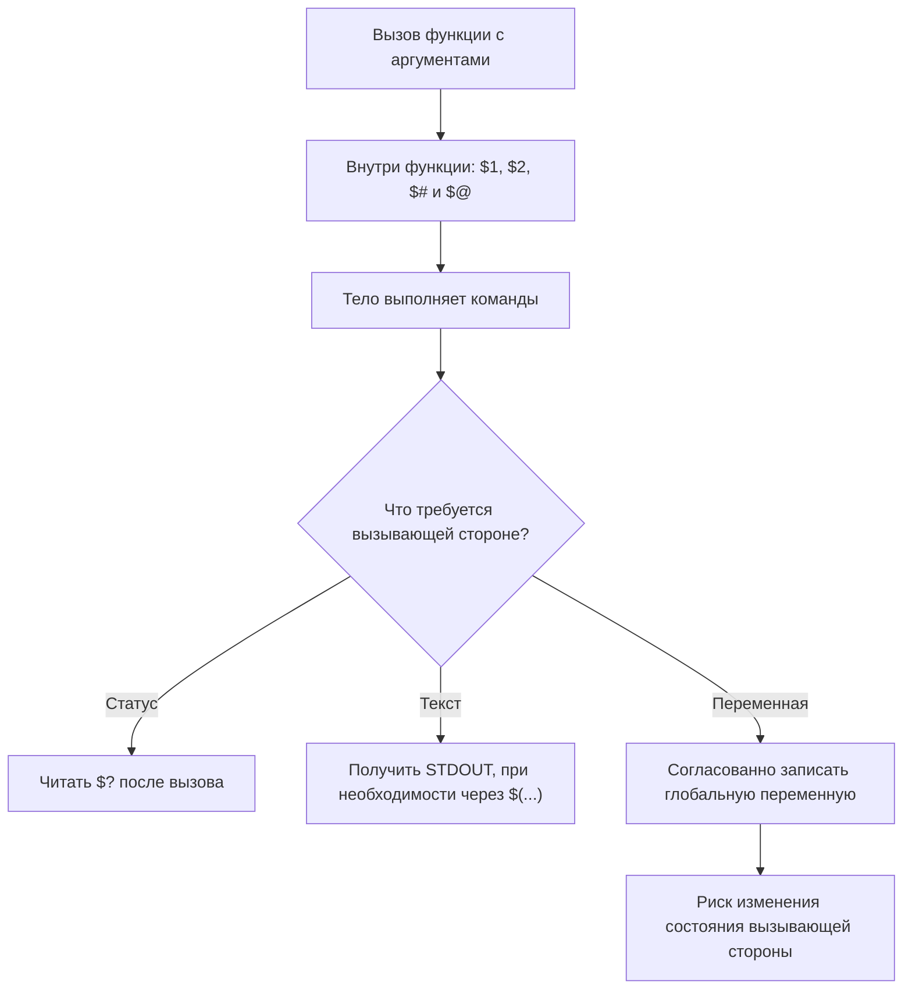
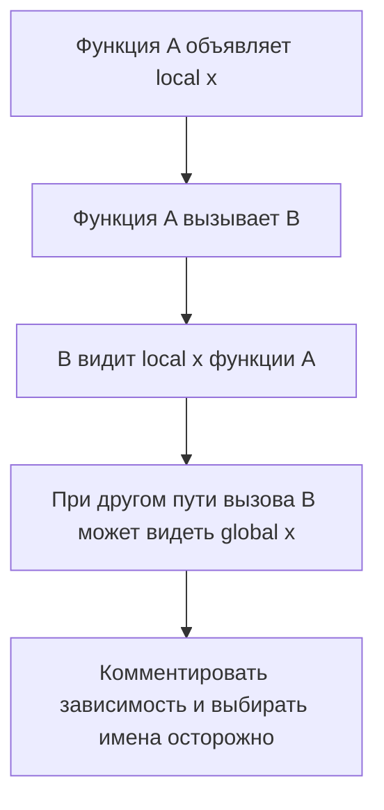
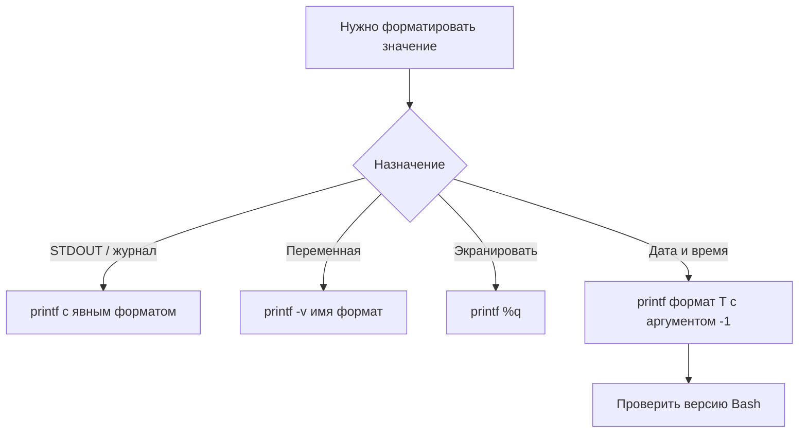

# Глава 6 — схемы функций Bash

Источник: PDF 83–93, RAG `p0083:c01–p0093:c01`. Схемы моделируют содержание главы, а не фактическое выполнение кода.

## Аргументы, статус и вывод функции

Книжный принцип: статус, вывод и глобальная переменная — разные каналы возвращения результата. [PDF 85–87]

## Область видимости

Это динамическая область видимости, описанная авторами в PDF 87–88.

## Форматированный вывод

Подстановка даты через `%(... )T` описана для Bash 4.2+, и в книге отдельно отмечена несовместимость старого Bash на Mac. [PDF 89–92]

## Ограничения

`Usage_Message` задаёт перенаправление `1>&2` один раз на определение, но оно действует во время вызова. [PDF 88–89] Выражение `Summer` из PDF 87 не нормализовано в готовый рецепт: см. [source-findings.md](source-findings.md).
