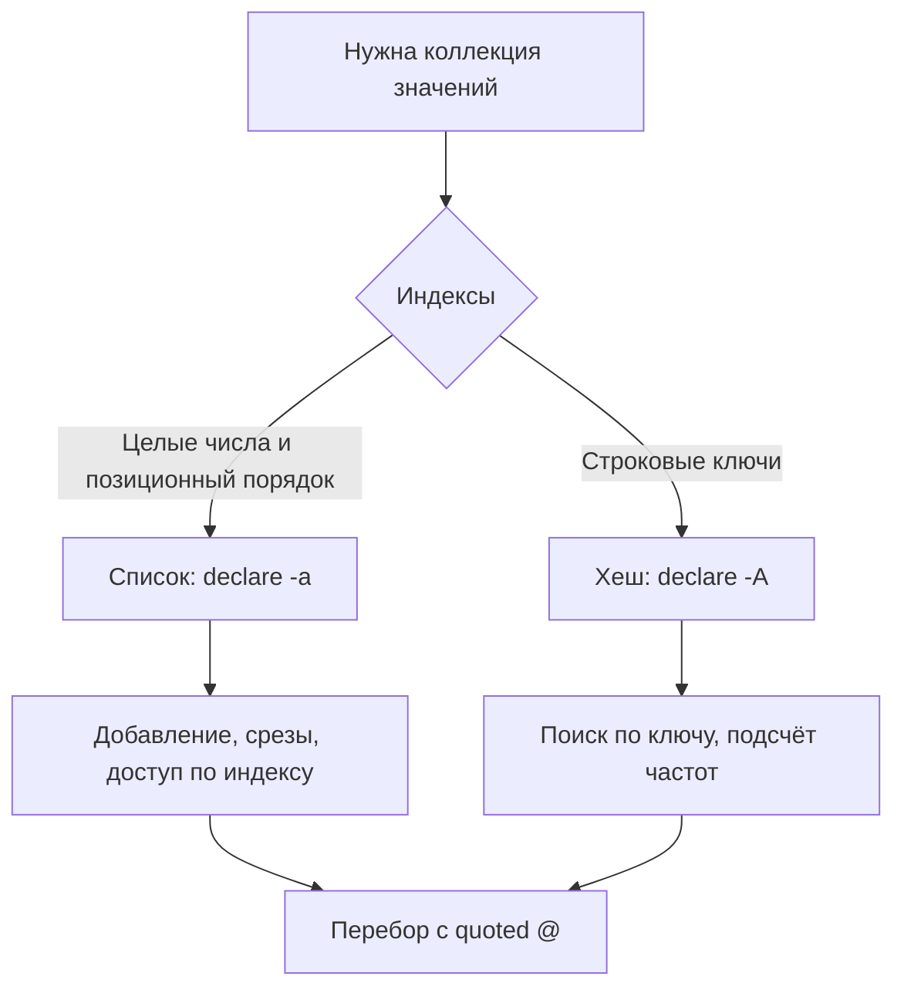
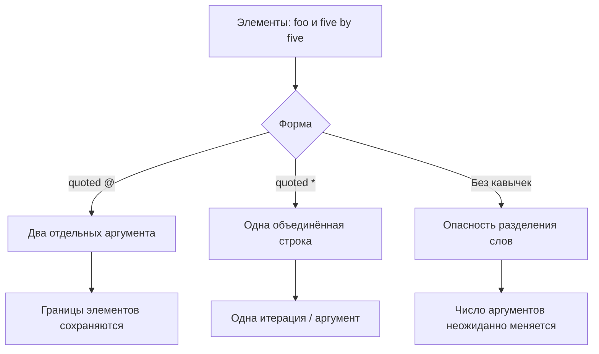
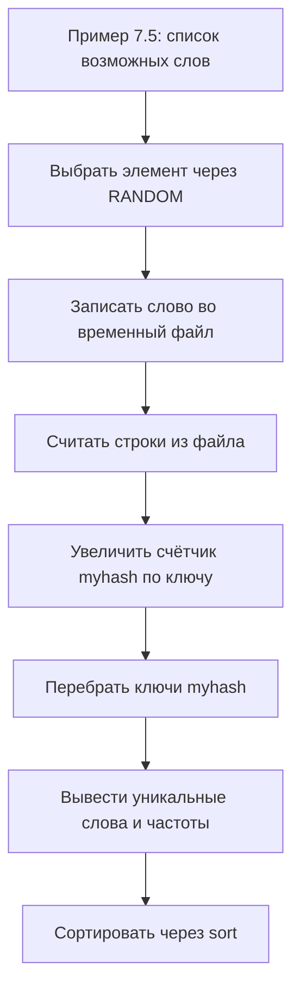

# Глава 7 — схемы списков и хешей

Источник: только RAG `p0094:c01–p0110:c01` (PDF 94–110). Схемы обобщают примеры главы, не утверждают выполнение сценариев.

## Выбор структуры данных

Исходный вывод: для хеша важен ключ, а понятия «сдвиг первого» и «извлечение последнего» не имеют смысла, как для последовательного списка. [PDF 95–105]

## Массив с пробелами

В примерах 7.1–7.4 показан отдельный случай намеренного `"$*"` для объединения через `IFS`; он не отменяет рекомендации использовать `[@]` для обычного обхода. [PDF 96–106]

## Подсчёт слов в хеше

**Предупреждение:** буквальное воспроизведение файловой части примера перезаписывает `/tmp/words.txt` и ставит `trap` с `rm -f`. В схеме не изображён какой-либо «безопасный» запуск; пути и rollback — **[Needs confirmation]**. [PDF 107–109]
