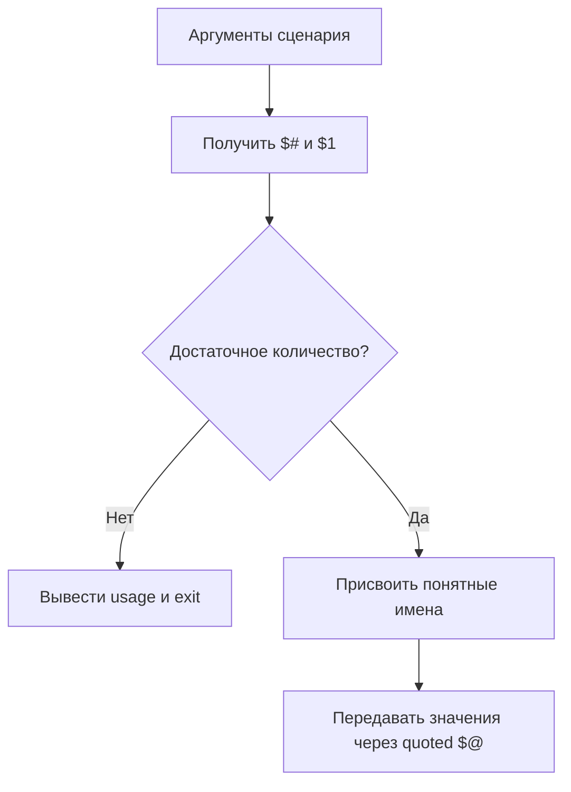
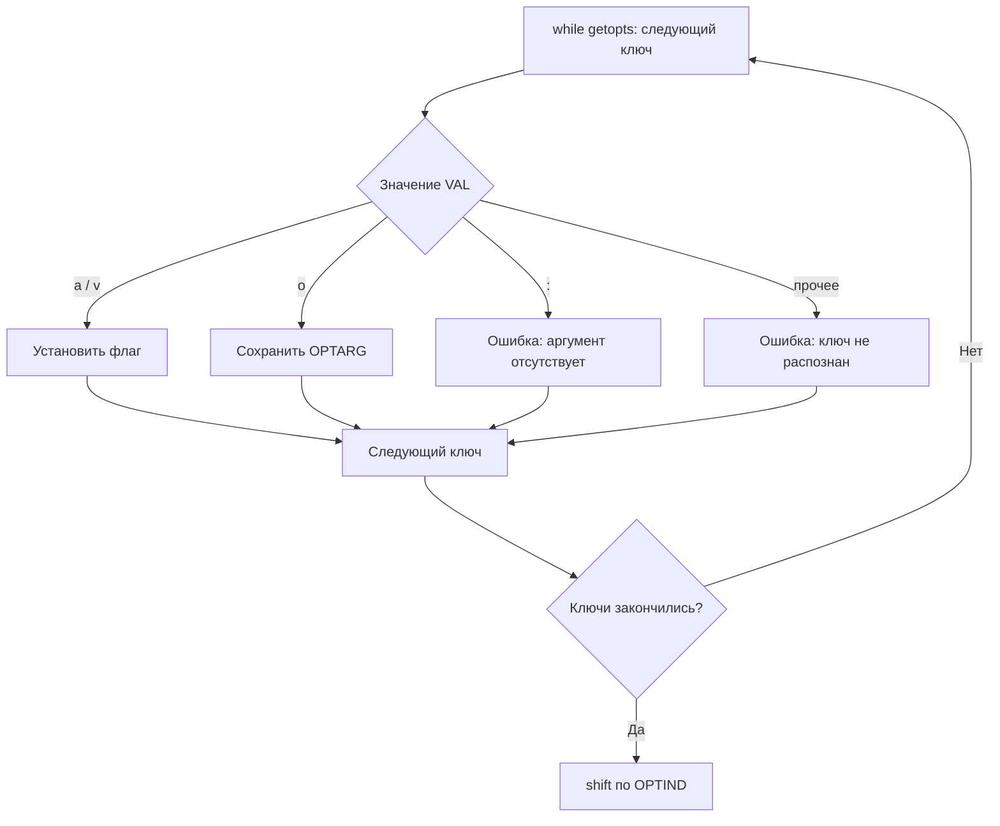
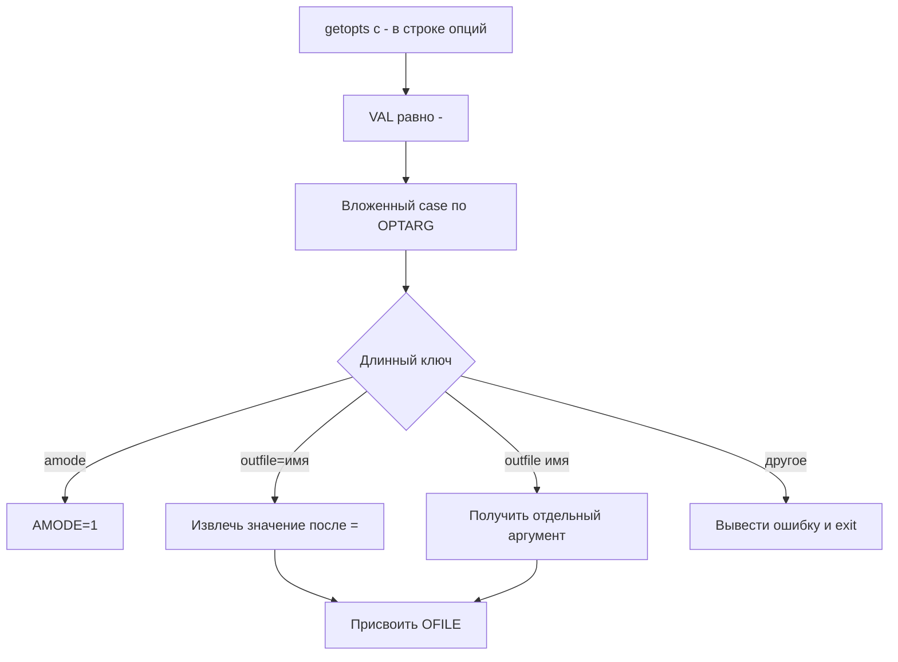
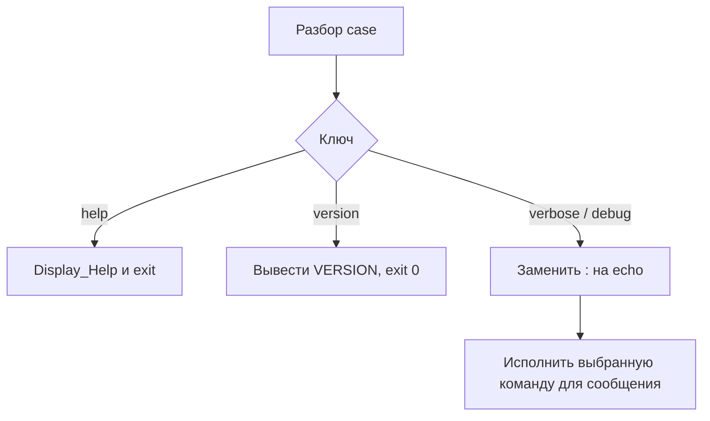

# Глава 8 — схемы разбора аргументов

Основание: PDF 111–125, RAG `p0111:c01–p0125:c01`. Концептуальные потоки авторских примеров; исполнение не проводилось.

## Первый аргумент и контроль количества

См. PDF 111–113.

## Короткие ключи

См. PDF 114–115; обработка ошибок возложена на сценарий.

## Длинные ключи в реализации автора

См. PDF 116–118. Это специальная реализация в коде, а не универсальное свойство всякого вызова `getopts`.

## Справка и диагностический вывод

См. PDF 119–125. Конкретный статус выхода для справки авторы обсуждают как неоднозначный.
