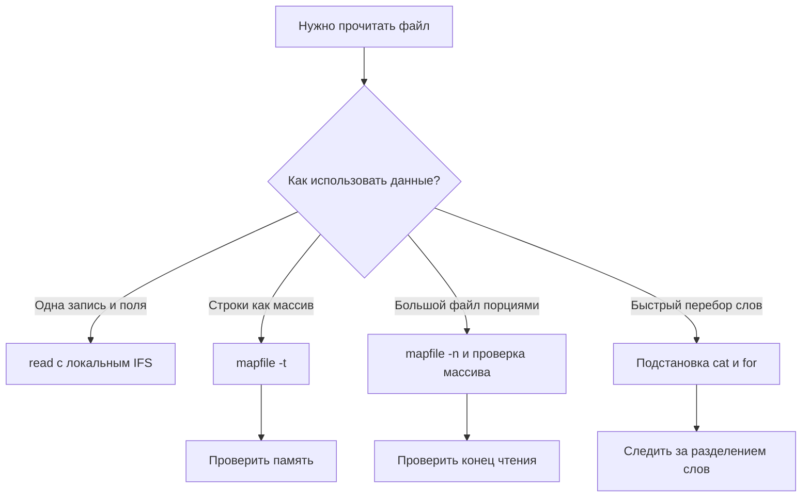
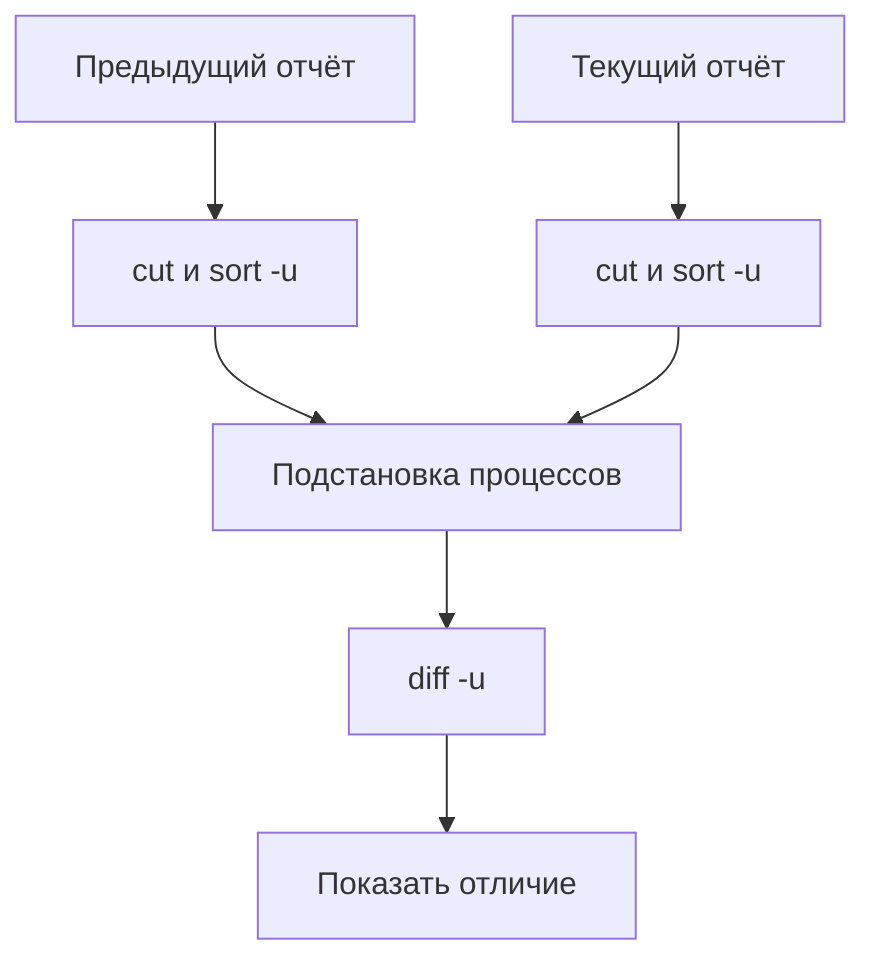
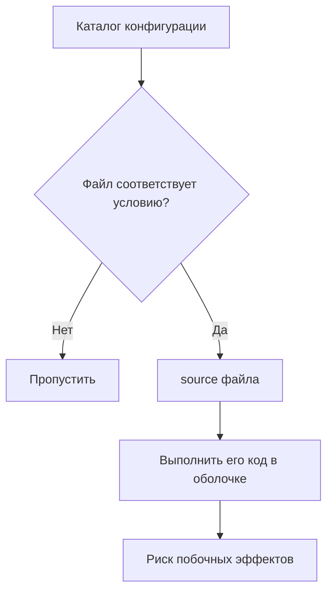
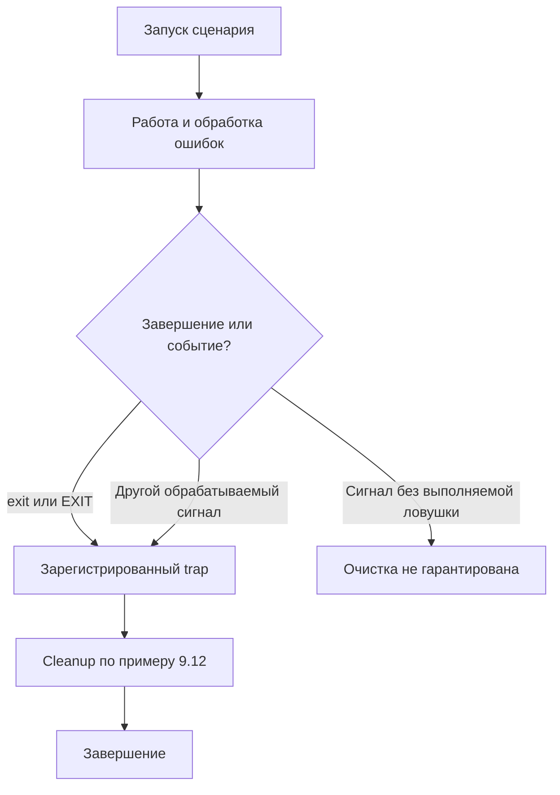

# Глава 9 — схемы на основе RAG

**Источник:** PDF 126–145, чанки `p0126:c01–p0145:c01`. Диаграммы отражают принцип книжных примеров, не выдают их за проверенные процедуры.

## Выбор способа чтения файла

PDF 126–133: у `read -d` задаётся разделитель конца записи, не разделитель полей. Конвейер с `read` может поместить переменные в подоболочку; авторы обсуждают `lastpipe` с ограничениями.

## Поток данных без промежуточных файлов

PDF 134–135. Вместо записи и последующего `rm` промежуточных результатов сравнение использует `<(...)`.

## Подключаемые настройки и библиотеки

PDF 135–137. Права `-x` / `-r` — условие отбора примера, не проверка безопасности самого содержимого.

## Код выхода и очистка

PDF 140–142. Авторы прямо предупреждают, что `trap` не решает задачу очистки при `kill -9`; результат зависит от регистрации обработчика.
