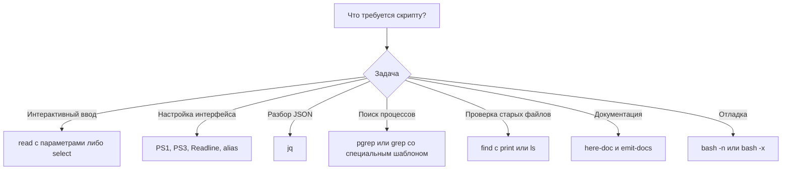
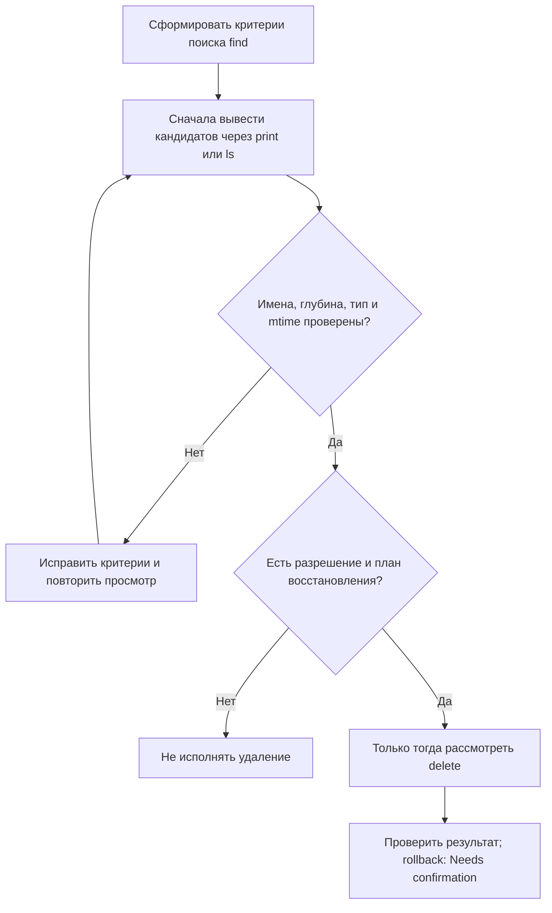
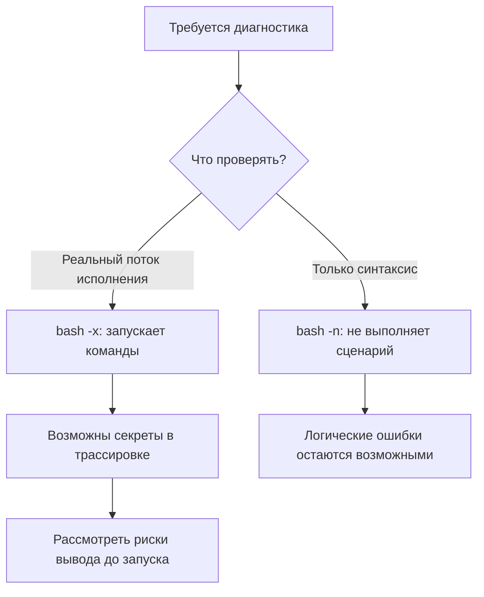
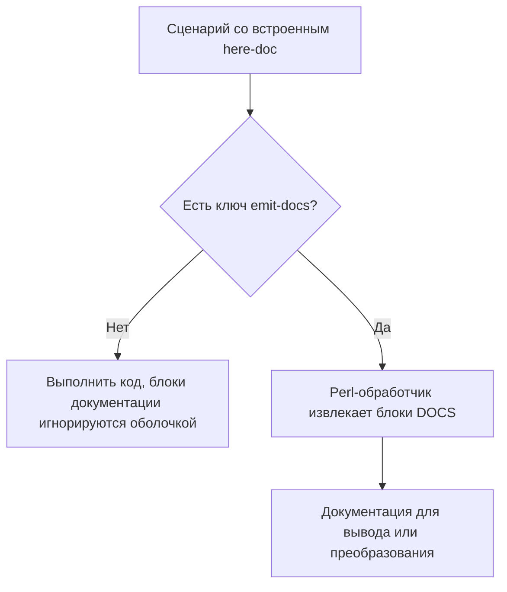

# Глава 10 — схемы из RAG

**Источник:** PDF 146–174, RAG `p0146:c01–p0174:c01`. Схемы иллюстрируют источниковые принципы, не доказывают результат запуска.

## Практическая работа с Bash: выбор средства

Идиомы собраны в разных разделах исходной главы (PDF 147–173), авторы не представляют их в виде единственного обязательного рабочего процесса.

## Безопасная последовательность для удаления файлов

Книжная рекомендация `-print`/`-ls` **до** `-delete` — PDF 163–164. Условия авторизации и восстановления — операционное ограждение, а не дополнительная команда из источника.

## Проверка синтаксиса и трассировка

PDF 171–172. `set -x` включает трассировку в сценарии, `set +x` выключает её, но уже выведенные данные не удаляет.

## Встроенная документация

Источник: примеры 10.18–10.19 (PDF 164–170). Для POD авторы обсуждают `perldoc` и `pod2*`; разбор внешними инструментами в нашей работе не выполнялся.
