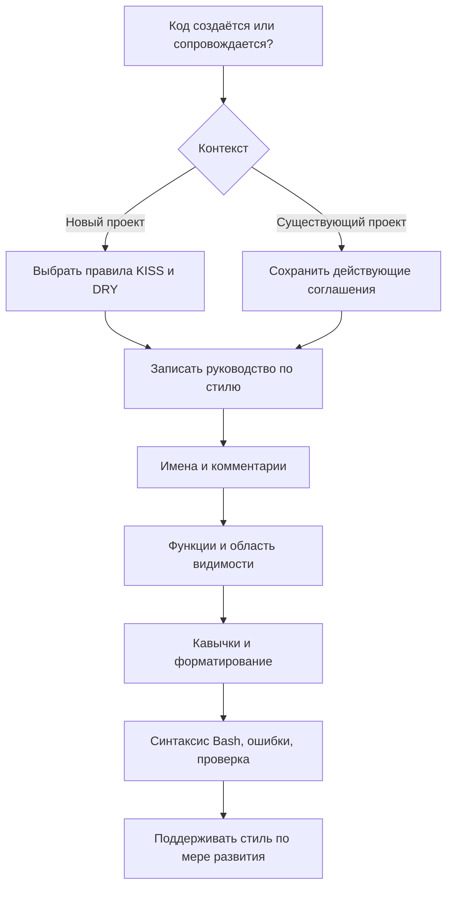
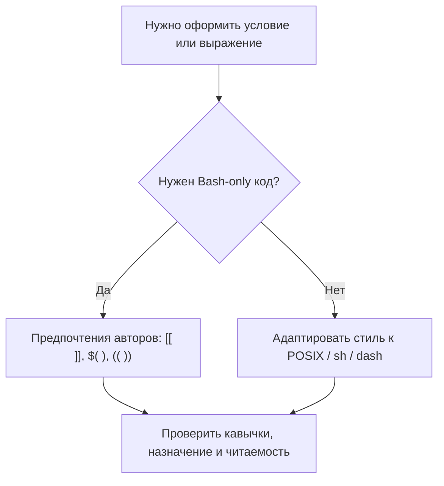
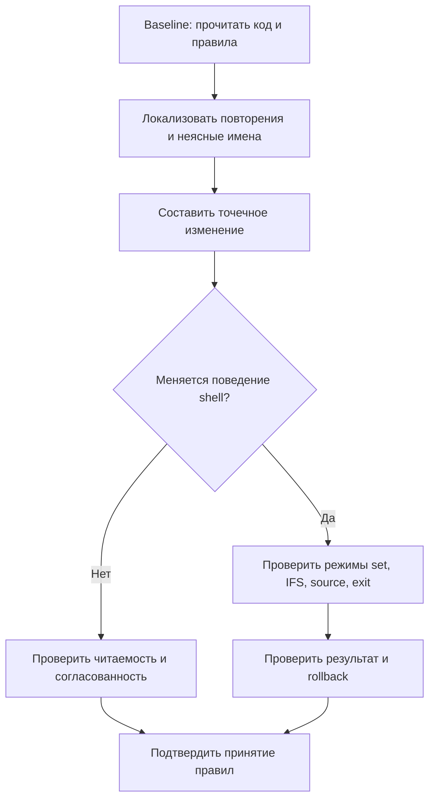
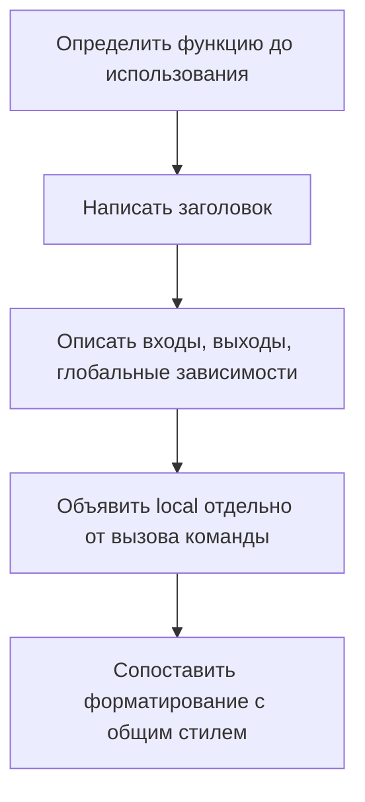

# Глава 11 — концептуальные схемы стиля

**Provenance:** PDF 175–192, RAG `p0175:c01–p0192:c01`. Это схемы авторских рекомендаций, не независимый стандарт.

## Выбор и внедрение соглашений

Источник: вступление PDF 175–177; выбор стиля существующего проекта PDF 179; разделы PDF 178–191.

## Синтаксис и переносимость

PDF 177, 184–188. Для `[[...]]` и regex исходник содержит отдельную неоднозначность `~=`, описанную в [source-findings.md](source-findings.md).

## Путь от диагностики к изменению

Переходы основаны на KISS/DRY, советах о переносимости и изменяющих shell-конструкциях (PDF 175–188). Универсальная команда rollback в RAG отсутствует: **[Needs confirmation]**.

## Комментарии к функции

PDF 183–184. Не переносить примеры шаблона как исполняемый код без замены заглушек.
