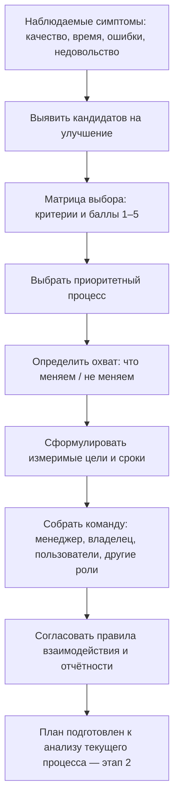

# Логика этапа 1 — планирование изменений

**Граница:** PDF pp. 33–42; chunks `business-process-improvement-hbsp-ru:p0033:c01`, `p0035:c01`–`p0042:c01`. Диаграмма отражает пять шагов из p. 35 и их детализацию; это не программный алгоритм.

## Source mapping

- Симптомы: pp. 35–36.
- Матрица и приоритеты: pp. 36–38. Содержимое таблицы 2 в текстовом слое частично потеряло табличное форматирование; [source-findings.md](source-findings.md).
- Охват, цели, сроки: pp. 38–39.
- Роли: pp. 40–41.
- Правила работы команды: pp. 41–42.
- Следующий нумерованный раздел «Этап 2. Анализ текущего бизнес-процесса»: chunk `business-process-improvement-hbsp-ru:p0043:c01`.

**Ограничение:** переход к этапу 2 показан как порядок изложения книги; источник не задаёт автоматизированный approval gate.
